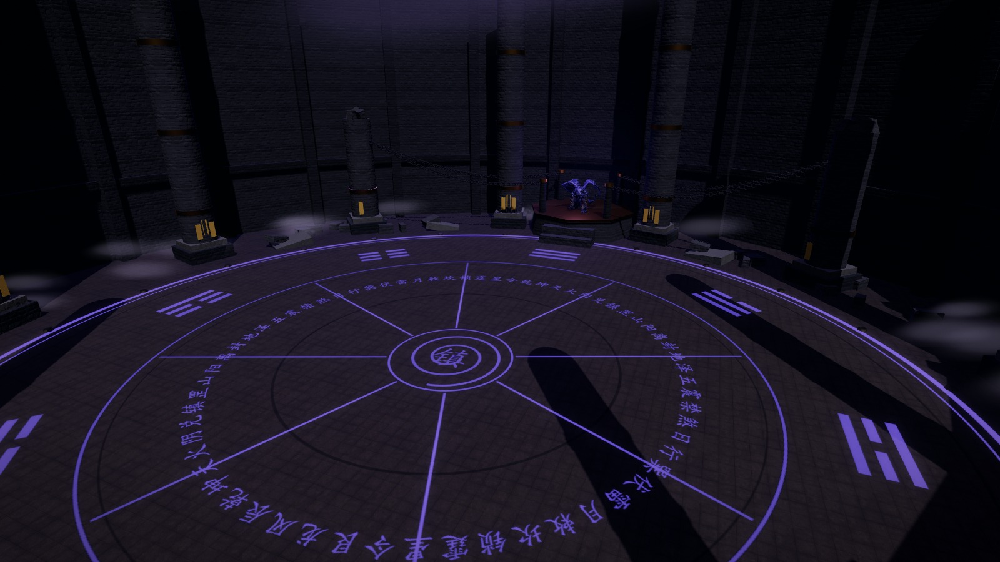
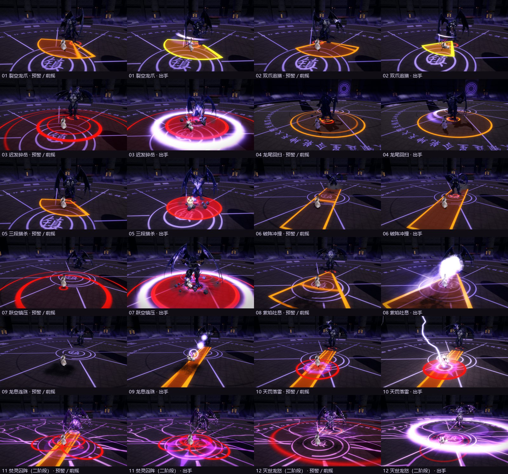
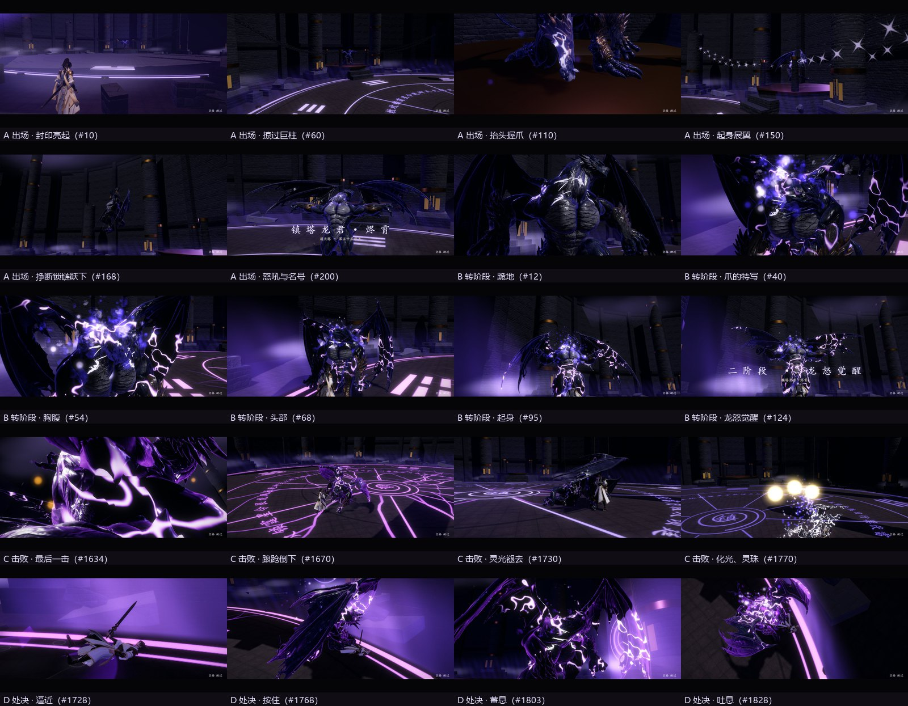
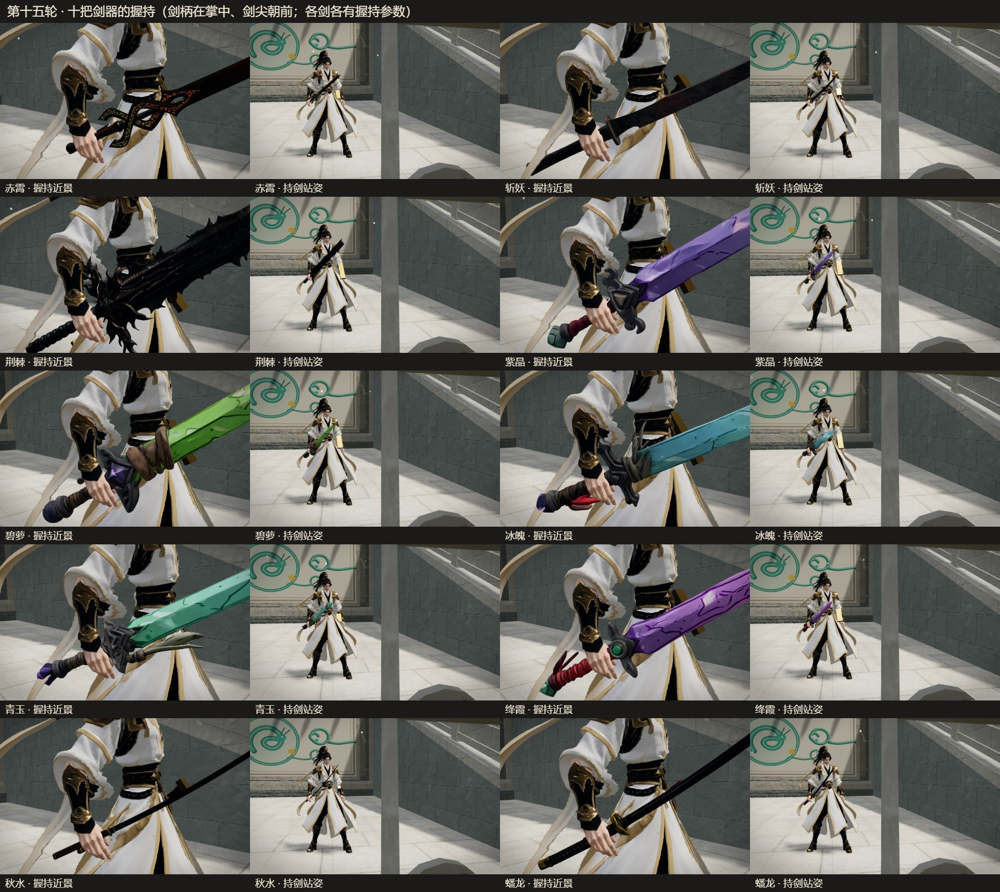
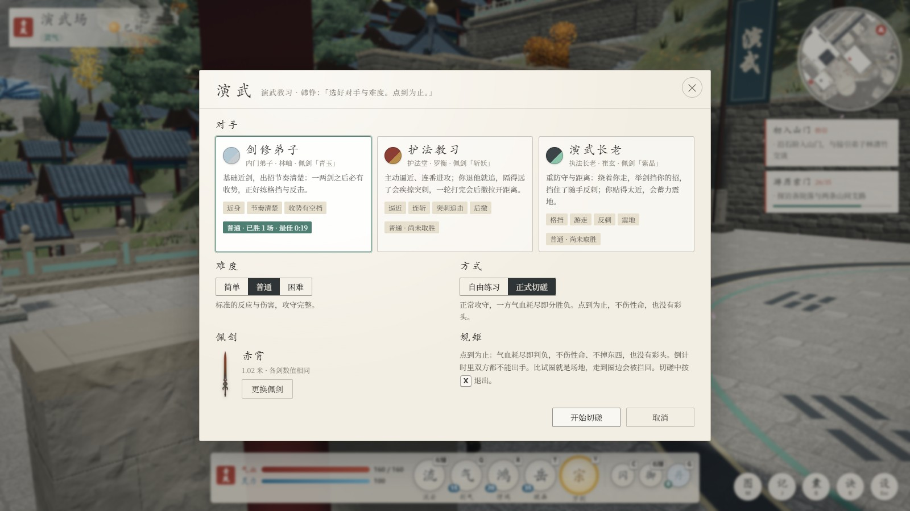
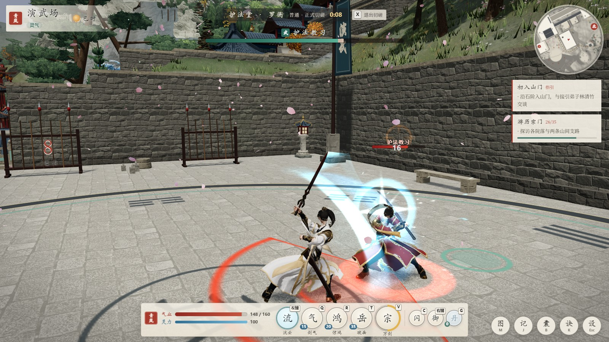
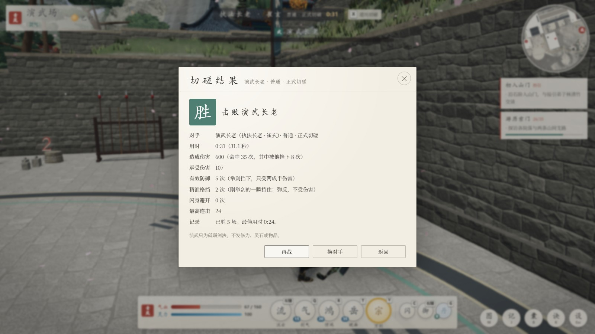

# 青岚宗 · 山门日常（可探索 3D 宗门场景）

群山环抱、依山而建的修仙宗门。玩家沿中轴从山门一路拾级而上：接引台、问心阶、汉白玉演武广场、须弥座高台上的凌云阁、上院，再走天阶直上云顶问道殿。中轴两侧由叠落廊、台地、支院和石阶连成一片：问心阶与天阶两侧各有一对爬山廊，西翼沿居所、膳堂一级级上到藏经阁，天阶两侧的台地上有碑园、茶亭、钟亭与松风台。沿途可以和同门交谈、接取委托、在梯田采药、到丹房交付，在演武台的聚灵阵打坐，翻阅藏经阁典籍；另有两条山间支路，分别通往竹林溪涧和后山小亭。游戏时间以现实 100 倍的速度流动，一昼夜约 14.4 分钟。

> **关于这个公开仓库**
> - 这里只有代码、文档与部分录像。`assets/`（模型、贴图、音效、音乐）与本地备份没有上传：其中有 Unity 商店的付费特效包、从游戏里提取的模型、商用音乐等第三方素材，不能公开再分发。各素材的来源与授权见下文「素材来源与授权」。
> - 所以克隆下来不能直接运行：需要另备这些素材，放回 `assets/` 下原来的位置，再用 `python serve.py` 打开。
> - `docs/media/` 只附了几段录像：墨里终焉的处决演出（第二十八、二十九轮）、普攻、雷龙破虚、九霄凤焰；报告里提到的其余录像没有上传。

第四轮接入了 `assets/` 中新增的四类素材：宗门两侧的寒玉台、赤岩台上各驻守一条护宗神龙（冰龙、火龙，共用飞龙素材但材质、状态、动画各自独立）；后山崖下藏着通往地底魔修遗迹「幽渊秘境」的废弃石洞（地下神殿为 temple 素材）；院落、山门、后山与外围林地加入了素材树；近、中两层山体用山体素材烘焙的高度印章塑形。另新增了一套简单的战斗：玩家剑技、魔修敌人、地面预警圈，双龙在宗门遭魔修袭扰时协助御敌。

第六轮着重「仙境感」与几处缺陷：宗门北面与两侧的天上浮着六座仙岛（岛上松樱、亭台、宝塔、殿阁，岛沿瀑布垂入云海），三群丹顶鹤绕着宗门、云顶与仙岛盘旋；画面加了柔光与轻微调色，近处草地铺满细草与成片野花，空中飘着灵光、入夜是萤火；夜空有银河、带月面细节的月亮与流星；樱花扩到 250 株并在坡地成林，花瓣从树冠飘落、树下铺着落花；丹房可以推门走进去（独立的室内场景，按屋外的尺寸与朝向布置，陈设用 Poly Haven 的中式家具与项目自带的药瓶）；幽渊秘境的入口改为一条连贯的甬道（原来入口洞室的穹顶挡在路上，像一堵墙），殿内步道加宽、补上落脚石台，走路贴边滑行，不再卡住。

第七轮依参照图（宗门整体三视图，主殿 / 藏经阁 / 丹殿、灵池、镇灵塔、装饰物三视图）做了整体场景升级，见下文「第七轮：依参照图的场景升级」。

第八轮依分区三视图（HTML）与五张渲染图，把山门、演武广场、西翼、丹殿、灵池五个分区下方的绿坡改成悬崖岩台（独立的岩壁网格 + 下挖的深谷、谷中石柱与薄雾），并深化五区的建筑、庭院、材质与水景，见下文「第八轮：五区岩台与建筑深化」。

第九轮依参考包 v2（总览、五区效果图、多视图、八张细部图、48 项资源清单与材质色板）精修同样五个分区：崖壁改为连续的大岩体，柱础、石栏杆、门窗、屋脊瓦当换成细部图的样式，演武场聚灵阵改为与地面齐平的石玉铜镶嵌，灵池重做（池壁 / 池底 / 压顶 / 水面分开、修炼岛与两座石桥、完整的水链与荷花），丹殿改暖白墙并按细部图做丹炉与器物，西院加廊下家具与月洞门。见下文「第九轮：参考包精修」与 `docs/R9_REPORT.md`（48 项对应表、材质配置、截图、性能对比、未完成项）。

第十轮只改两部分——全宗门的殿阁房屋，与宗门外围的山岩、崖壁及其与台地的衔接：主要建筑换成 `assets/buildings/01.fbx` 中拆出的八种古建模型（问道殿、凌云阁、藏经阁、丹殿、两座配殿、膳堂、两处院舍、钟鼓楼与阙楼），外围深谷整体下切二三十米、两侧山脊加高，五区台地与外谷谷壁由 `assets/mountain/mountainside_4k.blend` 的扫描岩壁实例化成五百多块大岩体。见下文「第十轮：殿阁与山岩」与 `docs/R10_REPORT.md`。

第十二轮改三处：问道殿外观改用 `assets/buildings/01.fbx` 的手绘贴图，檐角陡翘并挑出仔角梁，角间改粉墙、槛窗改米黄菱花窗，顶层上檐改十字脊；灵池院环池种到 12 株粉樱、5 株银杏；落樱加大加密，有阵风花吹雪，落水的花瓣浮在水面。见下文「第十二轮：问道殿外观、灵池花树与落樱」与 `docs/R12_REPORT.md`。

第十三轮加了五样：夜间照明（月光与夜间环境光、171 处灯具做光源、近处分到实时点光、灯下贴地光晕、通天塔一层层亮到云里）；御剑飞行（F 起飞 / 落地，空格升、C 降、Shift 加速，有碰撞、不穿模，落不下去会说明原因）；宗门后方四座空岛面积扩大到约 4 倍并重新塑形、布置；后山东北新增通天塔岛，百层通天塔高约 395 米，一层是可以走进去的接引大厅与守塔执事（二层以上预留，尚未开放）；宗门与五座空岛之间的传送阵。见下文「第十三轮：夜间照明、御剑飞行、后方空岛与通天塔」与 `docs/R13_REPORT.md`。

第十四轮做了一套完整的剑招，配上剑诀特效，并重做了战斗界面。动作用 `assets/fighting` 的 Quaternius 动作库（CC0），重定向到修士骨架上；特效贴图用 `assets/special effects` 的 Kenney 粒子包（CC0）。
- **剑招**：左键流云三连，Q 剑气·新月，R 惊鸿掠影，T 破岳，V 万剑归宗（剑意满时），C 闪身，右键格挡与弹反，G 服丹。魔修出手也换成同一动作库的动作。
- **战斗界面**：剑诀栏（气血、灵力、五格剑诀与三个小格，调息、灵力不足、剑意都看得见）、连击数、魔将血条，以及剑诀面板（K）。桌面各种窗口宽度与手机触屏都实测过不重叠。
- 详见下文「第十四轮：剑招动作、剑诀特效与战斗界面」与 `docs/R14_REPORT.md`。

第十五轮把玩家换成金白修士，接入十把剑，并新开一处可以切磋的演武场。
- **人物**：`assets/figure/gold_cultivator_v1_model_only/gold_cultivator.glb`。移动、打坐、出剑、格挡、交互、御剑都保留；素材缺的待机、格挡、受击、御剑姿势由动作库重定向或自制补上。
- **剑器**：`assets/sword/` 整理出十把剑（含两把 CC BY 太刀，其中蟠龙带原装刀鞘）。按 P 更换，每把剑有自己的握持参数，御剑的飞剑也随之换。
- **演武场**：在天阶东侧、后山小径起头。找台口的演武教习韩铮，可选三位对手、三档难度、自由练习或正式切磋；有倒计时、结算、首胜与最佳用时记录，不发奖励。
- 详见下文「第十五轮：金白修士、剑器与演武场」与 `docs/R15_REPORT.md`。

第十七轮重做了人物的战斗。
- **动作**：在金白修士的骨架上编排了 27 段新动作：四段普攻、蓄力重击、格挡 / 顶架 / 弹反 / 破防、四向受击、四向闪身、三种施法、拔剑入势、战斗待机。
- **操作**：按住左键连续出手；0.15 秒输入缓冲；每招有自己的接招与取消窗口。
- **弹反**：0.18 秒窗口，两次开窗至少隔 0.7 秒；格挡消耗守势，耗尽破防。来招按招式带防御属性。
- **新增**：Z 蓄力重击、1 缚灵锁（控制）、Tab 锁定。
- 演武场的对手与第五十层的龙君用同一套规则。
- 详见下文「第十七轮：人物战斗系统重做」与 `docs/R17_REPORT.md`。

第十八轮改了五处。
- **弹反僵直**：弹反成功后出手的一方短暂僵直。
  - 魔修残魂 1 秒、魔将 1.4 秒、演武场的对手 1 秒以上。
  - 镇塔龙君的招式被弹断，僵直 0.6 秒（连受击动作约 0.8 秒）。
  - 顺带修好魔修被弹反时僵直被「出手收势」吞掉的老问题。
- **普攻距离**：普攻四式与蓄力横扫的判定各加长 0.4–0.5 米；目标在剑够不着的地方时，出手的前冲按需要拉长，剑真的扫到人。
- **龙君的头**：不再歪着、越转越多。头的底姿势与嘴的位置也改正了。
- **龙君的动作**
  - 编排动作改为每秒 60 帧并做平滑。
  - 修掉段首跳变、翻肘、爪贴着肩膀直穿、冲撞蹭地、原地转身打滑；淡入淡出自己管权重。
  - 同一份量具下「蹦」的帧数由 108 降到 9。
- **音效**
  - 龙君与剑的声音改用录音：`assets/sound effect` 的素材与 OpenGameArt / Kenney 的 CC0 素材，剪成 27 种。
  - 第五十层有了出场与战斗音乐，设置里可调音乐音量。
- 详见下文「第十八轮」与 `docs/R18_REPORT.md`。

第十九轮改了三处动作，换了一批音效。
- **拔刀斩（Z）**：取代蓄力重击，参照怪物猎人太刀的居合拔刀斩。
  - 按住 Z 纳刀蓄势：剑收入鞘，沉身按柄。可缓步走，也可闪身——闪身不断蓄力。
  - 松开 Z 拔刀横斩，踏步前冲。蓄得越久伤害越高（26 → 150），最多蓄 5 秒；蓄过 3 秒多一道金色剑气。
- **回血葫芦（2）**
  - 左手取下腰间的葫芦饮一口，回复三分之一气血。
  - 每次装满 3 口：打坐调息、力竭醒来、守关战重来、演武场开打时装满。
  - 随修为加口数的接口已留好（现在还没有修为等级）。
- **养元丹**：眼下的玩法里恒为 99 颗。
- **音效**
  - 普攻、成功弹反、缚灵锁、剑气、拔刀斩的蓄力与出鞘、万剑归宗的落剑与末了的巨剑，换成 `assets/sound effect/` 里指定的录音。
  - 葫芦的拔塞、吞咽、塞回用 qubodup 的 CC0 素材。
- 详见下文「第十九轮」与 `docs/R19_REPORT.md`。

第二十轮给普攻与拔刀斩加了水墨特效，重做了拔刀斩的蓄势站姿。素材是项目里的 Unity 特效包 `FX_Ink slash`：不依赖 Unity 解包，取用其中的水墨贴图、两个网格与粒子参数，在网页里重建材质、粒子、动画与时序。
- **普攻**：每一刀沿剑的真实轨迹铺开一道墨弧（斜斩斜、反手横斩横、重劈竖、突刺一笔直），随即碎开淡出、甩出少量墨点；命中处一团墨，空挥只有刀光。
- **拔刀斩蓄势**：侧身、沉胯、屈膝、上身前倾，右手握柄、左手扶鞘。常用的背后镜头里剑柄露出 51%、握柄的手 89%（原来 0% 与 13%）。
- **墨向刀聚**：蓄力时墨点、墨雾、细小光粒沿螺旋收向剑柄与鞘口，越蓄越密越快，鞘口一道细亮边；蓄满后不再增加，取消、受击、力竭时原地散开。
- **出刀**：一道月牙墨自左向右扫开，外沿就是这一刀的判定距离（3.9–4.8 米），张开就是判定弧（200°）；蓄过 3 秒的剑气改成墨色。
- 详见下文「第二十轮」与 `docs/R20_REPORT.md`。

第二十一轮接入了等级与境界，和双模式的大招「九霄凤焰」。
- **修为**
  - 下界 1–99 级、九个大境界，每境分初期、中期、后期、大圆满。境界由等级推导，存档里不存境界名。
  - 修炼灵气与战斗灵力分开，只在主动打坐时吸收：Y 随处打坐；聚灵阵 ×3、灵池静修台 ×4。降妖、Boss 首通、宗门任务也给灵气。
  - 按 L 打开修为面板，分开显示基础需求、突破额外消耗、总需求与进度。灵气够了「提升修为」：脱战 5 秒、聚气 3.4 秒、一次提交。
  - 伤害、气血、灵力随等级成长；御剑按境界（练气不能、筑基短续航）。
  - 现有角色首次进入时为 21 级金丹初期，其他进度不变。
- **九霄凤焰**（金丹解锁；按 3 召出，按 4 切换下一次的模式；两种模式共用 90 秒冷却，耗三成灵力）
  - **凤翔天击**：凤凰飞 8 秒，按住左键它就追着镜头的准星飞，上下左右都可，人照常走跳闪挡。路过的地面留下 20 秒的火带：敌人灼烧，你站在里面回血。撞上第一个敌人爆开，并有小概率直接斩落当前阶段。在自己的火里弹反成功会多一道凤焰冲击。
  - **凤灵护战**：凤凰随身 30 秒，用凤焰弹、掠翼、吐息打敌人；仇恨满了的敌人会转去打它。
- 详见下文「第二十一轮」与 `docs/R21_REPORT.md`。

第二十二轮完善了三处。
- **舞刀召凤**：按 3 先舞一段 1.2 秒的刀——剑在头顶平着绕一周。凤凰从剑尖显形，随刀势绕身一周，再沿刀刃从剑尖飞出。舞刀时可以缓步走；最后一刀之前可被格挡、闪身取消，不扣费。
- **万剑归宗用手中的剑**：飞剑与末了的巨剑都是施法时手中那把剑（直剑、太刀、宽刃都认得出），中途换剑不改空中的剑。
- **弹反与凤凰**：
  - 完美弹反回 8 剑意、四分之一守势；随后 2 秒内下一次普攻或拔刀斩 ×1.5。龙君被弹断僵直 1.0 / 0.8 秒。
  - 凤凰伤害提到首轮测试值（直接撞击 720）。
  - 操控改为朝准星所指的那一点转：转得更快、近处对准敌人会俯冲。
- 详见下文「第二十二轮」与 `docs/R22_REPORT.md`。

第二十三轮改了三处。
- **六格剑诀**：八种主动技能（含惊鸿掠影、两种模式同一格的九霄凤焰、新的雷龙破虚）装进六个槽，槽键固定为 Q、X、R、V、1、3；剑诀面板（K）里点击（或拖拽）装备、卸下、替换，满槽时提示选一格替换。脱战 5 秒、没有正在施法才能调整；冷却按技能记，换槽、读档、换场景都不刷新；卸下之后旧键、中键、按钮都放不出来。旧存档迁移一次，其余进度不动。
- **雷龙破虚**（金丹解锁，耗 35% 灵力、调息 120 秒）：选锁定的敌人、准星对着的敌人或地面（30 米内、看得见、有地面、上方有空间，否则红圈写明原因、不扣费），撕开虚空，一条无翼金龙从裂隙里逐段游出，在 8 米半径的十团雷云间盘游：8 秒 10 次落雷，每次至多 15 个敌人各挨一道；最后弧线俯冲撞向主要目标、在接触处爆雷。主人照常走动出剑。
- **普攻水墨重做**：浓墨核心贴着剑刃的真实轨迹，外沿伸到每一式的判定距离，宽约原来两倍；外层墨雾、飞白、墨点低透明随剑势甩出；只在真实命中的接触点按招式炸墨。用了第二组水墨贴图（`assets/special effects/ink`），与第二十轮的 FX_Ink slash 按用途组合。
- 详见下文「第二十三轮」与 `docs/R23_REPORT.md`。

第二十四轮做了通天塔第三十层的守关 Boss「烬狱剑尊」。
- **模型与动作**：把 Tilt Brush 笔画模型（灰烬之魂）拆出人物与剑，套上单手剑动作包的 UE5 Manny 骨架，绑定、蒙皮，剑挂在右手。动作用动作包里的实际动作；包里没有的格挡、跪地、被弹反收势、直刺、跃起重劈，用素材动作拼接或 IK 摆出，并在对应表里写明。
- **两个阶段**：一阶段 2400、二阶段 1920 气血。
  - 十套快慢刀连招，弹反中途一顿、收招一击被弹完整收势，架势满了失衡；
  - 「截锋架势」截住正面近战再反击，「留锋突刺」追击远远后撤的闪身；
  - 七种火焰招式，二阶段有蓄力 5.5 秒、覆盖台面 3/4 的秒杀「焚天断界」；
  - 出场、转阶段、击败、失败四段过场，奖励只发一次。
- 详见下文「第二十四轮」与 `docs/R24_REPORT.md`。

第二十五轮给拔刀斩做了升级形态「拔刀斩-终式·墨·终焉」。它不是新技能，沿用拔刀斩的格子、按键、动作与判定。
- **墨势**：普攻连续有效命中 30 刀得一层（最多一层），没成势时 8 秒没有有效命中就清零。
- **终式**：有墨势时按住满 3 秒再松开，消耗墨势，刀身那一下伤害 ×2。
- **处决**：真实打中的主目标当前阶段只剩 10% 以下、允许处决时，放一段约 8 秒的水墨处决：
  - 化墨绕后，画卷与山水铺开；
  - 缓步，拔刀穿行，背身缓慢收刀，凤凰与雷龙撞入；
  - 八卦与墨带展开，收刀合拢的一刻结算，爆墨。
- **精简演出**：墙边、断崖、大型目标与非最终阶段改用原地的精简演出。非最终阶段只结束当前阶段，随后是首领正常的转阶段过场。
- 详见下文「第二十五轮」与 `docs/R25_REPORT.md`。

第二十六轮改了四处，另接入了项目作者新放的水墨特效包。
- **普攻第三、四式**：常用的背后镜头里，突刺、重劈原来只剩一个点、一条线。
  - 突刺：刺到头时一面水墨太极印旋转张开，一串墨环顺着刺的方向推到判定外沿，喷墨、刺线、螺旋墨带、竹叶一起带出。
  - 重劈：劈到底时立起一道竖着的白光刀痕；地上盖一面太极印，墨裂顺着劈的方向犁开，竹叶震起。
- **雷龙撞地**：撞上之后多了这些，伤害不变：
  - 雷柱、深色气浪、电裂纹、尘浪与碎石；
  - 一记往下沉的撞地闷响与电弧噼啪；
  - 一秒内再劈 4 道余震雷；落点残留电弧，被撞到的敌人身上缠着电光。
- **第三十层剑尊**：
  - 体型：放大到约 4 米（玩家的 2.3 倍），出招时按每一刀俯身，剑仍落在玩家胸口；
  - 模型：笔刷贴图换回原素材的分辨率；
  - 佩剑：手里换成荆棘剑（`assets/sword/sword3`）；
  - 节奏：慢刀的举剑停顿短了约 45%，蓄满就劈；
  - 打击感：命中、被挡时加重顿帧与震屏，剑尊自己也顿一下，劈到地上会炸开。
- **弹反**：
  - 按下即开窗，窗口 0.2 秒；
  - 刀碰到身上之后 0.09 秒内再按也算弹反；
  - 弹空之后才有 0.4 秒的间隔，连段的每一击都能接着弹。
- 详见下文「第二十六轮」与 `docs/R26_REPORT.md`。

第二十七轮把拔刀斩的升级形态改名为「墨里终焉」，处决演出整段重做成 16 秒的统一版。
- **一套演出**：普通敌人、精英、首领的非最终与最终阶段放的都是同一段 16 秒，不再有精简版，只在结算上区分。首领的阶段过场在演出交还之后才放。
- **画中世界**：水墨山水从玩家脚下铺开，原场景（宗门的屋顶庭院、首领场地的火墙与红光）被替换，退场时还原。
- **画卷与书法**：长 8.2 个人高的画卷沿地面展开，书法「墨里终焉」逐笔写在卷上；定格时写出「终焉」。
- **龙凤、八卦、刀光、爆墨**：
  - 凤凰、雷龙同框约 2.4 秒后撞入，八卦与墨带展开；
  - 收刀合拢的一刻，横贯画面的刀光与结算同时发生；
  - 爆墨不再带字与印章。
- **音乐**：演出音乐从原曲 33 秒处起。
- 详见下文「第二十七轮」与 `docs/R27_REPORT.md`。

第二十八轮加重了「墨里终焉」里凤凰、雷龙砸向敌人的那一下：照第二十六轮雷龙撞地的层次，换成水墨。
- **墨震**：天上砸下三道墨柱，一圈浓墨贴地推开，九道墨裂由八卦外沿裂出，喷墨、墨雾、碎墨崩起；龙撞上之后四次余震，敌人身上渗出墨丝。
- **手感与声音**：镜头往下一顿、震屏、画面四角压暗；合成的撞地声，砸入前后演出音乐让开一下。
- **不挡八卦**：落点的墨迹在八卦成形之前淡去，墨裂与余震都在八卦外沿之外。
- 只是表现：结算、伤害与 16 秒时间线不变。详见下文「第二十八轮」与 `docs/R28_REPORT.md`。

第二十九轮把「墨里终焉」的处决演出改成通用的终结，并修好了实际游玩时的演出音乐。
- **通用的终结**：不论用哪种招式打死敌人（普攻、剑诀、拔刀斩、凤凰、雷龙、剑气），都放这段 16 秒的演出，不需要墨势。群战里只在打死最后一个敌人时放，首领只在最后一条命时放。
- **演武场**：切磋对手也放；收刀时击倒，演出交还之后演武场判胜。
- **演出音乐**：在山水铺开之前 0.1 秒进，从原曲 33 秒处放满整段演出、一倍速。原来实际游玩时从原曲开头放，又短又轻；录像里是对的。
- 详见下文「第二十九轮」与 `docs/R29_REPORT.md`。

第十一轮把云顶问道殿重建为可以进入的五层楼阁：首层占地按面积扩大到原来的约 10 倍（46 × 44 米加抱厦，2,131 平方米，原殿约 216 平方米），台基面到宝顶 54 米；殿内五层都能走到，东西两座双跑楼梯直上五层。殿内是独立场景，但与宗门共用世界坐标，窗外画的就是宗门本身（先画宗门、只画窗洞框住的部分，再画室内），所以位置、朝向、楼层高度、视差、时辰、天气和窗外的云鹤龙人都与殿外一致。见下文「第十一轮：五层问道殿」与 `docs/R11_REPORT.md`。

本项目是纯静态网页，不需要安装依赖，运行时不访问任何网络资源。three.js r160（MIT）放在 `vendor/`；建筑、地形塑形、植被组合、云与人物由程序生成，材质贴图、天空、远山高程、叶片、石狮、宫灯和山石使用收集来的授权素材（均已下载到 `assets/`，来源与授权见下文「素材来源与授权」）。第七轮起藏经阁、香炉改为依参照图营造，原塔楼模型（`chinese_tower/`）与香炉扫描模型保留在 `assets/` 中但不再载入。

## 运行

浏览器不允许 `file://` 加载 ES Module，需要先起一个本地服务器：

```bash
python serve.py
```

然后打开 <http://localhost:8130>。`serve.py` 关闭了缓存，并同时监听 IPv4/IPv6，改完代码刷新即可生效。也可以直接部署到任意静态托管（如 GitHub Pages）。

画质在「设置」（Esc）中切换：流畅 / 均衡 / 精美。手机端默认「流畅」，并显示虚拟摇杆与交互键。

## 操作

| 操作 | 作用 |
|---|---|
| W A S D / 方向键 | 行走（以镜头朝向为前） |
| Shift | 疾行；御剑时加速 |
| 空格 | 跳跃（约 1.2 米高）；御剑时上升 |
| 移动鼠标 | 转动视角：左右转身，上下俯仰（可抬头，约 -31°～66°）。点击画面锁定鼠标后直接移动即可，不用按住 |
| 鼠标左键 | 第十七轮：点一下出一剑；按住连续出手——斜斩 → 反手横斩 → 突刺 → 重劈，第四式收势后再从第一式起；松开即停（当前这一下打完）。近战辅助只在小距离、小角度内对准正前方的对手，没有就照镜头方向出剑。第二十一轮：只有凤翔天击的凤凰在飞时，左键改为操控凤凰（按住追镜头的准星，松开保持方向，这时不出剑）；飞行结束后重新按下才恢复出剑。第二十二轮：凤翔天击的舞刀中就接管左键——普攻时按着的不算，舞刀中新按下并按住的离刀即开始操控；凤凰朝准星所指的那一点转（水平 360°/秒、垂直 300°/秒），近处对准敌人会加速俯冲 |
| 鼠标右键 | 第十七轮：按下、真正举剑的一刻开弹反窗口，挡住正面 120° 内可弹反的来招即弹反；按住为格挡（按来招扣守势、漏过少许伤害，守势耗尽破防）；松开放下。第二十六轮：按下的这一刻就开窗（不等下一帧），窗口 0.2 秒；刀碰到身上之后 0.09 秒内再按也算弹反；弹空之后 0.4 秒内再按不开窗，弹反成功之后立刻可以再弹 |
| Q X R V 1 3 | 第二十三轮：六个剑诀槽的键（固定）。格子里装什么就放什么，空格按下只提示「空」；默认 Q 剑气、X 破岳、R 拔刀斩、V 万剑归宗、1 缚灵锁、3 九霄凤焰，惊鸿掠影与雷龙破虚在技能库（K 面板里装备）。1、3 在对话中仍是选项 |
| 鼠标中键 | 拔刀斩的别名（第二十三轮：只在拔刀斩装备时有效，与它所在的槽键同一个动作；第二十五轮起 Z 也是同样的别名）。第十九轮起为拔刀斩：按住纳刀蓄势，可缓步走、可闪身（闪身不断蓄力）；松开拔刀横斩、踏步前冲。蓄得越久伤害越高（最多 5 秒，蓄满再撑 1 秒自动出刀），蓄过 3 秒多一道剑气（第二十轮起为墨色）。蓄势中举剑格挡则作废这次蓄力。第二十轮：蓄势时侧身沉胯、墨点墨雾向剑柄汇聚；出刀时一道月牙墨扫开，墨痕外沿就是这一刀够得着的地方 |
| Z | 第二十五轮：拔刀斩的别名，与鼠标中键一样——只在拔刀斩装备时有效，与它所在的槽键共用一个技能入口与一份蓄力；同一次蓄力只认最先按下的那个键（槽键、Z、中键）。拔刀斩已升级为「墨里终焉」（第二十五轮加入时叫「终式」，第二十七轮改名）：有墨势时按住满 3 秒（满了保持就绪、不自动出刀）松开即墨里终焉，没有墨势或不满 3 秒松开照旧是普通拔刀斩，见「第二十五轮」「第二十七轮」 |
| 1 | 第五个剑诀槽（默认缚灵锁：第十七轮起，金链缚住身前扇形内至多三个敌人，灵力 25，调息 14 秒）；对话中仍是选项 1 |
| 2 | 第十九轮：回血葫芦——饮一口回复三分之一气血，饮时只能缓步走；每次装满 3 口（打坐调息、力竭醒来、守关战重来、演武场开打时装满）；对话中仍是选项 2 |
| 3 | 第六个剑诀槽（默认九霄凤焰）。第二十一轮：九霄凤焰（金丹初期解锁；耗最大灵力的三成，两种模式共用 90 秒冷却，同时最多一只）。凤翔天击 / 凤灵护战，见「第二十一轮」；对话中仍是选项 3。第二十二轮：先舞 1.2 秒的刀（可缓步走），凤凰随刀势绕身一周、1.05 秒从剑尖飞出——这一刻才扣灵力、进冷却 |
| 4 | 第二十一轮：切换九霄凤焰的模式（只影响下一次召唤，已放出的凤凰不变；第二十三轮起只在九霄凤焰装备时有效）；对话中仍是选项 4 |
| Y | 第二十一轮：随处打坐 / 起身（吸收修炼灵气；移动、出手、受击即起身）。聚灵阵、灵池静修台仍按 E |
| L | 第二十一轮：修为面板——境界、等级、升级需求（基础 / 突破额外 / 总需求 / 进度）、此处浓度与速度、奖励、属性、提升修为 |
| Tab | 第十七轮：锁定 / 解除锁定身前的对手（出招对着它，镜头仍自由） |
| 滚轮 | 拉近 / 拉远（2.2–22 米） |
| E | 与人物、物件交互；对话中继续；采药、加固封印时按住；启动传送阵、进出通天塔 |
| F | 御剑起飞 / 请求落地（第十三轮；找不到安全落点时继续飞行并提示原因） |
| C | 闪身（第十四轮，闪出的一瞬不受伤害）；御剑时下降（没有用 Ctrl：浏览器里 Ctrl+W 会直接关闭标签页） |
| Q | 第一个剑诀槽（默认剑气 · 新月：斩出一道贯穿沿途魔修的新月剑气，灵力 15，调息 2.5 秒） |
| X | 第二个剑诀槽（第二十三轮；默认破岳：四连重斩，末式举剑破地掀翻周围的魔修，出招时不为寻常攻击所动，灵力 35，调息 12 秒） |
| R | 第三个剑诀槽（第二十三轮起默认拔刀斩：按住纳刀蓄势、松开出刀；第二十五轮起拔刀斩为升级形态，第二十七轮改名「墨里终焉」——格子里的字「墨」、格下「终焉」，规则见上面 Z 一行；惊鸿掠影——持剑疾掠、途经之敌各受一剑、掠身时不受伤害，灵力 20、调息 6 秒——移入技能库，可在 K 面板装进任一格） |
| T | 第二十三轮起不再是剑诀键（破岳默认装在 X 格） |
| V | 第四个剑诀槽（默认万剑归宗：剑意圆满时施展，剑阵落地、万剑自天而降、巨剑镇阵；第二十二轮起飞剑与巨剑都是施法时手中的那把剑） |
| 雷龙破虚 | 第二十三轮：不在默认装配里，K 面板装进任一格后按那一格的键。锁定（Tab）的敌人 / 准星对着的敌人 / 准星对着的地面，30 米内；起势 0.65 秒（之前可格挡、闪身取消，不扣费），之后自行演完 |
| G | 服丹：服下一枚养元丹回复气血（第十九轮起眼下的玩法里恒为 99 颗） |
| K | 剑诀面板（第二十三轮：六个槽与技能库——点击或拖拽装备、卸下、互换，满槽时选一格替换；脱战 5 秒后才能调整）：各招式的消耗、调息、操作、特点、解锁条件与要领 |
| P | 佩剑面板（第十五轮）：十把剑的缩略图与旋转预览，佩上即换（手中、鞘中、御剑的飞剑一起换），并存档 |
| 退格 / H / U | 演武场切磋中（第十五轮）：退格退出切磋（第二十三轮起；原来是 X，X 现在是剑诀槽键）；自由练习时 H 复原双方气血，U 开关陪练出招。通天塔第五十层守关战中（第十六轮）：退格放弃挑战；过场中空格 / Esc / E 跳过。第三十层守关战中（第二十四轮）同样：退格放弃挑战，看过的过场按空格 / Esc / 回车 / E 跳过。墨里终焉的处决演出中（第二十五轮起；第二十七轮为 16 秒的统一演出）：空格或 E 跳过——走同一个终结入口、只结算一次；Esc 照常打开设置（演出与演出音乐随之暂停） |
| 1–4 / 点击 | 选择对话选项；传送阵菜单里 1–6 直接选目的地 |
| M / J / B / K | 舆图 / 行记 / 行囊 / 剑诀 |
| Esc | 释放鼠标；鼠标已释放时打开设置；关闭面板、离开对话 |

**鼠标锁定**：点击「入山」或点击画面即锁定鼠标（光标隐藏），直接移动鼠标转动视角，左键出剑（按住连续出手）、右键按住格挡、中键按住拔刀斩蓄势（第二十三轮：只在拔刀斩装备时，与它所在的槽键相同）。按 Esc，或打开对话、行囊、舆图、行记、剑诀、设置时，鼠标随即释放、视角控制暂停，可以正常点击界面；关闭界面后画面中央提示「点击画面继续」，点击一下重新锁定——这一下只用于锁定，不会出剑。失去焦点、切换窗口、打开界面、力竭、过场或换场景时，按住的左键、右键、中键、Z 与缓冲的输入一律清掉（第十七轮），格挡解除、蓄力作废；右键不会弹出浏览器菜单。鼠标灵敏度在设置（Esc）中调节，原始鼠标输入、无加速，单次异常的大位移会被丢弃。触屏设备不锁定鼠标：单指拖动画面转视角，另有跳跃键；第十三轮加了「御剑」键，御剑时出现「升」「降」，跳跃键隐去。第十四轮起交战时（以及站在木人桩跟前时）右下出现剑诀格：流云格即攻击，点剑诀格出招，按住格挡格格挡。

进入后先是一段全景开场：镜头位于山门外高处，下方是溪谷与山门，中部是层层升高的院落和中轴，上方是云顶背后的主峰群、山腰云带和谷口外的远山。玩家开始走动后（或约 9 秒后），镜头缓缓落到身后，改为斜俯视跟随。右上角显示当前时辰（如「辰时 · 二刻」），入夜后变为夜色样式。

## 第二十九轮：墨里终焉——通用的终结、演武场、演出音乐

本轮三件事，实测的数字、录像见 `docs/R29_REPORT.md`。

改动的代码：
- `src/core/audio.js`：演出音乐改为载入时取回整首、解码，只留原曲 33 秒起的一段来放（`cue*`）；
- `src/game/inkFinale.js`：
  - 通用的终结 `lethalProbe()`，群战的最后一个 `isLastFoe()`；
  - 切磋对手的接口 `DUELIST`，比试圈里的站位；
  - 演出音乐在 `cueAt` 起；
  - 满蓄力拔刀斩的处决也照新规矩；
- `src/game/inkFinaleConfig.js`：`kill`（通用的终结）、`music.cueAt`，剑诀面板的说明；
- `src/game/combat.js`：玩家一方的致命一击先问演出；玩家剑气的伤害记下来路；
- `src/game/boss30Fight.js`、`src/game/boss50Fight.js`：最后一条命打空时先问演出；
- `src/game/arena.js`、`src/game/duel.js`：演出中演武场停住，胜负等演出交还之后再出；
- `src/main.js`（接上通用的终结）、`src/ui/loadoutPanel.js`（剑诀面板多一段「通用的终结」）。

没有新素材。

**录像**（`docs/media/`，带配音，不剪辑；上黑边里有录像标注）：

| 文件 | 内容 | 时刻（录像里的秒） |
|---|---|---|
| `r29_arena.mp4`（19.7 秒） | 演武场正式切磋：对手剩 4%，普攻打死他 → 演出 → 收刀时击倒 → 交还之后演武场判胜、结算面板 | 普攻 0.72；**演出开始 0.80**；音乐 1.32；收刀 14.0；交还 16.8，演武场判胜；结算面板约 18.7 |
| `r29_group.mp4`（20.8 秒） | 群战：三个魔修各剩一点气血，一刀一个 | 第一个倒下 0.7、第二个 1.7（照常倒下、各得修炼灵气）；**第三个（最后一个）打死时演出开始 2.73**；音乐 3.25；收刀 15.93；交还 18.73 |
| `r29_b30kill.mp4`（26.6 秒） | 第三十层二阶段（最后一条命）剩 1.5%：普攻打空 → 演出 → 收刀时整场胜利 → 胜利过场 → 结算 | **演出开始 1.70**；音乐 2.22；收刀 14.9；胜利过场 17.7；结算面板约 23.5 |

**截图**（`docs/screenshots/`）：`r29_arena_sheet.jpg`、`r29_group_sheet.jpg`、`r29_b30kill_sheet.jpg`（三段录像的联系表）。

### 演出音乐：实际游玩时为什么又短又轻

- **原因**：演出音乐原来用网页的 `<audio>` 放，确认处决时跳到原曲 33 秒处。
  - 开发服务器（`serve.py`，Python 自带的 http.server）不支持分段请求（Range）：问它要一段，它把整个文件回过来（200，不是 206）。
  - 浏览器因此认为这个文件不能跳着放（可跳的范围只有 0–0 秒），跳到 33 秒的那一下被丢掉，实际从原曲开头放。
  - 原曲开头约 3 秒几乎无声（−36 → −21 dB），之后是另一段旋律，听着又短又轻。
  - 录像的配音是离线按文件从 33 秒混的，所以录像里是对的。
- **播放速度**：一直是一倍速，没有开 0.5 倍速。
- **现在**：
  - 载入时取回整首（143.9 秒）、解码，只留原曲 33 秒起的 24 秒，用声音时钟来放，与服务器支不支持分段请求无关；
  - 在山水铺开之前 0.1 秒进（演出 0.5 秒），0.1 秒淡入；
  - 放到退场（15.6 秒）再 0.5 秒淡出，约 15.6 秒；
  - 暂停后由同一处接着放；收刀合拢前后、龙凤砸入时让开一下（同第二十七、二十八轮）。
- **实测**：墙上的钟走 3.007 秒，音乐在原曲里走了 3.000 秒（0.998，一倍速）。

### 演武场

以前切磋对手「点到为止」不处决。现在：
- 与别的敌人一样：任何招式的致命一击都放演出，满蓄力拔刀斩剩 ≤ 10% 也能处决；
- 演出中演武场停住：计时、对手的 AI、圈边的拦挡都不走；对手不出手，玩家不掉血；
- 玩家的几处站位都在比试圈里（离圈边至少 0.6 米）；
- 收刀合拢时把对手击倒，演出交还之后才判胜：画面中央的「胜」、结算面板；
- 自由练习同样放演出，交还之后 1.8 秒对手复原。

### 通用的终结

| 情形 | 结果 |
|---|---|
| 只有一个敌人，用任何招式打死它（普攻、剑诀、拔刀斩、凤凰、雷龙、剑气、反弹回去的投射物） | 放演出，不需要墨势 |
| 群战，打死的不是最后一个 | 照常倒下 |
| 群战，一下（群伤）打死好几个 | 只有最后一个放演出 |
| 首领（第三十层、第五十层）的前几条命打空 | 照常转阶段 |
| 首领、分段敌人的最后一条命打空 | 放演出，收刀时胜利 |
| 护宗双龙打死的、来路不明的持续伤害 | 照常倒下（不算玩家一方的击杀） |
| 御剑中、演出素材没就绪 | 照常倒下 |

- **「群战里的最后一个」**：同一场景里，除了它自己，没有别的活着、敌对、还在这场战斗里的敌人。
  - 首领、切磋对手都算在这场战斗里；
  - 交过手的（被打过、在追击 / 进攻 / 受击）在玩家 60 米内算；
  - 没交过手的，在 30 米内、没有沉睡的也算。
- **这一下不扣血**：最后一个敌人在演出收刀合拢（13.2 秒）时才倒下，修炼灵气、任务计数也在那时结算。
- **跳起来打死的也演**：化墨之后在地面上凝聚。

### 与第二十五、二十七轮不同的规矩

- 满蓄力拔刀斩的处决（剩 ≤ 10%）也照这两条：群战的最后一个、首领的最后一条命。
  - 以前首领的非最终阶段也放演出，只结束当前阶段；现在照常转阶段，不放演出。
- 墨势仍然有用：
  - 满蓄力拔刀斩刀身 ×2；
  - 最后一个敌人剩 ≤ 10% 却没被这一刀打死时，也直接处决。
- 第二十四、二十五、二十七、二十八轮自检里按旧规矩写的几组已改了期望，每处都注了「第二十九轮」（见报告第四节）。

### 自检结果

**`tools/r29_tests.js` `runAll()`**：13 组全过，约 64 秒。
- 演出音乐：0.517 秒进（0.5 秒之后的第一帧）、进的那一刻在原曲 33.005 秒；暂停后续放到 37.85 秒（= 33 + 5.35 − 0.5）；15.6 秒起 0.5 秒淡出；实时一倍速（3.000 / 3.007 秒）；
- 演武场：正式切磋、自由练习、满蓄力拔刀斩；
- 通用的终结：单个敌人的各种招式、群战与群伤、拔刀斩的新规矩、分段敌人、第三十层与第五十层的一二阶段、幽渊秘境、清理。

**回归**（各自重载页面后跑，定稿的代码）：

- **第二十七轮** `runAll()`：30 组全过，约 119 秒（规矩变了的几组已改期望）；
- **第二十八轮** `runAll()`：7 组全过，约 30 秒；
- **第二十六轮** `runAll()`：9 组全过，约 22 秒；
- **第二十四轮** `runAll()`（约 18 秒）：弹反 27 / 27，四段过场 7.22 / 6.22 / 5.82 / 5.02 秒，重试三次、奖励正常，与以前相同。胜利过场、「打赢后再战」两处改为先跳过演出（最后一条命先放演出，收刀才胜利）；
- **第二十三轮**（逐项）：六个槽键、雷龙 1500 总伤（落雷 600 + 俯冲 900）、暴击 1350、每次落雷至多 15 个、30 / 60 / 144 帧都是 10 次。三种帧率的总伤 5550 / 5100 / 5100：30 帧那次俯冲暴击了（暴击是随机的，正好多 450），不计暴击都是 5100。

### 没做完 / 限制

- **音乐没有实听**：只按声音时钟量了起止、位置与速度。预览是后台标签页，我听不到声音。
- **`serve.py` 仍不支持分段请求**：游戏已不依赖它。
- **最后一个敌人的结算晚了**：收刀合拢时才倒下、才发修炼灵气，比以前晚约 13 秒。
- **一个人游荡的魔修，打死一个就放一次**：每次 16 秒，可以随时按空格 / E 跳过。
- **旧录像的规矩已过时**：第二十七、二十八轮的 `r27_b30p1.mp4`、`r28_b30p1.mp4`（第三十层一阶段放演出）按的是旧规矩；现在一阶段不放演出。
- **别的旧自检**：第十七、二十一、二十二轮的自检这轮没有重跑。

## 第二十八轮：墨里终焉——龙凤砸入的压迫感

本轮只改「墨里终焉」演出里凤凰、雷龙砸向敌人的那一下（演出 10.5、10.7 秒）。照第二十六轮雷龙撞地（`DRAGON.quake`）的层次，加了一套水墨的「墨震」。只是表现：结算、伤害、16 秒时间线、站位与机位都不变。实测的数字、截图与录像见 `docs/R28_REPORT.md`。

改动的代码：
- `src/game/inkFinaleConfig.js`：新增 `FINALE.quake`（墨震的全部参数）；
- `src/game/inkFinaleFx.js`：
  - `quakeHit()`：撞上的一刻；
  - `updateQuake()`：之后每帧的墨柱、墨裂、余震、渗墨；
  - 第三组水墨贴图（`ink3`）的粒子池，墨柱、墨裂两组笔触；
- `src/game/inkFinale.js`：
  - 撞击登记 `impulse()`；
  - 镜头一顿与震屏 `jolt()`，四角压暗 `vigNow()`；
  - 墨震的声音，砸入前后的音乐让开；
- `src/world/post.js`：`setVig()`（四角压暗）；
- `src/core/audio.js`：合成音 `inkSlam`。

没有新素材：贴图都是项目里已有的三组水墨（第二十、二十三、二十六轮接入），声音是合成的。「素材来源与授权」与设置里的鸣谢不用改。

**录像**（`docs/media/`，带配音，不剪辑）：

| 文件 | 内容 | 时刻（录像里的秒） |
|---|---|---|
| `r28_normal.mp4`（22.4 秒） | 普通敌人的完整演出，流程与机位同 `r27_normal.mp4` | 确认处决 4.18；音乐让开 14.6；**凤砸入 14.67、龙砸入 14.87**；余震 15.03、15.23、15.45、15.72；音乐回升 15.12–15.62；收刀合拢 17.38 |
| `r28_slow.mp4`（3.5 秒） | 砸入一段的 0.5 倍慢放（演出 10.15–11.9 秒）。声音各自按原速放，没有音乐 | 凤 0.68、龙 1.08；余震 1.42、1.82、2.25、2.77 |
| `r28_b30p1.mp4`（29.4 秒） | 第三十层一阶段（非最终）：大型目标，墨震按体型放大约 1.5 倍 | 演出各时刻同 `r28_normal.mp4` |
| `r28_crash_compare.mp4`（3.2 秒） | 改前改后左右对照：同一段帧（演出 9.6–12.8 秒），左为第二十七轮、右为本轮；声音是本轮的 | 凤 0.9、龙 1.1 |

**截图**（`docs/screenshots/`）：
- `r28_crash_compare.jpg`：普通敌人，同一时刻的改前（上）、改后（下），演出 10.52、10.75、11.0、11.35、11.7 秒；
- `r28_b30p1_crash_compare.jpg`：第三十层剑尊，同上；
- `r28_bagua_fix_compare.jpg`：第二十七轮、本轮第一版（墨迹盖住八卦）、本轮定稿，演出 11.0–12.2 秒；
- `r28_normal_sheet.jpg`、`r28_slow_sheet.jpg`、`r28_b30p1_sheet.jpg`：三段录像的联系表。

### 照雷龙撞地的层次，换成水墨

| 雷龙撞地（第二十六轮） | 墨震（本轮） |
|---|---|
| 雷云劈下 3 道雷柱 | 天上砸下 3 道墨柱：竖着的浓墨笔触，约 6 米高，绕着敌人错开 0.05 秒落下，上端往外斜。头 0.06 秒落地，尾随后收进地里，边缘渐干。落地处溅开一团墨 |
| 落点电球爆闪 | 落点一团深墨炸开（`burstD` 序列帧），外面一圈压暗的墨晕 |
| 深色气浪推到 11 米 | 一圈浓墨圆相贴地推到 9 米，后面跟一圈淡墨环、一圈笔刷环 |
| 9 道放射的电裂纹 | 9 道放射的墨裂：由八卦外沿往外裂开，留 2.2 秒，慢慢干裂淡去。落点另有一张裂纹墨迹，0.8 秒内淡去 |
| 尘环、尘团、烟尘柱 | 墨浪推过之处喷起 7 束墨，离落点越远越晚；贴地往外推的淡墨雾；落点上方扬起的墨烟 |
| 崩起的碎石 | 崩起 26 片碎墨：墨块、墨迹碎片、墨滴 |
| 镜头往下一顿，震屏加重，白闪 | 镜头往下一顿 0.22 米；震屏 0.035 米，按演出原有的震屏上限封顶；画面四角压暗一下（水墨里不用白闪） |
| 撞地闷响，电弧噼啪 | 合成的撞地声：往下沉的低闷响、墨团砸地的「身子」与一声湿重的「啪」、墨浪声、溅落的墨点、低沉的余音。砸入前后演出音乐让开一下 |
| 一秒内 4 道余震雷 | 4 次余震（10.87、11.07、11.28、11.55 秒）：八卦外沿之外再炸开一小团墨，各带一圈墨环、一片裂纹与墨滴，一小下震屏与一声闷击 |
| 落点残留电弧，敌人身上缠着电光 | 敌人身上渗出、往上爬的墨丝（1.4 秒） |

### 凤先、龙后

- **凤凰（10.5 秒）**：整套的 0.6 倍——落点墨团、墨浪、裂纹墨迹、喷墨、墨雾、碎墨。镜头小顿一下，撞地声的音高略高，也轻一些。
- **雷龙（10.7 秒）**：整套，另有墨柱、放射的墨裂、余震与渗墨。
- **龙落下之前 0.32 秒**：敌人脚下一团墨影由大收小，8 道刺线由四周收向落点。

### 不挡住八卦

八卦在同一处展开：阴阳 10.55 秒，八卦 10.9 秒，墨线 11.2 秒。

第一版的裂纹墨迹、墨柱落地的墨滩、余震都落在八卦上，一直留到 12 秒以后，八卦看不清。录像逐帧对照之后改为：
- 落点的裂纹墨迹只留 0.8 秒，墨柱落地的墨滩只留 0.7 秒；
- 放射的墨裂由八卦外沿往外裂；
- 余震落在八卦外沿之外 0.3–2 米。

11.35 秒起，八卦与第二十七轮一样看得清（`r28_bagua_fix_compare.jpg`）。

### 体型与画质

- **体型**：墨震按目标体型放大，与演出其它部分用同一个系数，上限 1.6 倍。第三十层剑尊约 1.5 倍。
- **流畅画质**：放射的墨裂 5 道，粒子与渗墨按画质减半，其余照常。

### 只是表现

墨震不伤人，也不改结算：
- 落点 2.8 米处另一个魔修、玩家的气血，在墨震前后不变；
- 被处决的目标照常在 13.2 秒收刀合拢时结算。

暂停、跳过、退场与第二十七轮相同：
- 暂停时墨震与镜头一起停住：震屏只由演出时刻决定，暂停时画面照常重画，镜头也不抖；
- 跳过或退场时笔触收起、粒子清空，四角压暗回到原来的 0.22。

### 声音

- **`inkSlam`**（合成，`src/core/audio.js`），从低到高几层：
  - 往下沉的低闷响：70 → 34 赫兹；
  - 墨团砸地的「身子」：130 → 58 赫兹，软削波带出泛音；
  - 一声湿重的「啪」：950、340 赫兹两段带通噪声，另有一下很短的「溅」（2.4 千赫上下）；
  - 墨浪声：粉噪声，低通由 2000 扫到 240 赫兹；
  - 8 下溅落的墨点，低沉的余音。
  
  「啪」「身子」的起音不短于总线压缩的起音（4 毫秒），免得峰值越过压缩。
- **音量**：
  - 凤一声，0.54，音高 1.15；
  - 龙一声，0.9；
  - 余震四声 `inkHit`，0.5，音高 0.7–0.8。
- **砸入前后音乐让开**：10.42 秒起 0.08 秒内压到 0.7，10.95 秒起 0.5 秒回升。

  音乐与墨震同过一道总线压缩（游戏里的总线与录像混音的参数相同）。音乐不让开时，闷响只会让压缩压得更深，听不出来。
- **听感**（录像混音实测，A 计权的短时响度，约 46 毫秒一段）：
  - 砸入那一下与第二十七轮的撞入相当（普通敌人 −24.3 dB，第二十七轮 −23.9 dB），多了低频：凤砸入时 20–80 赫兹 +3 dB；
  - 龙砸入时，中高频比第二十七轮低约 2–4 dB——音乐让开了一些，墨震补上的主要是低频；
  - 收刀清响仍是整段最响的一下：比砸入响 5.5 dB（第三十层 5.7 dB；第二十七轮 5.0 dB）。
  
  原始的采样峰值两者接近（普通敌人：砸入 −6.0、收刀 −5.4 dBFS），合成音每次渲染相差 ±1.5 dB。砸入的峰值主要来自低频波形，听感上不显。以上由 `tools/r28_audio_check.py` 量出。

### 性能（1280×720，本机后台标签页，`perf28Run`）

- **均衡画质**：
  - 砸入前后约一秒（10.5–11.6 秒），每帧中位数比砸入之前的龙凤同框段多 0–2 毫秒（六次连跑；绝对值随整机忙闲在 5.6–13.8 毫秒之间）；
  - 演出中不新编着色器（第一次演出照旧 1 个，见第二十七轮）。
- **流畅画质**：砸入前后每帧中位数 4.0–6.7 毫秒，最长 8.0 毫秒。
- **偶发的卡顿**：六次连跑里有三帧 0.42–0.47 秒，分别落在余震段、缓步段、山水段（后两段与墨震无关），都没有新编着色器，同一处重跑不复现。是后台标签页的偶发停顿（第二十七轮也见过）。

### 自检结果

**`tools/r28_tests.js` `runAll()`**：7 组全过，约 25 秒。
- **时刻与次数**：
  - 凤 10.5 秒、龙 10.7 秒各撞一次；30 / 60 / 144 帧下相差不超过一帧；
  - 墨柱 3 道，墨裂 9 道（流畅画质 5 道），余震 4 次；
  - 渗墨 13 缕（流畅画质 7 缕）。
- **声音**：
  - 墨震 10.5、10.7 秒，余震 10.87、11.07、11.28、11.55 秒；
  - 音乐 10.43 秒压到 0.7，10.95 秒回升。
- **镜头与画面**：
  - 镜头一顿最大 0.22 米，震屏最大 0.035 米（上限 0.044），四角压暗最大 0.45；
  - 量画面实际用的镜头：龙撞上之后 0.05 秒，比演出机位低 0.24 米；撞上之前、余震过后偏移为 0；
  - 暂停时（时钟为 0、画面照常重画）演出时刻不走，镜头一点不动。
- **不伤人**：落点 2.8 米处的魔修、玩家，气血在墨震前后不变。
- **清理**：
  - 演出结束后笔触收起、粒子清空，四角压暗回到 0.22；
  - 连续两次，几何体与贴图数都不增加。

**第二十七轮的 `runAll()`**：30 组全过，约 84 秒。音乐一组改为只核对收刀前后的那次让开；砸入时的让开由本轮自检核对。

**第二十六轮的 `runAll()`**（音效与后期是共用的）：9 组全过，约 14 秒。

### 没做完 / 限制

- **墨柱是朝向镜头的笔触带**（同第二十七轮的墨带）。演出的机位都是平视或略俯视；从正上方往下看会变窄，演出里没有这样的机位。
- **声音没有实听**：只在录像的离线混音里（与游戏同一套压缩参数）量过峰值与各频段的能量，没有在不同音箱、耳机上听过。
- **位置带随机**：余震、喷墨、碎墨的落点每次略有不同；时刻与数量固定。
- **天空的老问题**：天空每帧重绘环境贴图（第二十七轮已另列），本轮测性能时同样关着；之后已单独修正，见「性能」一节。

## 第二十七轮：墨里终焉

本轮把第二十五轮的拔刀斩升级形态改名为「墨里终焉」，处决演出整段重做。普通敌人、精英、首领的非最终与最终阶段用同一套 16 秒的完整演出，不再有精简版，只在结算上区分。实测的时刻、数字、截图与录像见 `docs/R27_REPORT.md`。

改动的代码：
- `src/game/inkFinaleConfig.js`（`FINALE`）：全部参数，重写；
- `src/game/inkFinale.js`：规则沿用第二十五轮；站位、镜头与 16 秒演出的流程重写；
- `src/game/inkFinaleFx.js`：画卷、书法、龙凤、八卦、墨带、刀光、爆墨、「终焉」，重写；
- `src/game/inkStage.js`（新）：画中世界——水墨山水、纸地、天幕、墨幕，以及原场景的替换与还原；
- `src/actors/cultivatorClips.js`：新的慢收刀动作 `iai_noto2`；
- `src/core/audio.js`：演出音乐（`cue()`）；
- `src/world/post.js`：退场叠化、朱红不被调灰、演出中压低柔光；
- `src/world/assets.js`：新素材的载入；
- 界面：`combatHud.js`、`loadoutPanel.js`、`loadout.js`、`style.css`。

**录像**（`docs/media/`，带配音，不剪辑；上黑边里有一行录像标注：自确认处决起的时刻与当前段落）：

| 文件 | 内容 | 标注时刻（录像里的秒） |
|---|---|---|
| `r27_normal.mp4`（22.4 秒） | 普通敌人（魔修残魂，剩 8%）：成势 → 满蓄力 3 秒出刀 → 16 秒完整演出 → 交还、结算提示 | 开始蓄力 0.8；满蓄力 3.82；出刀 3.95；**确认处决 4.18**（演出 0 秒）；山水铺开 4.78；画卷落下 6.3、绳结解开 6.58、书法 7.03–8.48；缓步 8.18；拔刀穿行 10.18；缓慢收刀 10.68；龙凤 12.18；撞入与八卦 14.68；墨带 15.68；**收刀合拢 17.38**；定格「终焉」18.98；退场叠化 19.78；**交还 20.18** |
| `r27_b30p1.mp4`（29.4 秒） | 第三十层一阶段剩 8%（非最终）：同一套 16 秒演出 → 只结束一阶段 → 剑尊正常的转阶段过场 → 二阶段开打 | 演出各时刻同上（确认 4.18、合拢 17.38、交还 20.18）；**转阶段过场 20.18–26.38**；二阶段（1920 / 1920）开打 26.38–29.4 |
| `r27_b30p2.mp4`（29.0 秒） | 第三十层二阶段剩 8%（最终）：同一套 16 秒演出 → 整场胜利 → 胜利过场 → 结算面板 | 演出各时刻同上；**胜利过场 20.18**；**结算面板 25.98**（「胜 · 烬狱剑尊化作余烬 · 第三十层通关」） |

三段的演出部分逐帧对得上：同一条时间线，确认之后的各个时刻相同，16 秒不含蓄力，也不含首领随后的过场。

**截图**（`docs/screenshots/`）：
- `r27_normal_sheet.jpg`、`r27_b30p1_sheet.jpg`、`r27_b30p2_sheet.jpg`：三段录像的联系表；
- `r27_ink_density_compare.jpg`：按「山水太淡」的反馈加浓墨色，改前改后；
- `r27_land_trees_compare.jpg`：山岛的描边与伞松修好前后；
- `r27_boss_scroll_compare.jpg`：大型首领在画卷镜头里的构图，改前改后。

### 改名与入口

- **名称**：「墨里终焉」。
  - 剑诀栏：格子里的字「墨」，标签「终焉」，悬停「墨里终焉（R、Z、鼠标中键）」；
  - 剑诀面板（K）：名称、「升级形态」标记、「普通释放」「墨势满蓄力释放」两段说明、标签「16 秒水墨演出」；
  - 墨势签：「墨势：18／30」「墨势已成 · 满蓄力可施展墨里终焉」「墨里终焉蓄势 1.5／3.0 秒」「墨里终焉 · 满蓄力（松开出刀）」；
  - 演出中只留「空格 / E 跳过」。
  
  界面上不再出现旧名，自检逐处核对。
- **内部 ID 不变**：技能 `power`、升级形态 `inkFinale`、存档 `skillUp.power`。旧存档的装备与进度照旧。
- **其余照第二十五轮**：
  - 拔刀斩的升级形态，不占新格子，无视等级直接解锁；
  - 槽键、Z、鼠标中键共用一个入口与一份蓄力；卸下拔刀斩后都放不出；
  - 没有墨势就是普通拔刀斩。

### 规则（沿用第二十五轮，本轮未改）

- 墨势：普攻 30 次有效命中得一层，最多一层；未成势时 8 秒没有有效命中清零。
- 蓄力：有墨势满 3 秒松开，消耗墨势，刀身 ×2（只乘一次）。
- 处决：当前阶段剩余 ≤ 10% 的唯一主目标；只在收刀合拢的一刻提交一次。

细节见「第二十五轮」。本轮自检把这些规则重新跑了一遍（见下文「自检结果」）。

### 16 秒统一演出（`FINALE.show`）

- 从确认处决算起，不含 3 秒蓄力，也不含首领随后的阶段过场。
- 用演出自己的时钟（菜单、失焦时停住），各事件按时刻触发。
- 30 / 60 / 144 帧下，关键事件相差不超过一帧，各只发生一次。

| 时刻（秒） | 画面 | 声音 |
|---|---|---|
| 0 | 确认：镜头立即接管，敌人躯干居中，整个轮廓占画面高度 37%–42%；界面、伤害数字、奖励提示隐去，只留黑边与「空格 / E 跳过」 | 演出音乐从原曲 33 秒处起，0.2 秒淡入；场景音乐压到 25% |
| 0–0.6 | 玩家化墨消散，一笔墨痕绕到敌人身后，重新凝聚 | 墨痕破空（0.05） |
| 0.6–2.4 | 水墨山水以玩家为中心铺开：纸地、天幕、墨幕由近及远推到 240 米；近、中、远三圈山岛从地下升起（视差）；墨幕扫过的原场景物体随之换掉 | 山水铺展的低涌（0.62） |
| 2.1–3.95 | 画卷：卷着的画卷落在脚下，绳结解开（2.4–2.75），沿地面向敌人展开（2.62–3.95） | 展开（2.45）、纸声（2.7） |
| 2.85–4.3 | 书法「墨里终焉」逐笔写在画卷一侧（竖排，避开人物与八卦）；9.5–10.4 淡去 | |
| 4.0–6.0 | 一手扶鞘、一手握柄，沿画卷缓步接近（真实步伐） | 脚步 |
| 6.0–6.5 | 快速拔刀穿过敌人，停在它身前；敌人失衡定住 | 拔刀（6.0） |
| 6.5–13.2 | 背对敌人缓慢收刀（`iai_noto2`）；6.5–8.0 镜头沿弧线绕到玩家身前四分之三 | |
| 8.0–10.5 | 凤凰自画面左后、雷龙自画面右后完整进场，同框约 2.4 秒，沿弧线汇向敌人 | 凤鸣（8.2）、龙吟（8.45） |
| 10.5–11.5 | 龙凤撞入敌人、化作墨流；脚下八卦依次展开：阴阳鱼（10.55）→ 八卦（10.9）→ 墨线（11.2） | 撞入（10.5、10.7）、八卦共鸣（10.6） |
| 11.5–13.2 | 墨带由腿 → 躯干 → 肩逐层缠绕上升 | 低鸣在 13.05 收住；演出音乐 13.0 起让开（压到 40%） |
| 13.2 | 刀镡与鞘口合拢：收刀清响、横贯画面的刀光、提交处决是同一个事件 | 收刀清响；音乐 13.55 起 0.5 秒回升 |
| 13.2–14.8 | 爆墨：墨带被切开，深墨核心收缩后爆开，墨浪往两侧与斜后方推，飞白、墨滴、断带、山水碎片，几点朱红墨点；13.9 起龙凤由余墨在玩家身后重新凝成 | 爆墨（13.27） |
| 14.8–15.6 | 正脸定格 0.8 秒：左凤右龙的水墨形态留在身后，留白处写出「终焉」 | |
| 15.6–16.0 | 退场：书法、画卷、山水收走（最后一帧按墨晕的形状化开，中间先开），原场景与灯光还原，镜头绕着人回到第三人称（到 16.5 秒） | 音乐 0.5 秒淡出 |

结算之后（都在交还之后才出现）：
- 寻常敌人：倒下，奖励提示；
- 首领的非最终阶段：只结束当前阶段，接首领自己的转阶段过场，二阶段照常开打；
- 最终阶段：胜利过场与结算面板。

### 站位与镜头

- **站位**（`FINALE.pos.levels`，米）：身后起点、拔刀处、穿过后停下的位置都按敌人体型外缘算。
  - 完整：5.6 / 3.9 / 2.4；收紧：3.2 / 1.7 / 1.7；最紧：2.0 / 1.2 / 1.3。
  - 每档都沿 0°、±25°、±50°、±80°、±115°、±150°、180° 试轴线：查墙体（两个高度）、断崖台阶、场地边界。
  - 都放不下时退到原地的局部演出空间：在原地凝聚、就近拔刀，流程与时长不变。
- **镜头**（演出视角 40°）：

| 时刻（秒） | 机位 |
|---|---|
| 0–0.6 | 入场：自玩家一侧绕敌人偏 28°，按敌人的高度定距离（构图目标 42%），敌人躯干居中，轻推 |
| 0.6–2.4 | 拉远放低，越过敌人与玩家看向远处，看山水从玩家处铺开 |
| 2.4–4.0 | 玩家身后高处，顺着画卷看向敌人。大型目标（剑尊、龙君）按比例拉远，脚下与敌人头顶都在画面里 |
| 4.0–6.0 | 侧面略后跟拍缓步（剑柄、鞘口这一侧） |
| 6.0–6.5 | 横向大景，拔刀穿行 |
| 6.5–8.0 | 沿弧线绕到玩家身前四分之三（不穿过人） |
| 8.0–14.8 | 身前四分之三：玩家在前景，敌人在中后景，龙凤在两侧上方；极慢地推近，合拢时一下封顶的轻震 |
| 14.8–15.6 | 正脸近景，按头骨的实际位置对准 |
| 15.6–16.5 | 由最后的机位绕着人平滑回到第三人称（0.9 秒，一直看着人，不从人身上穿过去；头 0.2 秒被退场叠化盖着） |

- **大型与特殊体型**：
  - 站位、墨带、八卦与刀光的高度按体型算：剑尊身高 3.96 米；龙君身高 3.4 米、半径 2.2 米；
  - 龙君入场构图按连同双翼的 4.5 米（实测包围盒 4.46 米）；
  - 画卷镜头按比例拉远（见上表）。

### 画中世界：山水先铺开、原场景被替换（`src/game/inkStage.js`）

- **铺开**：一圈墨幕从玩家脚下推出去，半径 0.6 → 2.4 秒由 0 推到 240 米（近处慢、远处快）。纸地（贴着地形起伏）、天幕、山脚云气、三圈山岛（近 5、中 5、远 6 座）随墨幕依次升起、显现，有前后视差。
- **替换原场景**：墨幕扫过的原场景物体（宗门的屋顶庭院、第三十层的火墙与地上的阵纹、第五十层的封印殿……）移到镜头不画的一层。
  - 不改 `visible`：远近细节切换每帧会改它；
  - 灯不动，原场景的灯数不变，着色器不重编；
  - 灯的颜色与强度在每帧最后一刻调成中性的天光，原场景的红光、火光不再染到山水上。
  
  退场时全部还原：物体、层、灯光、调色、柔光。
- **色板**：近 #10151B、中 #414950、远 #858B8C、纸 #D8D0BE、雾 #BBBDB5、朱 #A9342D。
- **墨色加浓**（按「山水太淡」的反馈）：
  - 山体的墨按「越暗越浓」的水墨映射重做，暗部压到近乎焦墨，亮面保留纸白；
  - 远处的空气感、山脚云气调淡，山的墨色透得出来；
  - 演出中柔光压低（`post.inkDim`），白纸不再泛光；
  - 画卷上的山水也加浓。
  
  对照见 `r27_ink_density_compare.jpg`。
- **修了一个着色器错误**：山岛的描边与伞松用顶点色，转出来的顶点色是 RGBA，three 这时把 `color` 声明为 vec4，着色器按 vec3 赋值编译失败。这两样此前一直没画出来，回归自检查出控制台的着色器错误后修好。对照见 `r27_land_trees_compare.jpg`。

### 画卷与书法

- **画卷**：长 8.2 个人高（14.8 米）、宽 3.1 个人高（5.6 米），从玩家身后 1 米起铺到敌人身后，玩家、敌人、八卦都在卷上。
  - 纸面在运行时按地形逐段生成：卷边、纸纹、墨线、画中山水；
  - 轴、上杆、绳结与绳结解开的形态键取自素材 `long_paper_scroll_knot_tied.fbx`。
- **书法**「墨里终焉」：竖排在画卷一侧，第一个字在敌人那一头——从玩家身后看向敌人时正着、自上而下读，不倒置、不镜像，避开人物与八卦。
  - 由 `tools/r27_calligraphy.py` 按 Make Me a Hanzi 的笔画轮廓与中线逐笔「写」出：起笔积墨、行笔渐淡、交叠处更浓，笔锋、飞白、洇墨；
  - 贴图里存墨色浓度、书写时刻、湿度三个通道，运行时按笔顺逐笔显现；
  - 进入包围、爆墨之前淡去。

### 龙凤、八卦、墨带

- **龙凤是演出自己的实例**：几何、骨骼、贴图与原技能共用，材质与动画参数各自一份。原技能的凤凰、雷龙不受影响，自检核对材质不变（`isolationRun`）；护宗双龙不在演出里用到。
  - 凤凰：真实的振翼动画，墨黑、灰白为主，羽缘一点朱红，溶解边是灰墨；
  - 雷龙：长身连续游动（S 形），墨鳞、灰白身、少量银白电弧，无翼。
- **路径**相对「身前四分之三」机位算：凤自左后、龙自右后，同框约 2.4 秒，不挡玩家的脸、收刀的手与鞘。撞入后化作墨流。
- **八卦**：阴阳鱼先现，再展开八卦与墨线，转动克制。
- **墨带**：9 条（流畅画质 5 条）带飞白、粗细变化与溶解，由腿到肩缠绕上升，留出敌人轮廓与横斩的位置。
- 龙凤、八卦、墨带都不造成伤害、治疗、仇恨、秒杀，也不碰冷却。

### 刀光、爆墨、定格

- **刀光**：经过敌人受斩部位，按镜头距离、视角与画幅算长度。
  - 实测横贯 102% 的屏幕宽度，可见 0.18 秒；
  - 银白细芯，外侧墨色描边与少量飞白、裂纹；
  - 与收刀声、提交处决同一个事件，只扩大视觉，不扩大判定、不重复伤害。
- **爆墨**：去掉第二十五轮的朱印与带字的红块。分层展开：
  1. 深墨核心收缩、爆开；
  2. 大笔触墨浪向两侧与斜后方推；
  3. 飞白、墨滴、断带、山水碎片；
  4. 几点朱红墨点，随后溶解。
  
  主要的墨在人物身后，脸、手与收刀姿势清楚。颜色：#080B10 / #15191F / #46505A / #D8D1C4 / #EAF0F2 / #B63832。
- **文字只出现两处**：画卷上的「墨里终焉」与定格时的「终焉」（同一套书法贴图，逐笔写出）。

### 动作：`iai_noto2`（8 秒慢收刀）

- **关键帧**（秒）：
  - 0–0.52：血振（0.52 一甩定住）；
  - 0.95–2.3：左手扶上鞘口；
  - 3.1：刀尖入鞘；
  - 3.1–6.7：缓慢推刀（4.25、5.4、6.45 三段匀速）；
  - 6.7：刀镡合拢；
  - 7.3–8.0：残心收势。
- **时间对齐**：演出 6.5 秒开始放，合拢正好在 6.5 + 6.7 = 13.2 秒——提交处决的时刻由动作的 close 标记推出，不是另写的定时。
- **速度**：拔刀穿行与刀光仍然快而利，没有靠全局慢放凑时长。缓步用真实的走路动作（脚步、重心）；收刀是连续的手、剑、鞘动作，不长时间停在同一个姿势。
- 全程只有手里这一把真实的剑与鞘，不另造武器。

### 音乐与声音

- **音乐**（`FINALE.music`）：`tunetank-china-epic-background-music-349892.mp3`。
  - 只在确认处决之后起；普通蓄力、取消、没触发处决时不放；
  - 从 33 秒处起，不变速；0.2 秒淡入、0.5 秒淡出，音量跟随设置里的音乐音量；
  - 载入时预加载，入山点击时已完成浏览器的音频解锁；
  - 场景原有的音乐在演出中压到 25%，退出后还原；
  - 菜单、失焦时与演出一起暂停，回来从同一处接着放。
- **音效**：顺序是墨痕破空 → 山水铺展 → 画卷与纸声 → 脚步 → 拔刀 → 凤鸣、龙吟、撞入 → 八卦共鸣 → 收刀清响 → 爆墨。
  - 时刻见上面的时间线，都对着动画事件；
  - 收刀清响：原曲的母带响度接近满格，不让开的话收刀清响只比周围的音乐高 2–4 dB。所以合拢前后演出音乐让开（`FINALE.music.dip`：13.0 秒起 0.15 秒压到 40%，13.55 秒起 0.5 秒回升），低鸣也在 13.05 秒收住。录像实测：三段的收刀清响（连同紧跟的爆墨）峰值 −5.2 / −4.8 / −5.1 dBFS，都是各自整段的最高；合拢前后 0.2 秒的音乐在 −12 dBFS 上下。
  - 顿帧、震屏统一封顶，不按特效数量叠加。
- **新的录音**由 `tools/r27_build_sfx.py` 截取、变调、按响度归一后追加进音效库：`mlRoar`（龙吟）、`mlCry`（凤鸣）、`mlGong`（八卦共鸣）、`mlUnfold_1/2`（画卷展开）。原有的凤凰、雷龙技能的音效不变。

### 暂停、跳过、清理

- **单人演出**：
  - 演出期间别的敌人、伤害、战斗计时都暂停；玩家与目标受保护；
  - 回来不补算暂停期间的伤害与治疗，暂停中的敌人出招不会在恢复的同一帧一起放出。
  - 本项目没有多人共享的战斗，不涉及联机的局部实例。
- **菜单、失焦、切到后台**：演出与音乐一起停住。
- **跳过**（空格 / E）：
  - 走同一个终结与清理入口，只结算一次；
  - 首领的非最终阶段跳过后照常接阶段过场。
- **重试、离开、换场景**：这条处决作废，不向新的战斗提交旧目标的结果。
- **清理**：退出时还原原场景、灯光、调色、柔光、镜头、控制，撤掉临时物体与粒子，停掉音乐。
  - 清理可重复调用；
  - 玩家留在合法的最终站位上，不弹回、不掉下去；
  - 演出后要重新按下才出手。
- **预热与对象池**：
  - 载入时建好全部演出物，编好着色器，并把贴图、几何体传上显卡；
  - 再用原场景的灯光真画一次（只画一个像素），第一次演出不再在半路编译、上传；
  - 粒子用对象池，连续多次演出后几何体、贴图、材质数量不变。
- **流畅画质**（`FINALE.low`）：先减次要的层——山岛上的伞松（均衡画质也只近、中两圈有树）、中远处的屋舍、山脚云气（三层留一层）、墨点粒子（380，均衡 900）、墨带（5 条，均衡 9）、碎片（12，均衡 30）。人物、佩剑、龙凤、画卷、八卦、刀光与题字都保留。

### 性能（1280×720，均衡画质，本机后台标签页）

- **演出各段**（每帧毫秒，中位数；`perf27Run` 跑三次：冷启动、第二次、第三次）：
  - 0–0.6 秒开场 18–24：原场景还在，又开始画画中世界；
  - 0.6–2.4 秒山水铺开 10–15；
  - 2.4–15.6 秒画卷到定格 6–11：原场景已换掉，比平时还轻；
  - 15.6–16 秒退场叠化 20–24：原场景回来。
- **整段**：中位数 7.5 / 8.9 / 7.5，p95 18.1 / 17.2 / 22.4。同一页面里平时的场景 13–21（后台标签页的计时起伏可到 2 倍）。
- **绘制调用**：峰值 721，在退场叠化时（原场景回来）；画中世界的段落里约 65–80 次。
- **演出中新编译的着色器**：冷启动 1 个，之后 0。这一个是原场景里带透明裁切的投影物体第一次进阴影范围时的深度变体，约 14 毫秒。
- **冷启动的第一帧**：约 0.13–0.16 秒。原场景从演出机位第一次被看到，这一帧有 96 个物体第一次画出；不是演出素材，第二次起不再有。
- **载入**：多约 0.43 秒，在载入画面里——演出着色器预编译、贴图与几何体上传，再真画一次。
- **流畅画质**：每帧中位数 4.2–5.6，绘制调用峰值 616。
- **测量条件**：关着天空的环境贴图重绘（`skyQuiet(true)`）。当时它每帧重绘，这个老问题之后已修正，见「性能」一节。

### 素材（`assets/skill/molizhongyan/`，只读）

| 文件 | 用法 |
|---|---|
| `mountain-and-river-scroll-black-and-white/`（Sketchfab 下载包：`source/MountainAndRiverScroll.fbx`、`textures/BlackAndWhiteVersion.jpg` 8192²、`BrushStrokes.png`） | `tools/r27_convert_land.py`：去掉平地，拆成四座山岛（山体、描边、屋舍山石、伞松留 20%、地面笔触），meshopt 压缩 → `converted/molizhongyan/land.glb`（3.2 MB）、`land_bw.jpg`（4096² 灰度）、`land_brush.png`、`land.json`。材质在游戏里另做（水墨色板、入雾、由玩家处逐层显现） |
| `long_paper_scroll_knot_tied.fbx` | `tools/r27_convert_scroll.py`：取轴、上杆、绳结与绳结解开的形态键 → `converted/molizhongyan/scroll.glb`、`scroll.json`。纸面在运行时生成 |
| `sound effect/dragon-studio-epic-dragon-roar-364481.mp3` | 龙吟 `mlRoar` |
| `sound effect/freesound_community-phoenixscreech1-107784.mp3` | 凤鸣 `mlCry` |
| `sound effect/kontraa-gong-cinematic-fx-178830.mp3` | 八卦共鸣 `mlGong` |
| `sound effect/unfold.mp3` | 画卷展开 `mlUnfold_1/2` |
| `sound effect/tunetank-china-epic-background-music-349892.mp3` | 演出音乐，原文件直接放（从 33 秒处起） |
| `效果图.png` | 项目作者的效果参照，不载入 |

另外复用：凤凰（第二十一轮）、雷龙（第二十三轮）、三组水墨贴图（第二十、二十三、二十六轮）、手中的佩剑与鞘。书法的笔画数据取自 Make Me a Hanzi（`tools/r27_hanzi_strokes.json`，只有这四个字）。

### 自检结果

- **本轮 `tools/r27_tests.js` `runAll()`**：30 组全过（约 95 秒）。
  - 规则：改名、剑诀面板、解锁与别名、墨势积累 / 无效命中 / 超时、3 秒蓄力与 ×2、反击、10% 阈值、阶段比例与分段处决；
  - 演出：16 秒时间线、30 / 60 / 144 帧（关键事件相差不超过一帧）、刀光（102% 屏宽、0.18 秒）、龙凤同框（2.42 秒）；
  - 站位与构图：开阔 / 墙边 / 紧贴墙 / 崖边都是完整的 16 秒；构图 37%–42%；
  - 音乐：33 秒起、暂停续放、收刀前后让开、淡出、场景音乐压到 25% 再还原；
  - 收尾：跳过、暂停、换场景、连续三次后的清理、退场叠化（读回画面比对）、原技能的龙凤不受影响、首领（第三十层一二阶段、第五十层）、重试、保护。
- **回归**（各自重载页面后跑）：
  - 第二十六轮 9 / 9；
  - 第二十四轮：只有两组节奏不过，与第二十六轮相同，是第二十六轮有意缩短的慢刀前摇与迟滞；弹反 27 / 27、过场、阶段、处决、凤凰、重试、奖励都正常；
  - 第二十三轮：六个槽键、卸下后放不出、冷却保持、雷龙 10 次落雷与 5100 总伤（30 / 60 / 144 帧）、第一式墨带 2.51 米 / 外沿 3.5 米，都与以前相同；
  - 第二十二轮：舞刀召凤 1.05 秒、凤凰 720 / 270、完美弹反 +8 剑意 / +25 守势 / ×1.5，都与以前相同；
  - 第二十一轮 `runAll()`（140 秒）：没有报错，撞击 1440 / 爆发 540 / 暴击 1080 / 奖励 127.82 与期望一致；
  - 第十七轮 `suite()`（117 秒）：连招、拔刀斩按住、弹反窗口 0.200 / 0.200 / 0.194 秒、九项场景回归都 ok，压力测试 3600 帧每帧 6.78 毫秒。
- **天空环境贴图修正之后**（本轮补充，各自重载页面）：第二十七轮 30 / 30、第二十六轮 9 / 9；第二十四轮与修正前相同，输出逐项对照只差随机量与存档累积。
- 详见 `docs/R27_REPORT.md` 第十六节。

### 没做完 / 限制

- **素材出处**：三维山水、画卷的 FBX 与 `unfold.mp3` 都没有附带作者与授权说明，按名称也没查到原页面。按项目作者提供的素材使用，公开发布前请核对（见「素材来源与授权」）。
- **冷启动的第一帧**：刚载入后第一次施展时，开演那一帧约 0.13–0.16 秒。原场景从演出机位第一次被看到，是游戏第一次看某个方向时的老开销；之后的演出没有。
- **退场叠化的头三帧**：原场景回来时，显卡每帧约多花 0.05 秒，共三帧。这时画面被留住的最后一帧盖着（96%–99%），看不出来。
- **天空每帧重绘环境贴图**：第十三轮起的老问题，不是本轮引入（`sky.js` 判断「时辰跳了多少」的公式写反了）。本轮补充时已修正，见「性能」一节。
- **丹房里每帧重拍门外的景色**：`interior.js` 的 `backdropStale` 用的是同一个写反的公式（第六轮起）。在丹房里，每帧都把门外的宗门整画一遍：实测每帧中位数 15.9–21.7 毫秒，不重拍时 6.7 毫秒。没有改，已单独提出。
- **书法的朝向**：「墨里终焉」按画卷镜头（玩家身后看向敌人）摆正。缓步、身前四分之三的镜头里，它是从侧面、对面看到的地上的字（不镜像），9.5–10.4 秒淡去。
- **多人**：项目没有多人共享的战斗，演出按单人处理（暂停其他战斗实体）。
- **首领**：只在第三十层（一、二阶段）与第五十层（一阶段）验证过。别的多阶段首领要接入，需提供 `finaleInfo / executeStage` 等接口（同第二十五轮）。
- **流畅画质**：测了两次，第一次在墨带段出现过一帧 0.52 秒（没有新编译的着色器，天空也没重绘），重跑没有复现；后台标签页里的计时起伏较大。
- **精英**：自检用阈值分段的「试炼魔将」验证过同一套完整演出，录像只录了寻常敌人与首领。
- **录像**：游戏按真实的代码逐帧推进、逐帧截下，每秒 30 帧，不是实时录屏。配音是按录像时记下的声音事件、用同一个音效库与合成代码离线混出来的。

## 第二十六轮：普攻第三四式的水墨、雷龙撞地、剑尊的体型与节奏、弹反手感

本轮的四项要求与改法见下，真实的数字、对照与取舍在 `docs/R26_REPORT.md`。

**录像**（带声音，改动前 / 改动后各一段，`docs/media/`）：
- `r26_light_*`：普攻四式，背后、侧面、慢放；
- `r26_dive_*` / `r26_diveside_*`：雷龙撞地，常规视角 / 侧面慢放；
- `r26_boss_*`：剑尊；
- `r26_parry_*` / `r26_parryboss_*`：弹反。

**对照图**（`docs/screenshots/`）：`r26_light34_compare.jpg`、`r26_boss_size.jpg`、`r26_boss_closeup.jpg`。

### 普攻第三式突刺、第四式重劈

突刺、重劈都是顺着视线出的：常用的背后镜头里，突刺只剩一个点，重劈竖着的墨弧侧对镜头被淡掉、只剩一条线。

- **突刺**（刺到头的一刻）：
  - 从剑尖起，一串墨环顺着刺的方向推到判定外沿再往外 0.5 米；第一圈是一面水墨太极印，旋转着张开再化开；
  - 剑尖白光、白色光环与往前射的细白光、一束白色刺线；
  - 放射的墨锋、墨枪、两片十字交叉的喷墨、一条绕剑往前钻的螺旋墨带；
  - 被剑风带出的竹叶。
- **重劈**：
  - 竖着的墨弧侧对镜头时不再淡掉；
  - 劈下时剑尖带一串白光；
  - 劈到底：一道竖着的白光刀痕（衬一小团墨）；地上盖一面太极印（往前挪了 1.3 米，铺到敌人脚下）；
  - 墨裂顺着劈的方向犁开，两侧翻起墨锋；放射墨裂、墨浪；
  - 震起竹叶、溅起白光，镜头轻震。
- 第一版的重劈立起一排浓墨柱，从背后看把人和敌人都盖住了约半秒，已改掉。

### 新放的两个水墨包

- **`Ink+slash+Collection+1.0.unitypackage`**：与第二十轮的 `FX_Ink slash` 是同一套素材（74 个文件逐字节相同），没有新的形状可用。
- **`Realistic Ying Yang Spells VFX Pack1.0.unitypackage`**（Piloto Studio）：
  - `tools/r26_build_ink3.py` 不解包，直接从包里读出 8 张贴图，只取形状，拼成第三组水墨贴图集 `converted/fx/ink3/`；
  - 包括太极（阴阳两半）、喷墨、竹叶、放射裂纹、刺线，另有墨点、飞白、云纹（本轮暂未用）；
  - 运行时按水墨色板着色。

### 雷龙破虚：撞上之后的压迫感（`DRAGON.quake`）

伤害、目标与时长不变。

- **撞上的一刻**：
  - 由雷云劈下 3 道雷柱，落点电球爆闪；
  - 一圈深色气浪推到 11 米（白天的白地面上，蓝白的光看不见，深色的浪看得见）；
  - 9 道放射的电裂纹，前一半缝芯电光闪烁，之后只剩焦黑的缝；
  - 尘环、贴地往外推的尘团、扬起的烟尘柱、崩起的碎石；
  - 镜头往下一顿，震屏加重（上限 0.4 → 0.65），白闪加强。
- **声音**：爆雷之上叠一记合成的撞地声（往下沉的极低闷响、脆裂、碎石、低沉滚动），接 1.6 秒越来越稀的电弧噼啪。
- **之后一秒多**：
  - 再由雷云劈下 4 道余震雷：一半落在被撞到的敌人身上，各一声落雷、一小下震屏；
  - 落点四周残留的电弧，由多到少；
  - 被撞到的敌人身上缠着电光，一闪一闪发蓝。

### 第三十层 · 烬狱剑尊

- **体型**：
  - `BOSS30.scale` 0.875 → 1.65，头盔顶约 3.96 米（玩家 1.72 米，约 2.3 倍）。
  - 动作包是按同身量的对手做的，放大后横斩会从玩家头顶过。所以每一击有一个俯身角度（`hits[].lean`），是按剑的真实轨迹量出来的：出招时上身往前压（spine_01 / spine_02，腿脚不动），剑身经过玩家时落在胸口到肩头。
  - 出招冲步停在约 2.8 米处，巨人用剑的远端打人。
  - 走跑速度、开招距离、近身距离、推开玩家的半径、留锋突刺、跃起高度、过场机位按体型放大。
- **模型清晰度**：
  - 笔刷贴图原素材是 1024 像素，第二十四轮导出时缩到了 512。现在用 `tools/r26_boss30_tex.py` 换回原分辨率，写成 `converted/boss30/boss30_hd.glb`；网格、骨架、动作逐字节不动。
  - 加了 8 倍各向异性过滤。
  - 笔画一笔一笔的刷痕是 Tilt Brush 原作的画风，没有重画。
- **佩剑**：
  - 手里换成剑器荆棘（`assets/sword/sword3`，第十五轮转出的 `jingji.glb`）；
  - 握点、剑轴对齐原装的剑，剑面对齐原装剑身的宽面；
  - 判定、剑光、剑上的火、燃刃留痕、击败时剑脱手都跟着新剑。
- **节奏**：
  - 举剑停顿短了约 45%，举剑那一段 1.25 倍速、停顿之后到这一击打完 1.3 倍速；
  - 招与招之间的空隙略短。
  - 实测：慢刀首段前摇 1.12–1.28 → 0.67–0.92 秒，迟滞间隔 0.77–1.12 → 0.57–0.72 秒；快刀不变。
- **打击感**（`CONFIG30.feel`）：
  - 命中：顿帧 0.07 / 0.09 秒（快刀 / 重刀），剑尊自己的时间轴也顿 0.05 / 0.07 秒；震屏 0.24 / 0.38，暖白一闪，火星加多，一声重击；
  - 被挡：顿帧与震屏加一档；
  - 剑劈到地上（或重刀劈到底的剑压）：地上炸开冲击亮环、发光的裂纹、焦痕、尘浪与火星，一声砸地；
  - 挥剑声更沉，脚步更重。

### 弹反：不再慢一拍

参数在 `PLAYER_COMBAT.guard`。

- **按下即开窗**：右键能举剑就在按下的这一刻开窗（原来要等下一帧处理输入缓冲），窗口 0.18 → 0.2 秒。
- **迟到的弹反**：正面、可弹反、正在出手的近战来招碰到身上的那一刻，没在窗口里、但能举剑：
  - 这一下先挂起 0.09 秒，期间无敌；
  - 挂起中按下右键就按弹反结算，到时没按照原来的受击结算；
  - 补上画面与按键的延迟：看到刀碰到身上再按也来得及。
- **开窗间隔**：0.7 → 0.4 秒，而且只罚弹空；上一次弹反成功，下一次按下立刻再开窗，连段的每一击都能接着弹。
- **重劈收招**：第四式收招早一点可以举剑 / 闪身。
- **实测**（同一套脚本，旧 / 新规则）：
  - 魔修的爪、剑尊的疾锋横斩：能弹反的按键时刻由「碰到前 0.18 … 0.03 秒」变为「碰到前 0.18 … 碰到后 0.06 秒」；
  - 剑尊的流影三式每一击都按时弹：由「弹反 / 格挡 / 弹反」变为三击都弹反。

## 第二十五轮：拔刀斩-终式·墨·终焉

> 第二十七轮起改名「墨里终焉」，演出换成 16 秒的统一版（不再有精简演出），见上文「第二十七轮」。本节的解锁与按键、墨势、蓄力与消耗、伤害与处决、结算规则仍然有效；「完整演出（约 8 秒）」「精简演出」「美术与声音」以及「配置与性能」「录像与截图」里关于演出画面的部分已被取代。

本轮把拔刀斩升级为「拔刀斩-终式·墨·终焉」，沿用现有的部分：
- 人物、手中的剑与鞘；
- 拔刀斩的动作与判定；
- 战斗结算（`combat.damage`）；
- 剑诀栏与装备槽、等级成长、存档。

没有另起一套战斗或输入系统，其他剑诀的平衡一概不动。代码分三处：
- `src/game/inkFinaleConfig.js`（`FINALE`）：全部参数；
- `src/game/inkFinale.js`：规则与演出流程；
- `src/game/inkFinaleFx.js`：演出画面。

真实素材清单、动作对应表、测试数字、截图与录像见 `docs/R25_REPORT.md`。

### 解锁与按键

- **解锁**：不看等级，直接解锁。存档里另记一个升级标记 `skillUp.power = { form: 'inkFinale', unlocked: true, … }`，原有进度都不重置。
- **不占新格子**：拔刀斩装在哪一格，终式就在哪一格（默认 R）。Z 与鼠标中键是它的别名。
- **卸下即失效**：卸下拔刀斩后，槽键、Z、中键、旧的按钮都放不出来。
- **一个入口**：拔刀斩与终式共用一个技能入口、一份蓄力。同一次蓄力只认最先按下的那个键，别的键按下、松开都不算。
- **界面**：
  - 剑诀栏里这一格的标签换成「终式」，悬停写名称与三个按键；
  - 剑诀面板（K）里分开写「普通释放」与「墨势满蓄力释放」。

### 墨势

- **积累**：普攻四式连续有效命中 30 刀得一层墨势，最多一层。
- **有效命中**：
  - 真实打中一个活着、敌对、能受击的目标；
  - 战斗系统接受了这一下——没有被无敌、格挡、弹反拒绝。
- **不算的**：
  - 一刀打中几个只算一刀（按攻击实例号 + 段号去重）；
  - 空挥、友方、木人桩、已倒下的目标；
  - 剑诀、召唤物、持续伤害、弹反的自动效果。
- **超时**：还没成势时，距上一次有效命中满 8 秒即清零。计时用战斗时钟：打开界面、演出、首领过场时不走。
- **成势之后**：
  - 第 30 刀只成势、不打断连击；
  - 不会因超时丢失；
  - 多出的命中不预存；
  - 用掉后从 0／30 重新积累。
- **清除**：力竭、重试、离开战斗场景、换场景时清除。墨势与计数都不存档，只存解锁标记。
- **界面**：剑诀栏右上一枚小签「墨势：18／30」。成势时：
  - 鞘口出现一圈墨环（墨芯、银白飞白边）；
  - 终式格子整格转墨、外发银光；
  - 小签变为「墨势已成 · 满蓄力可施展终式」。
  
  小签贴在剑诀栏上方，不挡画面中央的敌人与攻击预警。

### 蓄力与消耗

- **满蓄力**：有墨势时，按住拔刀斩的键 3 秒即满。外圈转银白，小签显示「终式 · 满蓄力（松开出刀）」。满了保持就绪，不自动出刀。
- **不消耗墨势的情况**：
  - 不满 3 秒就松开：照普通拔刀斩出刀（伤害按蓄力插值）；
  - 蓄势中举剑格挡或闪身，合法取消。
- **正式出刀**：满 3 秒后松开。
  - 消耗墨势，计数回 0／30；空挥也不返还。
  - 验证、消耗、生成唯一的攻击实例都在这一次出刀里做完。
- **费用与冷却**：与拔刀斩相同——不耗灵力，没有调息。
- **打断**：取消、受击、力竭、打开界面都不留下蓄力或待放的输入。

### 伤害与处决

- **强化伤害**：刀身那一下 = 满蓄力的拔刀斩 × 2。
  - 在现有的伤害流程里乘一次，之后照常乘等级成长、反击强化、目标的防御与减伤；剑气不加倍。
  - 实测：普通满蓄力 150 → 终式 300；弹反后的反击窗口里 450（150 × 2 × 1.5）。
- **主目标**：只从这一刀真实接触到的那批目标里选。
  - 锁定的目标被打中就是它，否则取刀轨上最先碰到的那个；同时碰到按固定顺序。一经选定不再改。
  - 主目标不符合处决条件，就不再找别的低血量目标。
  - 其余被打中的目标照常吃强化伤害，不加范围。
- **处决条件**（都满足才处决）：
  - 当前阶段剩余生命 ≤ 10%；
  - 玩家与目标都活着；目标敌对、可受击，这一刀没被格挡、弹反、无敌、剧情保护拒绝；
  - 配置允许，这一阶段能被结束，没被处决过，也没被别的处决占着。
- **符合与不符合**：
  - 符合：处决。这一刀对它不再算强化伤害。
  - 不符合：吃 ×2。这一刀把它打进 10% 以下也不补处决；打死就是普通的死亡。
  - 一次出刀最多处决一个。
- **阶段比例**：不用总血量比例。
  - 独立血条：本阶段气血 / 本阶段上限；
  - 共享阈值：(气血 − 本阶段终点) / (本阶段起点 − 本阶段终点)，限在 0–1。
  - 例：第三十层一阶段剩 192 / 2400 是 8%（按总血量算只有 4.4%）。

### 结算

- **唯一记录**：每次处决一条，记战斗实例、攻击实例、玩家、目标、阶段、状态、是否已提交。
- **确认处决时**：锁住目标、停下它的出招、挡住别的处决、接管演出，并让目标活着等结算。
- **只在收刀合拢的一刻提交一次**（演出里刀镡与鞘口相碰），走现有的流程：
  - 寻常敌人：照常死亡，奖励、计数照旧；
  - 多阶段首领的非最终阶段：只结束这一阶段，接着放首领自己的转阶段过场，不给胜利与奖励；
  - 最终阶段：照常胜利，奖励只发一次。
- **特效不伤人**：演出里的特效都不造成伤害。
- **方案先定**：演出方案在判定之前准备好——
  1. 先试完整演出；
  2. 放不下就用精简演出；
  3. 都建立不了，这一刀退回强化伤害，并打一条调试日志。
  
  不会把目标永久锁住。

### 演出期间（单人）

- 别的敌人、冷却、持续伤害、回血、召唤物计时全部暂停。
- 玩家与目标受保护，不受伤害。
- 演出用自己的时钟：打开菜单、失焦、切到后台都停住，回来不补算。
- 同一刀打中的其他目标只结算那一次伤害，不扩大判定。
- 不涉及多人联机。

### 完整演出（约 8 秒，不含蓄力）

| 时刻（秒） | 内容 |
|---|---|
| 0–0.5 | 敌人失衡；玩家化墨消散，一笔墨痕绕到敌人身后，重新凝聚 |
| 0.5–1.6 | 画卷由脚下铺向敌人：卷轴向前滚，有卷边、纸纹、晕染，逐段贴地，高差处撕开。远、中、近三层山水依次显现（临时布景，演出结束即撤） |
| 1.6–2.7 | 一手扶鞘、一手握柄，侧身缓步接近 |
| 2.7–3.2 | 快速拔刀穿过敌人，停在它身前；敌人从 2.86 秒起定住（已被斩中，尚未显现） |
| 3.2–5.7 | 背对敌人缓慢收刀（新动作 `iai_noto`）；凤凰自画面左后、雷龙自画面右后，沿弧线撞入敌人 |
| 5.7–6.1 | 阴阳鱼 → 八卦 → 墨线自脚下展开 |
| 6.1–6.8 | 水墨沿阵纹涌出，旋转包围敌人；腰间留出刀光的位置 |
| 约 6.8 | 刀镡与鞘口合拢：提交处决；横向银白刀光切开墨带，爆墨 |
| 6.8–8.0 | 墨浪、飞白、山水碎片、朱印；最后 0.5 秒正脸定格 |

- **对准真实动作**：合拢的时刻由 `iai_noto` 的 close 标记推出（3.2 + 3.6 = 6.8 秒），不是写死的定时。
- **站位按尺寸算**：
  - 身后起点在敌人身子之外 2.4 米；
  - 缓步到 1.25 米处拔刀；
  - 穿过后停在身前 2.3 米。
- **路线检查**：
  - 沿路线查两个高度的墙体射线；
  - 查断崖与台阶：相邻采样点高差上 0.46 / 下 0.7 米，整条不超过 1.2 米；
  - 查场地边界。
  
  正对的轴线不合法时，依次偏 ±25°、±50° 再试。
- **位移只有一个来源**：玩家在演出里的位置由同一个位移驱动给出，不会瞬移回原处，也不改碰撞。
- **刀与鞘**：用手中真实的剑与鞘，不另造武器。
- **龙凤**：都是独立的演出实例。
  - 凤凰：水墨羽，一点朱红；雷龙：灰白身、墨鳞、银色电弧。
  - 几何与骨骼复用，材质各自一份；原技能的模型与材质不动，不调用原技能的攻击、治疗、仇恨、秒杀与冷却。
  - 弧线以演出镜头为准，避开玩家的脸、手与鞘。
- **八卦与墨带**：八卦是贴地的阵纹，墨带是一条条带飞白的笔触，都不是不透明的圆筒。暗场景（首领场地、夜里）里改成银灰的笔触。
- **镜头**：分段机位——
  1. 侧面中景；
  2. 身后高处看画卷；
  3. 侧面跟拍缓步；
  4. 横向大景看拔刀；
  5. 收刀时在玩家身前四分之三；
  6. 最后正脸。
  
  演出视角 40°；结束后 0.7 秒平滑回到第三人称。

### 精简演出

用于以下情况，都在原地进行，约 3.75 秒：
- 首领的非最终阶段；
- 墙边、断崖边放不下完整演出；
- 大型目标（身子半径 > 1.2 米，或第五十层龙君）。

过程：
1. 定住 0.25 秒；
2. 出刀余势；
3. 缓慢收刀（`iai_noto` 从 0.78 秒起、1.2 倍速），八卦与墨带先后展开；
4. 合拢结算：横向刀光、爆墨。

非最终阶段随后放首领正常的转阶段过场（过场延到演出交还之后才放）。

### 美术与声音

- **色板**：深墨 #080B10、主墨 #15191F、灰墨 #46505A、宣纸 #D8D1C4、银白 #EAF0F2、朱红 #B63832。演出时画面整体偏向水墨调色。
- **声音顺序**：墨痕破空 → 画卷纸声 → 脚步 → 拔刀 → 凤鸣、龙吟、撞入 → 八卦低鸣 → 收刀清响 → 爆墨。
  - 收刀清响是金属一碰、一声清亮的余韵，加一点木鞘的闷声，是整段最响的一下（录像实测峰值 −5.1 dBFS，爆墨 −5.7 dBFS）。
  - 顿帧、震屏、音量统一封顶，不按特效数量叠加。
- **素材**：新的声音都是程序合成的，画卷、山水、八卦、朱印的图案都是程序画的，没有新增外部素材。

### 接管、暂停、跳过与作废

- **接管**：演出期间不接受普攻、技能、换装、移动；普攻缓冲、蓄力与待放的动作都清掉；接管镜头与鼠标。
- **交还**：要重新按下才出手，按住左键不会自动续打；镜头平滑回位，震屏归零。
- **暂停**：打开菜单、失焦只暂停演出，不取消。
- **跳过**：空格或 E。
  - 走同一个终结入口，只结算一次；
  - 非最终阶段跳过后照常进转阶段过场。
- **作废**：重试、离开、切换场景时，这条处决记录作废。
  - 不提交伤害与奖励；
  - 清掉保护、暂停、镜头与临时资源；
  - 已消耗的墨势不返还。
- **清理**：清理函数可以重复调用，多个退出事件不会重复结算。

### 配置与性能

- **集中配置**：全部参数在 `FINALE`——
  - 30 刀、8 秒、一层、3 秒、10%、×2；
  - 完整、精简的时间线；
  - 站位、镜头、尺寸；
  - 龙凤、画卷、山水、八卦与粒子预算；
  - 音量、顿帧、震屏。
- **预热**：进入场景时预先建好演出资源、编好着色器，确认处决时不再同步准备。
  - 会投影的演出物（画卷的卷轴、凤凰、雷龙）的阴影着色器，在接下来真画的一帧里编好（放在镜头下方 200 米、颜色深度都不写，画面上看不到）。
  - 着色器随场景里的灯数而变，所以满蓄力的那一刻再预热一遍投影。
  - 实测演出中没有新编译的着色器。修之前，第一次演出在画卷出现（0.52 秒）、龙凤出现（3.3 秒前后）时各卡一下（那一帧 17–59 毫秒）。
- **帧耗时**（1280×720，均衡画质，本机后台标签页实测，起伏较大）：演出每帧中位数 12–18 毫秒，与演出前的场景本身（14–16 毫秒）同一量级。收刀爆墨那半秒最重（中位数 21–29 毫秒，绘制调用峰值 861）。
- **对象池**：粒子用对象池；临时实例结束即撤，不碰人物和其他技能仍在用的共享资源。连续三次后几何体、贴图数量与材质都不变。
- **流畅画质**：
  - 少一层远山（山水两层）；
  - 墨点、墨雾的粒子池 320（原 720），实测同时在场的最多 48 个（原 103）；
  - 墨带 4 条（原 7）、碎片 12 片（原 26）。
  
  人物动作、真实的刀、龙凤本体、八卦阵与终结刀光都保留。实测绘制调用峰值 711（均衡 861），演出每帧中位数 14–17 毫秒，演出中同样没有新编译的着色器。

### 录像与截图

`docs/media/` 下：
- `r25_stack.mp4`：普攻积累与成势；
- `r25_charge.mp4`：3 秒蓄力；
- `r25_damage.mp4`：高血量目标的强化伤害；
- `r25_full.mp4`：普通敌人的完整处决；
- `r25_boss.mp4`：第三十层一阶段的处决与正常转阶段；
- `r25_wall.mp4`：墙边的精简演出。

六段都带配音。合成音也在里面（终式的墨声、纸声、收刀清响、爆墨、八卦低鸣）：录完在页面里用游戏同一段合成代码离线渲染成一轨，再与录音混在一起。

`docs/screenshots/` 下：
- `r25_*_sheet.jpg`：六段录像的联系表；
- `r25_boss30_compact_sheet.jpg`、`r25_boss50_compact_sheet.jpg`：第三十层、第五十层精简演出的连续截图（暗场景里银灰的八卦与墨带）；
- `r25_ring_sheet.jpg`：成势时的鞘口墨环。

## 第二十四轮：通天塔第三十层 · 烬狱剑尊

本轮在现有游戏里做了第三十层的守关 Boss，沿用原有的人物操作、战斗结算（`combat.damage`）、闪身、格挡与弹反、剑诀、凤凰、雷龙、等级与存档，没有另起一套战斗系统。第三十层有自己的配置与场景，不覆盖第五十层。全部参数是首轮测试值，集中在 `src/game/boss30Config.js`：

- `BOSS30`：名号、等级、境界、模型与动作文件、配色；
- `CONFIG30`：气血、场地、判定、弹反、架势、截锋、留锋突刺、选招权重、伤害、火焰、焚天断界、过场；
- `COMBOS30`：十套连招，含各段的动作、起止、举剑停顿、出手段与中断规则；
- `SPECIAL30`、`FIRE30`：截锋反击、留锋突刺与七种火焰招式。

详细的测试数字、对应表、截图与录像见 `docs/R24_REPORT.md`。

### 进入与场地

- **入口**：一层楼层传送阵选「第 30 层 · 烬狱剑台」→ 挑战说明 → 进入。剑台是直径 36 米的圆台，南面一座桥、桥头拱门。台心一堆不灭的余烬，走上剑台（离台心 16.8 米以内）就开演出场。
- **开战与离开**：开战时火墙升起、拱门封住，胜负之前不能离台。按**退格**可放弃挑战，之后回到桥头。拱门下按 E 回一层。
- **剑尊的数据**：等级与境界写在配置里，为 27 级、金丹中期（`BOSS30.level`、`progressConfig.js` 的 `boss30`）。
- **两条独立的气血**：一阶段 2400，二阶段 1920（0.8H），各有阶段号 `b30:p1`、`b30:p2`。一阶段耗尽只进转阶段，二阶段耗尽才是胜利。
- **二阶段的变化**：移速 +15%，常规收招 −15%；慢刀的举剑停顿不变；火焰招式的比重从 25% 提到 45%。
- **调试**：地址加 `?boss30debug=1` 显示调试面板（出招、阶段、过场、无敌、AI）；`?boss30hp=debug` 把两条气血放大五倍。用过调试入口的一场不计入记录，也不发奖励。

### 模型与动作

- **模型**：素材是 Tilt Brush 笔画模型（`assets/boss/boss30/…tilt_brush.glb`），一层场景，没有骨骼和动作，原文件不动。离线处理分四步：
  1. 按连通块（一笔一块）把人物与场景笔画分开；
  2. 再把人物分成身体、手中的黑剑、背后的火焰大剑（不用）和零散笔画；
  3. 套上单手剑动作包的 UE5 Manny 骨架，按人物比例改骨长、对准各关节；
  4. 按笔画到骨的距离算权重（披风按颜色单独处理，小块笔画整块跟一根骨），绑定后烘回骨架的静止姿势。
  
  剑放到自己的坐标里（握点为原点、剑尖方向、刃宽方向），挂在右手骨上，握点在拳心。脚本都在 `tools/`：`r24_isolate_boss30.py`、`r24_classify_boss30.py`、`r24_rig_boss30.py`、`r24_export_boss30.py`、`convert_boss30.mjs`；联系表在 `docs/screenshots/r24_rig_results.jpg`。
- **动作**：用 `assets/fighting/One Handed Sword Animation V5 FBX` 的实际动作，取 RM 版（根骨位移另存一张表，运行时按场地限制落到剑尊身上）。素材里没有的几段由素材动作拼接或用 IK 摆出，见下表与报告的清单：
  - 格挡（截锋架势）；
  - 单膝跪地（失衡、转阶段）；
  - 跪地垂臂（击败）；
  - 被弹反的收势；
  - 直刺（留锋突刺、流影三式的第三击）；
  - 跃起重劈（炎刃重坠）与跃起（焚天断界）。
- **剑的判定**：按剑的真实轨迹判定，握点到剑尖，每帧扫过的面细分六步。剑光、剑上的火、火痕都跟着这把剑。

| 剑尊的动作 | 来源 |
|---|---|
| 待机 / 走 / 跑 / 侧步转身 | Idle2、Walk_Fw_Loopable、Run_Fw_Loopable、Walk_L / Walk_R_Loopable（素材原样，转身由程序转向） |
| 横斩 · 重劈 | Attack8_Stage2_Complete（A01）、Attack8_Stage1_Complete（A02，举剑处停 0.45 秒） |
| 十套连招的各段 | Attack1、Attack2_Stage1–3、Attack3_Stage2、Attack4、Attack5_Stage1–2、Attack6_Stage1–2、Attack7_Stage1–3、Attack8_Stage1、Attack9_Stage1–2、Attack10_Stage1–2 与各 _Back 收招（表见报告） |
| 截锋反击 | Attack6_Stage1_Complete |
| 受击 / 跳 / 拔剑 | Hit_Fw / Hit_Bw / Hit_L / Hit_R、Jump / Jump_Start / Jump_OnAir / Jump_Land、Unsheath |
| 直刺（留锋突刺、A06 第三击） | 制作：下身 Dash_Fw 的步子 ＋ 上身两节 IK 的拉剑 / 直刺（动作包里没有直刺） |
| 格挡 · 失衡跪地 · 击败跪地 | 制作：在 Idle2 上用 IK 摆出 |
| 被弹反收势 | 制作：Hit_Fw 上身 ＋ Dodge_Bw 下身 ＋ IK 把剑震开 |
| 炎刃重坠 · 焚天断界的跃起 | 拼接：Jump_Start → Jump_OnAir（上身举剑） → Attack8_Stage1_Complete 落地斩 / Jump_Land |

### 十套连招

快刀起手有肩、腰或脚步的动作；慢刀举剑停住，剑在颤、剑上聚火，停顿前后的动作分得清。每套的节奏固定，不随机改停顿。出手前 0.15 秒锁定方向，连段之间可有限转向。每一击的有效段对同一目标只结算一次。

| ID | 招式 | 节奏 | 起手（实测） | 刀间间隔（实测） | 收招（实测） | 被弹反 |
|---|---|---|---|---|---|---|
| A01 | 疾锋横斩 | 快 | 0.48 | — | 0.77 | 即收 |
| A02 | 悬锋重劈 | 慢 | 1.28 | — | 0.82 | 即收 |
| A03 | 逆锋双斩 | 快·快 | 0.42 | 0.33 | 0.73 | 第一刀一顿，第二刀收 |
| A04 | 留锋追斩 | 快·慢 | 0.42 | 0.77 | 1.30 | 第一刀一顿，第二刀收 |
| A05 | 沉锋双落 | 慢·慢 | 1.12 | 0.80 | 0.77 | 任一刀即收 |
| A06 | 流影三式 | 快·快·快 | 0.45 | 0.30 / 0.25 | 0.88 | 前两刀一顿，第三刀收 |
| A07 | 迟刃三绝 | 慢·快·慢 | 1.18 | 0.32 / 0.90 | 0.85 | 前两刀一顿，第三刀收 |
| A08 | 四象错锋 | 快·快·慢·快 | 0.35 | 0.37 / 0.95 / 0.35 | 0.85 | 前三刀一顿，第四刀收 |
| A09 | 逐影四斩 | 快·慢·快·慢 | 0.40 | 1.03 / 0.32 / 1.08 | 0.92 | 前三刀一顿，第四刀收 |
| A10 | 五叠断魂 | 快·快·慢·快·慢 | 0.37 | 0.38 / 1.12 / 0.30 / 0.88 | 1.00 | 前四刀一顿，第五刀收 |

（秒，一阶段，玩家站在 2.1 米处；二阶段收招是这里的 0.85 倍，起手与停顿不变。）

### 弹反、架势与失衡

- **能弹反的**：所有实体剑击都能弹反，包括重刀、连段末击、截锋反击、留锋突刺、二阶段附火的剑刃。地上的火纹、火浪、火柱、火痕与焚天断界不能格挡也不能弹反。
- **中途弹反**：剑尊一顿 0.15 秒，时间轴整体暂停，动作、判定、转身一起停，恢复后不补算。
- **收招的一击被弹**：完整收势，一阶段 1.0 秒、二阶段 0.8 秒；按上表，A05 任一刀被弹即收。
- **架势**：上限 100。每次弹反 +20；玩家的招式沿用自带的架势值，没有的轻击 3、重击 6；持续伤害不加。6 秒没受架势压力后每秒衰减 5；两个阶段开始时清零。
- **架势打满**：剑尊被撞开、单膝跪地，一阶段 2.4 秒、二阶段 2.0 秒，期间受伤 ×1.25，结束后架势归零。崩溃中再打满不叠加。

短暂失衡、完整收势、崩溃都由同一个状态管理（`B.mode`），不会叠出异常长的僵直。

### 截锋架势与留锋突刺

- **截锋架势**：
  - 发动条件：剑尊空闲；玩家在身前近战范围、没有在出招或受击；冷却 8 秒。
  - 侧身横剑，准备 0.35 秒，窗口 0.18 秒，只截身前 120°，落空后有 0.6 秒破绽。
  - 只截真实到达的近战剑击：普攻四式、拔刀斩。不截背后的攻击、剑气、凤凰、雷龙、地火与万剑归宗。
  - 截住之后不掉血，接一记 0.45 秒准备的反击，可侧移、可闪、可挡、可弹，不是必中。
- **留锋突刺**：
  - 触发：按玩家真实的闪身事件判断，不读按键。远离剑尊、相距 3–10 米、剑尊空闲、冷却 7 秒好了，就必定触发。
  - 不排队、不打断剑尊手头的招，同一次闪身只触发一次。
  - 过程：0.8 秒前摇，先对着预判的翻滚落点，玩家落地后改对玩家；出手前 0.15 秒锁定方向，冲刺直刺，按剑身判定。
  - 冲刺停在预判点前 1.1 米，最远 11 米，不出场地；之后 0.9 秒收势。
  - 落地后横移就能躲开。二阶段沿途留一道 3 秒的短火迹，另算伤害。

### 火焰招式

| ID | 招式 | 阶段 | 内容 |
|---|---|---|---|
| F01 | 烬刃波 | 一 | 挥剑后地上亮出火道，0.8 秒后火浪沿地推出，到火墙为止（不穿墙）。刀身与火浪分别判定 |
| F02 | 踏火震 | 一 | 跃起踏地，脚下 4 米火纹，1.0 秒后爆发 |
| F03 | 燃刃留痕 | 一、二 | A02、A05、A07、A09、A10 的重刀剑尖低于 1.3 米处沿地面留下 4 秒火痕，每 0.5 秒灼一下；不延长刀身判定 |
| F04 | 三叠炎浪 | 二 | 三道火浪，快—慢—快（起步间隔约 1.65 / 0.6 秒），每道有自己的挥剑与预警 |
| F05 | 焚环裂地 | 二 | 插剑，3.4–8.6 米的环带 1.2 秒后爆发；环内、环外是安全区（平静的虚线圈） |
| F06 | 落烬火柱 | 二 | 放招的一刻在玩家脚下与左右各偏 40° 定下三根火柱的位置，1.1 秒后爆发，不再追人 |
| F07 | 炎刃重坠 | 二 | 跃到玩家身前 1.6 米处重劈（刀身可弹反）。落地时地上亮出 3.4 米火纹，0.45 秒后炸开（不可弹反，弹完刀再闪身或走出圈外） |

持续火域（火痕、火迹）同时至多 4 组，多了最早的先熄。焚天断界开始时先熄掉场上的持续火。

### 焚天断界（二阶段的秒杀）

- **时机与冷却**：二阶段开始 12 秒后才可能放，冷却好了以 75% 的概率优先。冷却 40 秒，从 4 秒恢复结束后才开始计。
- **起手与危险区**：剑尊跃到台心，蓄力开始时定下危险区：以台心为圆心、面积为台面 3/4 的圆（半径 15.6 米），不跟玩家转。
- **5.5 秒蓄力**：
  - 0–1 秒：举剑，地纹亮出，亮边就是分界；
  - 1–3 秒：火向剑身汇聚；
  - 3–5 秒：增强，火盆旺火，声音升高；
  - 5–5.5 秒：最终前摇。
  
  屏幕上有倒计时，「跑出亮边之外 · 或在爆发的一刻闪身」。
- **爆发**：只判定一次，经统一的伤害入口按致死结算。站在区内被打中，格挡、弹反都挡不住；闪身无敌或跑出亮边可以躲过。
- **安全区可达**：玩家从台心旁 1 米处出发，按正常跑速也能在 5.5 秒内跑到外圈。蓄力期间不出别的招，不叠火柱。
- **蓄力中被打断**：架势打满会中断这一招，撤销还没发生的判定，冷却照算。

需求第十节写的是「完整恢复 4 秒」，第十四节验收第 10 条写的是「结束后有 2 秒恢复」，两处不一致，这里按 4 秒做（报告里有说明）。

### 过场

四段过场第一次都完整放；看过的再遇到可以按空格、Esc、回车或 E 跳过。跳过直接落到最终状态，不重复生成剑尊、攻击或奖励。

- **出场**（7.2 秒）：
  - 火盆一只只熄灭；台心余烬翻涌，火墙升起封住出口；
  - 剑尊由余烬自脚下凝成，缓缓拔剑，剑尖擦地留下短火痕；
  - 名号「通天塔第三十层 · 烬狱剑尊」；镜头回到玩家身后，再过 0.8 秒剑尊才出手。
- **转阶段**（6.2 秒）：
  - 剑尊单膝跪地，甲缝裂出火纹，胸口的火汇入剑身；
  - 起身挥剑，荡开一圈火环（只是画面），场边火盆依次点亮；
  - 「二阶段 · 烬火复燃」，0.8 秒后开始决策。
- **击败**（5.8 秒）：
  - 剑上的火熄灭，跪倒，长剑脱手落地，身体自上而下碎成余烬；
  - 火墙落下、出口打开；
  - 结算显示用时、承受与造成的伤害、格挡 / 弹反 / 闪身次数与奖励，按钮「再次挑战」「返回通天塔一层」。
- **失败**（5.0 秒）：
  - 玩家被击退倒地；剑尊走到身前，剑尖指地收势；
  - 余烬横扫过镜头，黑场；
  - 按钮「重新挑战」「返回」。

### 奖励、兼容与清理

- **奖励**：只在结算时提交一次，重复调用、跳过、刷新都不会再发。
  - 首通：宗门贡献 +80、烬狱剑印 ×1、不灭余烬 ×2、修炼灵气（按首通事件给一次）。
  - 之后每次：宗门贡献 +15、不灭余烬 ×1。
  - 存档里记通关次数、最佳用时、首通时间、挑战次数与看过的过场（`state.tower30`）。
- **凤凰的阶段斩杀**：走剑尊自己的阶段结束流程，一阶段只推进到二阶段，不追加撞击伤害。二阶段受保护，不判斩杀，照常吃撞击伤害。
- **清理**：重试、倒下、离开与转阶段时，清掉进行中的招、火浪、火纹、火柱、火痕、焚天断界的地纹、粒子与灯、镜头与输入。
- **暂停**：暂停与失焦时整场停住，不补算。

### 录像与截图

`docs/media/` 下：

- `r24_actions.mp4`：素材动作 → 剑尊动作，无声；
- `r24_combos1.mp4`、`r24_combos2.mp4`：十套连招与弹反规则；
- `r24_guard.mp4`：截锋架势；
- `r24_roll.mp4`：留锋突刺；
- `r24_fire1.mp4`、`r24_fire2.mp4`：一、二阶段火焰；
- `r24_ult.mp4`：焚天断界——跑出、闪身、站着致死；
- `r24_cines.mp4`：出场、转阶段、击败；
- `r24_defeat.mp4`：失败；
- `r24_fight1.mp4`、`r24_fight2.mp4`：AI 全开的实战，玩家由脚本操作。

除 `r24_actions.mp4` 外都带配音。联系表在 `docs/screenshots/r24_*_sheet.jpg`，绑定结果在 `r24_rig_results.jpg`。

## 第二十三轮：六格剑诀、雷龙破虚、普攻水墨重做

本轮直接改现有游戏：沿用原有的出招入口、角色、佩剑、战斗结算、修为与存档；全部参数是首轮测试值，集中在 `src/game/combatConfig.js` 的 `LOADOUT`、`SKILL_INFO`、`DRAGON`、`INK.light` / `INK.outer` / `INK.hit2`。详细的测试数字、截图与录像见 `docs/R23_REPORT.md`。

### 六格剑诀（装备、卸下、替换）

- **占槽的主动技能（8 种）**：剑气、惊鸿掠影、破岳、拔刀斩、万剑归宗、缚灵锁、九霄凤焰（两种模式同一格）、雷龙破虚。惊鸿掠影带伤害，算主动技能、占槽，不是免费的闪身。
- **不占槽**：普攻、闪身、格挡、弹反、反击、移动、跳跃、御剑、交互、回血葫芦、服丹。
- **槽键固定**：Q、X、R、V、1、3。格子里装什么就放什么，空格按下只提示「空」。2 葫芦、G 服丹、C 闪身照旧；4 只在九霄凤焰装备时切换模式；鼠标中键只在拔刀斩装备时是它的别名（与它所在的槽键同一个动作状态）。T、Z 不再是剑诀键；演武场退出与第五十层放弃挑战改为**退格**（X 已是槽键）。
- **首次进入的默认装配**：Q 剑气、X 破岳、R 拔刀斩（中键同）、V 万剑归宗、1 缚灵锁、3 九霄凤焰；惊鸿掠影、雷龙破虚在技能库。已有的合法配置原样保留；存档迁移只做一次，等级、佩剑、任务与进度不动。
- **四样分开管**：技能定义与资源（`PLAYER_COMBAT.skills`、`SKILL_INFO`、各技能配置）、学习与解锁（`loadout.learned`，按等级推导，雷龙破虚与九霄凤焰金丹初期 21 级）、六个槽（`loadout.slots`）、冷却与运行状态（`moves.cools` 按技能 id，卸下、换格、重新装上、读档、换场景都不刷新）。出招一律走 `moves.press`，没装备的主动技能在那里就被拒——卸下之后旧键、中键、剑诀栏按钮都放不出来。
- **剑诀面板（K）**：上面六格，下面技能库，每种写明消耗、调息、操作、特点与解锁条件；点「装备」放进空格，六格都满时提示先点要替换的一格；点一格再点另一格互换，「卸下」清空；桌面另可拖拽。打开面板时鼠标释放，点界面不会出剑。
- **调整的限制**：脱战 5 秒、且没有正在施法时才能调整；凤凰、雷龙还在场，剑阵、剑气还没散的，不许动它那一格（别的格照常）。

### 雷龙破虚

- **解锁与消耗**：金丹初期（21 级）解锁；耗最大灵力的 35%，调息 120 秒，同时只有一条。提交之后自行演完，主人照常走、出剑、闪身、格挡、弹反；不接管左键，没有随机斩杀与治疗火。
- **选点**：锁定的敌人（以它脚下为雷云中心，记作俯冲的主要目标）→ 准星对着的敌人 → 准星对着的地面。准星射线从人物那里算起（镜头与人物之间的东西不算）。
- **校验（按键时与 0.65 秒提交时各一次）**：离主人三维距离 ≤ 30 米；胸口到选点上方 1 / 2.2 / 3.5 米任一条线没被墙体山石挡住；有合法地面（不是天空、水面）；选点正上方 2.4–9.5 米、四周 4 米处 6–9.5 米高、裂隙所在处都没有实心体；在当前地图的可施法范围里；提交时另查活着、已装备已习得、灵力与冷却、没有另一条龙。不通过：不放、不扣灵力、不进调息（也不加别的剑诀取消时的 0.4 秒再按间隔），地上红圈并写明原因。锁定的目标在起势中失效：不改去别的远处敌人，改按准星重选，提示写明「锁定目标已失效 · 改按准星」。
- **预览**：合法青白雷纹、无效红边，半径就是结算的 8 米（同一份数据）。提交后雷云中心固定，不随主人移动。
- **时间轴**：0–0.65 秒引雷起势（剑上聚雷）→ 0.65 提交，剑尖一道雷直上，裂隙细裂、撑开 → 0.85 起龙头探出，身体逐段穿出裂隙（裂隙背后的部分由裁切平面不画），约 2.3 秒尾巴离开裂隙 → 2.4–10 秒在十团雷云间盘游、落雷 → 9.2 秒起盘起身子（10.0–10.6 蓄势，俯冲落点可有限追踪）→ 10.6 落点定下，弧线俯冲，在实际接触处爆雷 → 约 1 秒雷云、裂隙、电弧渐隐。
- **龙的游动**：素材是无翼的金龙坐骑模型（173 根骨骼，自带 idle / rest / run 等动作）。脊柱按龙头走过的路径逐节摆放（尾巴走头走过的路，约 2 秒后到），沿身体弯曲、侧倾；四肢、须鬃、下颌取 run 动作并叠加张口、前爪前探；每帧由静止姿势重算（不累积旋转）。出场、入圈、蓄势、俯冲都是平滑的几何路径（相邻两节最大夹角 14°）。
- **雷云**：十团（中央一团最厚，内圈三团、外圈六团，高度、大小、相位错开），云里有间歇闪光与电弧，落雷时最近的一团一亮；云片数只影响画面。
- **落雷**：8 秒窗口、每 0.8 秒一次，共 10 次（2.4、3.2 … 9.6 秒）。每次重新选目标：敌方、活着、不在无敌、离中心按身体最近处不超过 8 米、头顶到云底之间没有屋顶等实心体；超过 15 个时主要目标优先，其余由近到远、同距离按稳定编号。每个目标每次至多一道（施法号 + 脉冲号 + 目标号去重）。落雷前 0.35 秒地上先亮青白预兆（跟着目标，落前 0.12 秒锁定），之后雷柱落在锁定点；目标已离开、转为无敌或阶段已变的，画成落空，不画成打中。
- **俯冲**：蓄势中落点跟着主要目标，但离施法起点不超过 30 米、离雷云中心不超过 8 + 6 米、看得见；主要目标倒下、走远或够不着就用最后一个合法的位置，从来没有就是雷云中心。沿龙头路径连续检查碰撞（敌人身体、地面、墙），在实际接触处爆雷。
- **伤害（21 级、倍率 1、防御前）**：每次落雷每个目标 60（单目标 10 次共 600）；俯冲直接命中 900（按直接攻击的暴击规则：10%，×1.5）；周围 5 米爆发 300（直接目标不重复吃）；单个目标全中的参考值 1500。按目标计，不按云团数相乘；提交时快照等级成长 × 装备 × 被动 × 临时增伤。落雷与爆发不暴击；不吃九霄凤焰的低境界翻倍与斩杀。目标自己的防御、格挡、无敌、阶段封顶照常；选中时记下阶段号，落到时阶段已变的那一道作废。
- **色板**：龙保留自己的金鳞配色，加冷银蓝 `#A8D9ED` 边光与蓝紫 `#8FADFF` 电纹；深蓝 `#426086`、云 `#273044`、雷芯 `#EAF8FF`、裂隙 `#101426`。
- **声音、镜头、性能**：裂隙撕开、龙鸣、落雷（一次脉冲只出一两声，不随目标数叠加）、滚雷、俯冲风声、爆雷，都对在事件上；镜头仍由玩家控制，俯冲时轻震后回正。雷柱是实例化的五种分叉雷枝（每次至多 15 道），落雷时只闪共用的两盏点光；流畅画质只减云片数（80 → 50），目标、次数与伤害不变。一律用战斗时钟：暂停、失焦、第五十层的过场都停住，不补算。主人倒下、重试、离开、换场景时完整清理。

### 普攻水墨重做（拔刀斩不变）

- **两组素材按用途组合**：
  - `assets/special effects/FX_Ink_slash`（第二十轮已转成 `converted/fx/ink/`）：墨弧的笔触序列（主墨带的形）、溶解噪声、命中时的一点白光、墨点、突刺的一笔圆、收尾的墨雾。
  - `assets/special effects/ink`（本轮新用；《只狼》一个水墨风格模组里的贴图，只取 alpha 形状，运行时按色板着色，转成 `converted/fx/ink2/`）：宽墨刷（主墨带外沿的毛边、溅点）、淡墨刷（靠剑一侧的淡墨过渡）、干笔飞白（外侧挖出的空白、外层的飞白）、墨雾序列帧（外层墨雾）、笔锋（外层甩出的笔锋）、墨团由聚到散与浓墨团（命中的爆墨）、甩墨细丝（斜斩甩出、突刺向前穿出）、晕墨（重劈砸在地上）、笔刷圆环（暴击）。
- **主墨核心**：沿剑刃的真实轨迹（剑身与剑尖逐帧取样）铺开，斜斩斜、横斩横、突刺直、重劈竖；判定段里外沿沿剑身伸到这一式的判定距离（3.5 / 3.5 / 4.2 / 3.8 米），宽约原来的两倍（浓墨核心 1.43 / 1.48 / — / 1.66 米，原来 0.74 / 0.74 / — / 0.91 米；突刺的笔触粗 0.15 → 0.3）。主墨带 0.4 秒左右、重劈 0.56 秒；连击时之前还在碎开的墨带最多再留 0.14 秒，同时可见的至多两条。竖着的墨弧从背后、斜后方几乎侧对着看时更淡更碎，不成一块齐边的黑板。
- **外层**：墨雾、飞白、墨点低透明，随挥剑的走向甩出，0.2–0.4 秒淡去，疏密不一、前后错层，不画出比判定更远的清晰边界。
- **命中爆墨**：只在真实命中的接触点上：斜斩横斩中小型飞溅，突刺向前穿出的笔锋，重劈厚重、向下与两侧展开（地上一团晕墨），暴击（反击强化）适度放大；空挥没有，一次命中只一团。
- **色板**：主墨 `#15191F`、深核心 `#080B10`、灰墨 `#46505A`、飞白 `#D8D1C4`；夜里外沿有一线细亮的刀锋（只在剑尖刚扫过的一小段）。
- **打断**：取消、受击、换招时墨带停止延伸、余下的碎开淡去，没有迟到的伤害。

### 录像与截图

`docs/media/r23_loadout.mp4`（剑诀面板与槽键）、`r23_reject.mp4`（锁定与拒绝：超距、取消、天空、隔墙、空间不足）、`r23_emerge.mp4`（裂隙出场，含侧面慢放）、`r23_storm.mp4`（雷云与落雷）、`r23_fifteen.mp4`（20 个魔修、每次 15 个、连击中的预警）、`r23_dive.mp4`（蓄势与俯冲，含慢放）、`r23_ink.mp4`（普攻水墨改前改后、侧面、正面、空挥、夜间），都带配音；各段的联系表与要点截图在 `docs/screenshots/r23_*`。

## 第二十二轮：舞刀召凤、万剑用佩剑、弹反的收益、凤凰的伤害与操控

完整说明见 `docs/R22_REPORT.md`：时间轴、动作与资源、参数、验收十七项、前后对比、帧耗时、未完成事项。
- 改动前的备份：`backups/xiuxian-r21-20261010-1012.zip`。
- 参数都是首轮测试值，集中在 `combatConfig.js` 的 `PLAYER_COMBAT.guard`、`PHOENIX`（`dBase`、`strike`、`cast`）与 `PLAYER_MOVES.phoenix`。
- 本轮没有新素材。
- **舞刀召凤**（`cultivatorClips.js` 的 `cast_phoenix`、`moves.stepPhoenix`、`phoenix.js` 的预演）
  - **时间轴**：0.18 秒凤凰由剑尖显形 → 绕身一周到 0.85 秒 → 沿刀刃汇向剑尖 → 1.05 秒从剑尖离刀。
  - 扣灵力、90 秒冷却、伤害快照、8 秒飞行、碰撞投火与左键操控都在离刀这一刻开始，各一次。
  - 预演中没有伤害、火、秒杀，不占飞行时间。
  - **动作**：编排的关键姿势，经骨骼解算（肩肘腕、胸腰都动，脚踩地）。云剑一周的编排是逐帧解算比较约三百种后选的，前臂扭转最大 131°，与普攻相当。
  - **走动施法**：步行速度 × 0.6，下身走路、上身照舞；绕身的中心跟着人走。
  - **取消**：最后一刀（0.85–1.05 秒）不能被格挡、闪身取消，之前可以，不扣费，预演 0.15 秒散去；受击、倒下、换场景随时打断。
  - **离刀**：喙尖落在剑尖的世界坐标（同一帧误差 0），由小灵体在 0.35 秒内展开成凤凰。直剑、太刀、宽刃巨剑都测过。
- **万剑归宗用当前佩剑**（`skillfx.js` 的 `UltKit`）
  - 飞剑与巨剑用施法时手中那把剑的模型、材质、贴图。
  - 实例化，一把剑一次绘制；几何体与贴图共用，材质另复制一份，手中的剑不受影响。
  - 剑尖方向按模型自己量；施法中按引用计数留住这把剑。
  - 中途换剑空中的不变，下一次才换。
  - 流程、落点、伤害都照原来：聚剑成阵（剑尖离地 3.2 米两圈）→ 飞剑刀尖朝前落下插地 → 同一把剑放大成 9 米的巨剑镇阵。全中仍是 592（21 级）。
- **完美弹反**（`moves.js`、`combat.js`、`boss50Fight.js`、`combatHud.js`）
  - 弹反成功：剑意 +8（最多到满）、守势回上限的 25%。
  - 反击强化：随后 2 秒内，下一次普攻或拔刀斩打中的第一个有效目标 ×1.5，打中即用掉。空挥、被挡不用掉，不叠层，再弹反刷新期限。剑气、万剑、凤凰不吃。
  - 剑诀栏上方亮一枚金签「反击强化 ×1.5」。
  - 龙君被弹断：僵直一阶段 1.0、二阶段 0.8 秒，受击动作同长，不另加锁定。双爪追猎的前一爪只顿一下。
- **凤凰的伤害**：D_base 360。
  - 撞击主目标 2.0（720）、周围 0.75（270）、灼烧每 0.5 秒 0.01（3.6）、凤焰弹反 0.15（54）。
  - 护战三招 0.18 / 0.22 / 0.25（64.8 / 79.2 / 90）。
  - 秒杀、火的时长、治疗、冷却、消耗都没改。
  - 实测：一直站在火里的主目标 20 秒共吃 864；但撞击的击退会把它推出凤焰印，站着不动时只吃第一跳（见报告 §4.2）。
- **凤凰的操控**
  - 常规 12 米/秒，近处对准、看得见的敌人加速俯冲到 20 米/秒（0.2 秒的时间常数）。
  - 期望方向 0.08 秒平滑，水平 360°/秒、垂直 300°/秒限幅。
  - 朝准星射线打到的世界点转，越过它或太近时保持方向。
  - 轻度瞄准辅助，可在设置里关掉。
  - 80 米外自动折返，65 米内才可再接管（准星下显示「凤凰折返」）。
  - 实测按下到第一次转向 1 帧，左转 85° 用 0.25 秒。
- **卡顿**：第一次舞刀显形那一帧原来多 74 毫秒，是第一次出声时才建音频上下文；改到「入山」那一下点击里建。凤凰与剑阵套件在载入、换剑时先编好。第一次与之后的每帧耗时都没有超过 40 毫秒的（报告 §6）。
- **自检**
  - `tools/r22_tests.js`：本轮各项。
  - `tools/r17_suite.js`：整套与第二十一轮一致。
  - `tools/r21_growth.js`：十九项全过；起手变长后改了推进方式。
  - 控制台没有报错。
- **发现但没改**：寻常魔修的爪本来就不让人受击硬直（`combat.damage` 的 `react` 缺省把它变成了 null），所以打断不了舞刀；龙君、演武场对手的出手会打断。见报告 §12。
- **录像**（带配音）：`docs/media/r22_dance.mp4`、`r22_ult3.mp4`、`r22_parry.mp4`、`r22_steer.mp4`、`r22_cmp.mp4`。

## 第二十一轮：境界成长与九霄凤焰

完整说明见 `docs/R21_REPORT.md`：公式与实测、验收十七项、按键、素材路径、配置参数、未完成事项。改动前的备份在 `backups/xiuxian-r20-20261010-0459.zip`。参数都集中在 `src/game/progressConfig.js` 与 `combatConfig.js` 的 `PHOENIX`，是首版配置、没有做过实战平衡。
- **等级与境界**（`progression.js`）
  - 下界九境：练气、筑基、金丹、元婴、出窍（即分神）、化神、合体、渡劫、大乘。56–88 级三境的名字是本轮选的。
  - 上界五境（天仙 → 金仙）只预留，不开放。99 级显示「大乘大圆满 · 已达当前版本上限」「飞升上界：后续开放」。
  - 境界由等级推导；读档时删掉存档里的境界名、校正非法值。
  - 首次接入标记与配置版本分开存，改参数不会重新初始化。
- **修炼灵气**
  - 升级需求：`round(2000 × 1.1^(L−1))`；跨大境界的八级另加 80%。
  - 吸收速度按目标节奏：`baseNeed / (4 × T(L))`。实测 4 倍灵脉 21 → 22 用 120 秒、55 → 56 用 359 秒、98 → 99 用 300 秒；21 → 99 共 4.8 小时。30 / 60 / 144 帧一致。
  - 浓度：稀薄 0.5、普通 1、宗门修炼区 1.5、聚灵阵 3、灵池池底灵脉 4，重叠取最高。
  - 奖励（本级基础需求的比例、敌我等级修正、遭遇或领取时记下基准、只发一次）：寻常魔修 1%、精英 5%、Boss 首通 20%、宗门任务 5–15%、秘境封印 10%。
  - 99 级起不再积累。
- **提升修为**：脱战 5 秒、存活、安全；聚气 3.4 秒内移动、受击、出手即取消；操作锁，一次性提交。
- **属性**：伤害 ×8、气血 ×3.2、灵力 ×2.6，都按 (L−21)/78 次方；每次从基础数据重算。升级保留已损失的量，换装保持百分比，读档直接恢复。
- **御剑**：练气不能；筑基每次 40 秒，落地歇 12 秒；金丹以上照旧。
- **九霄凤焰**（`phoenix.js`、`phoenixFx.js`、`actors/phoenix.js`）
  - **素材**：`assets/boss/phoenix-bird/`（原文件不动）。贴图的旧绝对路径改接，转成 `converted/phoenix/phoenix.glb`，保留 88 根骨骼与 3.33 秒的「Take 001」飞行动作。
  - 原素材只有这一段扑翼循环；俯冲收翅、攻击、受击、转向、消散在真实骨骼上叠加。着色器把原来的青绿色换成要求的红金色板。
  - **伤害**：施法时记下快照 D_cast = 120 × 等级成长 × 装备 × 临时增伤。大境界低于主人的目标 ×2；直接撞击、凤焰弹、掠翼可暴击（10%、×1.5）。
  - **凤翔天击**
    - 只在飞行阶段接管左键，按住追镜头的瞄准方向（三维），转向每秒 150°；镜头俯仰 ±80°、凤凰 ±89°。
    - 18 米/秒、8 秒；离主人 80 米自行折返，回来可再接管；出界在边界内消散；连续碰撞。
    - 撞击：主目标 1.0、周围 0.35（逐个查墙体遮挡）。
    - 秒杀 0.5%–5%（低境界加倍，最高 10%），只结束当前阶段：龙君走正常的转阶段过场，同一条气血按阈值转段的敌人停在阈值。
    - 火带：12 米内的真实地面，每 1.5 米一段、20 秒；树冠、殿阁屋顶不投。撞击处一枚 4 米的凤焰印。
    - 火里敌人每 0.5 秒受 0.01 D_cast，主人回 3% 气血；同一次技能的重叠区域共用间隔。
    - 在自己的火里弹反成功：5 米冲击 0.15 D_cast，共用 1 秒冷却，按真实弹反事件去重。
  - **凤灵护战**
    - 30 秒，凤凰气血等于主人的最大气血。凤焰弹 0.18、掠翼 0.22、吐息 0.25，公共间隔 2.5 秒。
    - 隐藏仇恨满 100 的敌人在决策时机改打凤凰，龙君也会。
  - **计时**：统一游戏时间。暂停、失焦、Boss 过场中，修炼、凤凰、火焰、冷却、仇恨都停，不补算。主人力竭、重试、换场景时全部清掉。
  - **渲染**：火焰用对象池，最多 256 个渲染单元，超出时合并相邻单元，逻辑区域一个不少。
- **界面**
  - 左上境界徽记；修为面板（L）；聚气进度环；凤翔天击的准星。
  - 剑诀栏「凤焰」格；菜单「修」。
  - 桌面各宽度与手机、平板都重新实测，不重叠。
- **实测出来的平衡问题**：21 级在第五十层站在火里，20 秒受伤 93、有效治疗 93。龙君在火中久站时更常出逼退招式（选招权重 ×3），但冷却与预警照旧，压不住 6% / 秒的治疗。本轮没有改，见报告 §13.4。
- **自检**
  - `tools/r21_growth.js`：`runAll()` 跑完二十一项，另有第五十层与补测几项。
  - `tools/r17_suite.js`：整套回归与第二十轮一致。
  - 自检中发现并修好了十几处问题，其中一处会让第五十层进不去，见报告 §22.2。
- **录像**（带配音）：`docs/media/r21_growth.mp4`、`r21_strike.mp4`、`r21_guard.mp4`、`r21_boss.mp4`、`r21_range.mp4`。

## 第二十轮：普攻与拔刀斩的水墨特效、拔刀斩的侧身蓄势

完整说明见 `docs/R20_REPORT.md`：做法、实测数字、自检与回归、录像、仍有的限制，以及素材包里各预制体的原参数。改动前的项目备份在 `backups/xiuxian-r19-20261010-0243.zip`。
- **素材**
  - `assets/special effects/FX_Ink_slash/FX_Ink slash.unitypackage` 由 `tools/r20_unpack_unitypackage.py` 解在同一目录（`FX_Ink slash/`，原包不动）。
  - 网页引擎载入不了 Unity 的包与预制体。贴图由 `tools/r20_build_ink.py` 做成三张单通道灰度图，两个 FBX 网格由 `tools/r20_convert_ink_meshes.py` 转成 glb（都在 `assets/converted/fx/ink/`），预制体的粒子参数由 `tools/r20_ink_parse.py` 读出。
  - Unity 的粒子系统、Animator 与 ShaderForge 溶解着色器，都在 `src/game/inkFx.js` 里按效果重写。
  - 20 张贴图用了 14 张，两个网格都用上。没有移植的（碎石、光晕、软粒子）与替代的做法见报告 §1、§9。
- **普攻**（`InkFx.swingStart` / `swingEnd` / `hit`）
  - 带子沿剑的真实轨迹铺开：按动作在两帧之间补点（`Cultivator.bladeLocalAt`），笔头在剑刃上。
  - 收剑后墨弧六帧碎开、噪声溶解，0.3–0.45 秒消散；墨点 6–12 个。
  - 命中在剑与身体的接触点放墨溅、墨花、墨点与一点白光。
  - 取消、换招、受击、力竭时带子停止延伸、0.15–0.18 秒碎完；前摇里取消则一笔不留。
- **拔刀斩蓄势**（`cultivatorClips.js` 的 `IAI*`、`cultivatorPose.js`）
  - 骨盆转 66°、两肩转 84°，骨盆离地 86 厘米，上身前倾 19°。
  - 鞘有蓄势、出刀两个位置（`IAI_SHEATH_HOLD` / `IAI_SHEATH`，`Cultivator.applySheath`），出刀的前 0.045 秒左手把鞘转到抽剑的轴上。
  - 出刀换手那一帧两把剑相差 0.2 厘米（原来 13.5 厘米），出刀改按每秒 60 帧取样。
  - 侧身只在姿势里，瞄准与判定不变。
- **墨向刀聚**（`InkFx.chargeBegin` / `chargeTick` / `chargeLevel` / `chargeEnd`）
  - 汇聚点每帧取鞘中那把剑的剑柄与鞘口。墨点每秒 14 → 40、墨雾 2 → 5、光粒 8 → 22；蓄满后在场 41–46 个、不再增加。
  - 每档几笔墨顺着包里的弯带子（`Ink_Plane001`）扫进剑柄，蓄满脚下一圈墨。
  - 停下时不再生，已有的 0.28 秒散开（出刀时 0.12 秒）。
- **出刀**（`InkFx.iaiSlash`）
  - 包里的月牙网格平放在身周，外沿按判定距离缩放、张开等于判定弧，0.14–0.205 秒自左向右扫开，判定之前跟着人走。
  - 实测：判定距离里的魔修挨刀，外面的不挨。
- **参数**都在 `combatConfig.js` 的 `INK`：刀光大小、时长、颜色、粒子数、汇聚速度、挂点偏移、蓄力强度。
- **性能**
  - 粒子池、带子、月牙都在载入时建好、循环取用，粒子的运动在着色器里算。
  - 平时 0 次绘制，连击最多 4、蓄力 9、出刀 5；每帧平均 0.018 毫秒。
  - 「流畅」画质粒子减半。素材没载入时退回原来的特效。
- **自检**
  - `tools/r20_ink.js`：刀光的形状与位置、取消与打断、蓄力、出刀与判定对照、性能、站姿的遮挡与接触、录像。
  - `tools/r17_suite.js`：整套回归通过。其中「斜劈 · 早举剑按住」是自检脚本的按键时刻错了，修了 `r17_combat_bot.js` 的 `duelAttack`。
- **录像**（带配音）
  - `docs/media/r20_ink_light.mp4`：普攻。
  - `docs/media/r20_ink_iai.mp4`：拔刀斩的蓄势、汇聚、出刀、取消与打断。

## 第十九轮：拔刀斩、回血葫芦、养元丹恒为 99，换音效

完整说明见 `docs/R19_REPORT.md`：做法、实测数字、自检与回归、录像、仍有的限制。改动前的项目备份在 `backups/xiuxian-r18-20261009-1401.zip`。
- **拔刀斩（Z）**
  - 招式：`moves.js` 的 `startIai` / `stepIai` / `startIaiSlash`；参数 `PLAYER_COMBAT.iai` 与 `PLAYER_MOVES.iai_slash`（两元数组按蓄力比例插值）。
  - 动作：纳刀、蓄势、蓄势缓步、出刀四段新编排（`cultivatorClips.js`）；手「按着鞘」写（`cultivatorPose.js` 的 `R.sheath` / `L.sheath`）。
  - 蓄势时左手把鞘压平（`Cultivator.sheathTilt`）；入鞘、出鞘那一帧换手不淡入淡出，手中的剑与鞘中的剑相差不到 0.5 厘米、0°。
  - 出刀时左手把鞘往后拉（鞘引き，`sheathPull`），剑一路沿着鞘的轴抽出，转出鞘口时只剩剑尖一小段在里面。
  - 闪身不断蓄力：蓄力记在招式之外，闪身落地后接回蓄势或直接出刀。
  - 特效：灵光向鞘口汇聚、每档一圈光、蓄满一闪、出鞘寒芒、前冲残影、金色刀光。
- **回血葫芦（2）**
  - 葫芦用项目作者提供的模型（`assets/figure/accessories/gourd_bottle.glb`，`tools/r19_convert_gourd.py` 转换）；没载入时程序生成。
  - 动作只盖左臂与头颈，下身照常走（最快 1.2 米 / 秒）。
  - 葫芦由腰间换到手中时渐变 0.1 秒，不跳。
  - 口数记在存档里（`state.js` 的 `gourdMax` / `useGourd` / `refillGourd`）；随修为加口数的系数 `PLAYER_COMBAT.gourd.perLevel` 现为 0。
- **养元丹**：`state.js` 的 `FIXED_ITEMS`（删掉这一项即恢复按数计）。
- **音效**
  - `tools/r19_build_sfx.py`（取代 r18 的）把素材剪成 `assets/converted/sfx/`（37 种、56 个文件）。
  - 普攻、弹反、缚灵、剑气、拔刀斩（蓄力 / 出鞘）、万剑归宗（落剑 / 末了的巨剑）用指定的录音，放的时候让录音最响的一下对上判定或落地。
  - 命中声去掉了原来与普攻重复的那层劈砍。
  - `audio.js` 的 `play()` 现在返回可半途淡出的句柄（拔刀斩的蓄力声）。
- **界面**
  - 「重」格换成「拔」（外圈按蓄力的秒数填金）；小格多了「葫」（角上是还剩几口）。
  - 剑诀栏宽了一格，桌面窄窗口的分档按实测宽度重算。
  - 触屏上收起「锁」字，小格不压到摇杆。
- **自检**
  - `tools/r19_iai.js`：拔刀斩、回血葫芦、养元丹、音效触发的实测与三段录像。
  - `tools/r17_suite.js`：整套回归，全部通过。
- **录像**（配音为按游戏里的触发时刻、用同一个音效库离线混出：`tools/r19_mix_audio.py`）
  - `docs/media/r19_iai.mp4`：拔刀斩。
  - `docs/media/r19_gourd.mp4`：回血葫芦与养元丹。
  - `docs/media/r19_sounds.mp4`：换了的音效。

## 第十八轮：弹反僵直、普攻距离，第五十层龙君的头、动作与音效

完整说明见 `docs/R18_REPORT.md`：查出的原因、改法、前后对照的实测数字（第十七轮的数字取自备份版本，用同一套工具量）、判定核对、自检与回归、录像、仍有的限制。改动前的项目备份在 `backups/xiuxian-r17-20261009-0941.zip`。
- **弹反僵直**
  - 参数：`PLAYER_COMBAT.guard.parryStun`。
  - 魔修：`combat.js` 的 `parryReaction`；`release()` 不再把弹反造成的受击改回出手收势。
  - 演武场的对手：`duel.js`。
  - 龙君：`boss50Fight.js` 的 `onParried`，招式作废、重受击、僵直期间不出招不转身。双爪追猎的前一爪只顿一下，最后一爪照常僵直。
- **普攻距离**
  - `PLAYER_MOVES` 的判定距离与近战辅助距离加长。
  - `aim.lunge`：目标比这一式自带的前冲更远时，前冲最多拉长 1.7 倍。
- **龙君的头**
  - three.js 混合器不写回没变的值，看向、尾摆、受击几层每帧在旧值上再乘一次，越积越歪；现在每帧先还原再混合。
  - 头的底姿势改取绑定姿势；嘴的位置按蒙皮顶点重量。
- **龙君的动作**（`boss50Pose.js`、`boss50Clips.js`、`boss50.js`）
  - 60 帧采样 + 高斯平滑。
  - 段首新项从「不设」值插值。
  - 肘的备用朝向与转速上限。
  - 手目标的途经点（横扫、下砸走弧线）与出爪末端的停顿。
  - 龙尾回扫匀速转、跳着转。
  - 冲撞重写跑步周期、放速随冲刺速度。
  - 落地动作提前到触地前开始。
  - 踏步转身三档。
  - 自管权重的淡入淡出。
  - 判定窗口随平滑提前 0.04 秒，逐招核对过打中的段没有变。
- **音效与音乐**
  - `tools/r18_build_sfx.py` 把素材剪成 `assets/converted/sfx/`（27 种、44 个文件、852 KB）。
  - `audio.js` 有录音就放录音（变体轮换、音高微随机、仍走空间化与限音），没有就用合成音。
  - 第五十层的出场 / 战斗音乐用 `assets/sound effect/boss/` 的两首，随过场、阶段、界面压低或淡出。
  - 设置里加「音乐音量」。
- **自检工具**
  - `tools/r18_boss_motion.js`：动作量化、IK 体检、判定对照、头部对照、整局对照、录像。
  - `tools/r18_parry.js`：弹反僵直实测与录像。
  - `tools/r18_reach.js`：普攻距离。
  - `tools/r17_suite.js`：整套回归，全部通过。
- **录像**
  - `docs/media/r18_boss50_motion_compare.mp4`：左第十七轮、右第十八轮，同机位同顺序。
  - `docs/media/r18_parry_stun.mp4`。
  - 对照图 `docs/screenshots/r18_head_compare.jpg`。

## 第十七轮：人物战斗系统重做（动作、操作、弹反、剑诀特效）

完整说明见 `docs/R17_REPORT.md`：先查出的实际问题、动作清单（新编排的与沿用的、仍缺的）、键位、各招的接招 / 取消窗口与响应参数、弹反与格挡的判定条件、来招的防御属性表、打击反馈、演武场与第五十层的适配、调试面板、性能与内存、验证记录、录像。改动前的项目备份在 `backups/xiuxian-r16-20261009-0645.zip`。
- **动作**：在金白修士的骨架上按关键姿势编排了 27 段新动作（`src/actors/cultivatorPose.js` 解 IK：握剑点 + 剑尖方向 + 刃口，肘与握法自动挑最自然的；脚踩地面参照、随根运动前移，残余的滑动见报告 §12.6）——中段架势待机、拔剑入势、四段普攻（斜斩 / 反手横斩 / 突刺 / 双手重劈）、蓄力与横扫、格挡 / 顶架 / 弹反 / 破防、四向受击、重击退、失衡、四向闪身、剑气 / 缚灵锁 / 万剑归宗的施法、拔剑走跑的持剑手臂。位移只有动作的根运动一个来源。
- **操作**：输入缓冲 0.15 秒（只留一个、按优先级替换）；左键按住连续出手；Z / 中键蓄力重击；1 缚灵锁；Tab 锁定。每招有自己的接招、格挡取消、闪身取消、剑诀取消窗口与承诺段；剑诀放出时才扣灵力、进调息。
- **弹反与格挡**：0.18 秒窗口、0.7 秒再开间隔、正面 120°（按人物朝向），六个条件同时成立才算弹反；守势、破防；来招按招式带防御属性（可挡 / 难挡 / 不可挡、可弹 / 不可弹、可弹回的魔弹、多段是否逐段、弹反后对手的反应），魔修、演武场的对手与镇塔龙君共用。
- **反馈与特效**：火星在实际接触点、剑光跟着真剑刃、撞墙火星、分档顿帧（封顶不叠加）、只平移不倾斜的镜头短位移（设置里可调弱或关）、限制叠音；剑气是立体的月牙、缚灵锁是实体锁链、破岳 / 万剑归宗的地面圈就是伤害半径；「危」字与金光两种出手提示。
- **调试**：地址加 `?combatdebug=1` 显示战斗调试面板（招式时间轴与各窗口、弹反与守势、缓冲、每次出手各段的结算、来招结算次数、强制魔修 / 对手 / 龙君出招、场景里的判定范围与格挡弧）。自检工具 `tools/r17_combat_bot.js`，整套自检 `tools/r17_suite.js`；录像 `docs/media/r17_*.mp4`，连续截图 `docs/screenshots/r17_*`。
- **顺带修的**：切磋或守关战进行中直接换了场景时，旧的一场会继续把人拦回原来的比试圈 / 封印阵，现在一换场景即收掉；龙君同一招里的几道落雷、火柱和吐息的每一跳又能各自结算（本轮去重规则引入的问题）。

## 第十六轮：通天塔第五十层 · 镇塔龙君·烬霄

完整说明见 `docs/R16_REPORT.md`：素材核对（缺什么贴图、缺什么动作、怎么补）、动作清单、场地、流程、十二招参数、两阶段、受击架势与 AI、特效与音效、过场、存档结算、调试入口、自检与平衡、录像、未解决的问题。改动前的项目备份在 `backups/xiuxian-r15-20261009-0239.zip`。原始 FBX 只读不改。

**怎么去**：
- 自宗门入通天塔，在一层厅心的楼层传送阵上点第 50 层（名册上亮紫色、标「守关」），看完挑战说明后进入第五十层「镇龙封印殿」。
- 龙君跪伏在北面封印台上沉睡。踏入殿心的封印阵即开战（出场过场，空格跳过）。
- 封印光墙升起之后，胜负未分不能出阵；按 X 可放弃挑战。南门内按 E 回到一层。

**镇塔龙君·烬霄**：
- 素材：`assets/boss/boss50/source/Dragon Character 3d by Oscar Creativo.fbx`（99 根骨、15 网格、16.7 万面、一段 21.1 秒的原地展示动作；FBX 引用的 45 张贴图一张不在，按 UDIM 格号改接 `textures/` 里的同格贴图；缺 Roughness.1043，按底色合成）。
- 转成 `assets/converted/boss50/boss50.glb`：15 材质合 1，贴图集 4096 / 2048，meshopt 压缩，9.4 MB。流畅画质用 7.5 万面的 `boss50_lo.glb`。
- 原素材没有行走、攻击、受击、倒地，33 段动作都是按关键姿势解出的真实骨骼动作（`src/actors/boss50Pose.js`、`boss50Clips.js`）：IK 双臂双腿、尾、翼、爪、根运动。另有尾摆、看向玩家、轻受击三个运行时动作层。
- 局部着色：暗鳞偏 #252830、甲片偏旧金 #B88A46；灵光一阶段 #7C68E8、二阶段 #B65CFF；二阶段体表裂出发光纹、眼光转亮、紫焰余烬。

**战斗**：
- **十二招**，各有独立的动作、判定、预警、特效、调息、AI 条件：
  - 一阶段：01 裂空龙爪、02 双爪追猎、03 迟发碎岳、04 龙尾回扫、05 三段猎杀、06 破阵冲撞、07 跃空镇压、08 紫焰吐息、09 龙息连珠、10 天罚落雷；
  - 二阶段加：11 焚灵囚阵、12 灭世龙怒。
- 判定只在出手窗口里。爪、尾按爪尖、尾尖实际扫过的角度判定；预警边就是判定边。橙色可格挡，红色加龙首「危」字为不可格挡。
- **两阶段**：一阶段 2000、二阶段 1300 各一条血。二阶段动作 ×1.25、移动 ×1.35、调息 ×0.8、伤害 ×1.15，受击与失衡更短，招式有变体。
- **架势**：连击、重击、弹反、打中低下的龙首都会积累；满了龙君跪地失衡，受到伤害 ×1.3。失衡后有保护期，不能无限连续失衡。
- 玩家按来袭方向有后仰、击退、击倒、麻痹、破防五种反应；连续受击有护体保护。守关战中停止寻常的气血回复（服丹照常）。

**四段过场**（都能跳过，跳过时直接摆到结束状态）：出场、二阶段觉醒、击败（奖励入账）、失败处决。

**结算与存档**：
- 只有二阶段耗尽才算通关；奖励只发一次。首通：宗门贡献 +120、镇塔龙印、烬霄龙鳞 ×2、养元丹 ×3。
- 记录通关次数、最佳用时、首通与首通奖励。
- 重试全部复原；退出时拆干净龙、特效、危险物、界面、监听，恢复镜头与输入。

**音效**：本轮起游戏有声音，全部是 WebAudio 程序合成（龙吼、爪风、砸地、雷、龙焰、封印、受击、格挡……），设置里可调音量与震屏闪光强度。

**调试**：地址加 `?boss50debug=1` 出现调试面板（任意一招、切换阶段、任意过场、无敌、AI 开关、调试血量 10000/6500）。正式界面不显示；用过调试的一场不计入记录。

**自检**：
- 十二招逐一触发并记录命中时刻；预警边界内外对照；两阶段参数；四段过场完整播放与中途跳过。
- 重试 ×5、进出 ×3 后，几何体、贴图、着色器、监听、危险物数量不变。
- 宗门、御剑、传送、打坐、护宗双龙回归。
- 规则机器人对战 12 场 3 胜，用时 148–184 秒。

录像：`docs/media/r16_boss50_intro_p1_fail.mp4`、`docs/media/r16_boss50_p2_victory.mp4`（960×540、20 帧/秒，由游戏实际逐帧运行录成）。截图：`docs/screenshots/r16_*.jpg`。





## 第十五轮：金白修士、剑器与演武场

完整说明见 `docs/R15_REPORT.md`：素材逐项核对、改动的文件、重定向与缺失动作、握持与换剑、演武场布置、对手与难度、流程、结算、测试、性能、限制。改动前的项目备份在 `backups/xiuxian-r14-20261008-1255.zip`。原始素材一律只读不改。

**人物**：
- 原素材是一个 18.5 万面的蒙皮网格，三张 4096² 烘焙贴图，Mixamo 式 28 根骨（没有手指），自带 10 段动作。其中只有走、跑，没有待机、格挡、受击，剑招只有 `Thrust_Slash` 一段。
- `tools/convert_cultivator.py` 的处理：贴图缩到 2048；把动作库的 20 段动作重定向到这副骨架，逐帧着地校正；补做待机与御剑站姿；量出走跑的步速。
- 运行时的 `src/actors/cultivator.js`：按骨骼遮罩混合；走跑相位按步速推进，脚不滑。
- 流畅画质与演武场的对手用减面 1/3 的版本。

**剑器**：
- 来源与名称：
  - `sword1–3` → 斩妖、赤霄、荆棘（默认赤霄）；
  - 素材包里的五把晶剑 → 紫晶、碧萝、冰魄、青玉、绛霞；
  - 根目录的两把太刀 → 秋水、蟠龙。
- 同一模型的其他格式（压缩包、LOD 版、重复贴图）都不重复登记。
- 握剑挂点在右手手骨上，每把剑各有一组握持与腰间挂接参数。
- 收剑时剑在左腰的鞘里：蟠龙用原装刀鞘，其余按剑身截面生成。
- 第一版各剑数值相同。没人用的剑释放显存。

**演武场**：
- 位置：天阶东侧一方 36 × 24 米的台地，南沿石阶下接后山小径（小径改道绕台地南、东两侧）；台口立牌坊，中央是半径 9.5 米的青石比试圈，四角石灯，两侧兵器架与战鼓。
- 教习与对手：
  - 演武教习韩铮在台口，交互即开演武选择界面。
  - 三位对手是同一模型的独立克隆，各自换色、换剑：
    - 剑修弟子：节奏清楚，收势有空档；
    - 护法教习：逼近、连斩、你退他追，隔远了突刺，打完后撤；
    - 演武长老：游走、举剑格挡、挡住反刺、贴身震地。
- 三档难度同时调反应、前摇、调息、连招长度、收势破绽、格挡准头、追击与适度的气血伤害。对手只按反应延迟之后看到的状态行事，每招都有前摇与地面预警，每轮之后必有调息。
- 流程：

  ```
  交互 → 选择 → 整备（载入失败可重试或返回）→ 入场 → 倒计时 → 交手 → 结算 → 再战 / 换对手 / 返回
  ```

  - 切磋中不能御剑、交互、换剑；打开界面时暂停。
  - 败了不受罚；退出、再战都会拆干净对手与监听，并清掉按住的按键。

**测试**：
- 用 `tools/r15_duel_bot.js` 的切磋机器人打了三位对手 × 三档难度 × 多种打法，验了全部流程、反复进出不积累、御剑 / 打坐 / 传送 / 存档的回归。
- 修掉两个第十四轮就有的问题：出剑时按右键白得格挡减伤；预警圈不释放几何体。

截图：`docs/screenshots/r15_shot_*.jpg`（握持、两把太刀、佩剑面板、演武选择、交手、结算、三位对手、演武场、夜景、御剑、动作、减面对照）。






## 第十四轮：剑招动作、剑诀特效与战斗界面

完整说明见 `docs/R14_REPORT.md`：改动的文件、素材与选用、重定向做法、招式表与规则、各招特效、魔修出招、界面布局、测试、性能、限制。改动前的项目备份在 `backups/xiuxian-r13-20261008-1035.zip`。

- **素材**（均为 CC0）：
  - Quaternius「Universal Animation Library 2 [Standard]」：选 14 段动作。`tools/convert_ual2.py` 离线重定向到修士的 15 个关节，打包成 75 KB 的 Int16 数据（`assets/converted/anim/`）。
  - Kenney「Particle Pack 1.1」：选 48 张，`tools/make_vfx_atlas.py` 拼成 2048×1536 单通道贴图集（`assets/converted/vfx/`），颜色在着色器里给。
- **动作**（`src/actors/anim.js`）：
  - 按名字播放某段动作，支持截取、倍速、定格、淡入淡出，以及全身 / 上身 / 双臂遮罩。
  - 动作与程序化姿势逐关节球面插值；程序化姿势下一帧开头还原，走路、衣袖、发丝照常。
  - 出剑时剑在右手，收剑后回到鞘中。
- **剑招**（`src/game/moves.js`，数值在 `combatConfig.js` 的 `MOVES`；第十七轮起改为四段普攻与 `PLAYER_MOVES`，现行规则见「第十七轮」一节）：

  | 键 | 招式 | 伤害 | 灵力 / 调息 | 要点 |
  |---|---|---|---|---|
  | 左键 ×3 | 流云三连：拂云 → 回风 → 断水 | 16 / 20 / 34 | — | 出剑前踏进，断水横扫大半圈、击退 |
  | Q | 剑气 · 新月 | 30 | 15 / 2.5 秒 | 30 米/秒、射程 26 米，贯穿沿途 |
  | R | 惊鸿掠影 | 28 | 20 / 6 秒 | 疾掠 7.5 米，途经之敌各受一剑，掠身无敌 |
  | T | 破岳 | 12 / 12 / 16 / 18 + 末式 42 | 35 / 12 秒 | 霸体（受伤减为六成），末式 4.8 米震波掀翻 |
  | V | 万剑归宗 | 每把飞剑 20 × 26 把，巨剑 72 | 剑意 100 | 剑阵半径 5.8 米，起手无敌 |
  | C | 闪身 | — | 0.6 秒 | 4.4 米，闪出时无敌，可打断出招 |
  | 右键 | 格挡 / 弹反 | — | — | 正面只受 25%；0.22 秒内挡住为弹反 |
  | G | 服丹 | 回复 80 | 15 秒 | 消耗一枚养元丹 |

  - **出剑判定**：按动作时间轴，与画面同帧。
  - **连招**：输入缓冲接下一式；出剑之后可以用剑诀打断；收势中按方向键可以直接走开。
  - **其余**：软锁定、命中顿帧、镜头震动。
  - **剑意**：出剑命中积攒，满 100 可放万剑归宗；脱战 8 秒后渐散。
  - **限制**：御剑、打坐、对话时不能出剑；室内只能用流云与格挡。
  - **练剑**：演武广场西侧有三根木人桩可以试招。
- **特效**（`src/world/vfx.js`、`src/game/skillfx.js`）：
  - 实例化面片粒子：加色、透明两池，各一次绘制；运动在着色器里算。
  - 剑光拖尾、残影、屏幕闪光。
  - 每招的特效：
    - 流云：月牙刀光与命中火花。
    - 剑气：飞行的新月。
    - 惊鸿：一串残影。
    - 破岳：金色刀光与三层震波、焦痕、光柱。
    - 万剑归宗：金色剑阵、天降飞剑、巨剑镇阵。
    - 弹反：金色星芒。
    - 服丹：灵光。
    - 魔修溃散：黑烟。
  - 流畅画质下粒子减半。
- **魔修出招**：
  - 残魂：Zombie_Scratch。
  - 术士：OverhandThrow。
  - 幽渊魔将：斩击 Sword_Regular_B，震地 Sword_Heavy_Combo。
  - 魔影：Melee_Hook。
  - 蓄势时定格，出手动作提前开始播，挥击落下的那一刻正是伤害结算的那一刻。
  - 魔将的震地会把人掀翻，修士倒地后起身；魔将有架势，只有断水、破岳末式、万剑与弹反能让他失衡。
- **界面**（`src/ui/combatHud.js`）：
  - 剑诀栏：调息时墨色一圈圈褪去并标出秒数，结束时亮一下；灵力不足时转青灰；万剑一格外圈是剑意，满了泛金；放不出来时那一格抖一下并说明原因。
  - 连击数、魔将血条、敌人头顶血条、分类的伤害数字、受伤红晕。
  - 剑诀面板（K）。
  - 宽度适配：
    - 不足 1520 宽的窗口上，剑诀栏右端贴在菜单键左边。
    - 再窄就按比例缩小。
    - 不足 908 宽时，交战中收起菜单键。
  - 触屏：剑诀格在右下交互键之上，气血在左上。
  - 对话时收起；御剑时转灰。
  - 同门名牌、敌人血条压在任务栏、小地图之下。
- **截图**：
  - `docs/screenshots/r14_moves.jpg`：剑招与特效，14 格。
  - `r14_enemies.jpg`：魔修出招，12 格。
  - `r14_hud_battle.jpg`、`r14_skills_panel.jpg`、`r14_hud_mobile.jpg`：界面。
- **测试**（详见报告第 9 节）：
  - 已测：木人桩数值、幽渊秘境殿中之战（两波、魔将掀翻与起身）、御剑中的限制、对话、面板、打坐、三处室内、双龙协防、传送阵、流畅画质、触屏点按。
  - 七种窗口尺寸下界面不重叠。
  - 控制台无错误。
- **性能**：
  - 不战斗时与第十三轮在同一会话交替对照：山门 +0.6 ms、演武广场 −0.5 ms，都在测量波动之内；绘制调用 +2–4。
  - 交战时特效约占 1 ms 的 CPU；万剑归宗多 60–80 次绘制。

## 第十三轮：夜间照明、御剑飞行、后方空岛与通天塔

完整说明见 `docs/R13_REPORT.md`，包括：改动的文件、用到的素材、各项做法与参数、空岛扩大前后的尺寸、通天塔尺寸表、楼层配置、验收测试与性能。没有新增外部素材。改动前的项目备份在 `backups/xiuxian-r12-20261008-0537.zip`。

- **夜间照明**（`src/world/nightLights.js`、`sky.js`）：
  - 月光与夜间天光改为冷蓝，月落后保留一束弱月光，建筑轮廓、台阶与人物在夜里看得清；没有整体提亮，也没有加强泛光。
  - 石灯、宫灯、铜灯、火盆、传送阵共 171 处登记为光源。角色附近的分到实时点光（均衡 6 盏、流畅 3、精美 8，不投影），平地上的灯下铺一圈贴地光晕。色温：灯笼 #FFD6A0，灵阵 #8DDDD6。
  - 登云阶平台、问心阶阶脚补了石灯。
  - 通天塔墙身在夜里远看补一层暖光，从宗门望去一层层亮到云里。
  - 点光整组显隐，入夜的着色器变体在载入时后台预编。第一次天黑的停顿由约 1.6 秒降到约 0.1 秒。
- **御剑飞行**（`src/actors/flight.js`）：
  - 按键：F 起飞 / 请求落地，WASD 平飞，空格升，C 降，Shift 加速。原 F 键的流云剑改到 R。
  - 速度：平飞 15 米/秒，加速 32 米/秒。
  - 碰撞：分步推进（每步 ≤ 0.35 米）。建筑、山岩用分层实心柱（`src/world/solidCols.js`，1 米格逐列记下占据的几段高度）：门洞、檐下、廊下、桥下飞得过，墙、柱、殿身挡住，步行进不去的殿内也是实心。矮的栏杆、石灯、香炉抬身越过（每步最多抬 0.42 米）；正面撞墙顺墙往上爬；头顶有檐压着就自动绕檐；树干顺着绕开。浮空岛岩体另有实心判定。高度上限 780 米，地图边界柔和推回。
  - 落地：按 F 时在脚下 3.6 米内找安全落点（平、没被挡、落下后走得开）；没有就继续飞，并说明原因（太高、屋顶、岛沿、水面、四面受困、山野……）。
  - 交付后按「很多地形会卡住」的反馈重做了碰撞（`docs/R13_REPORT.md` 第 12 节）：自动飞行 27,876 次，卡住 0、跳变 0；落地 424 处（宗门 176、七岛 248）里落下的都走得开。
  - 飞剑是程序生成的临时模型（`assets/sword` 里的剑形制不合）。
  - 触屏有「御剑 / 升 / 降」键。
- **后方空岛**（`src/world/isles.js`）：
  - 灵霄、栖霞、揽月、松涛四岛的岛顶面积都扩大到 ×4.01（长宽约 2 倍），岛心位置不变。岛面高度与岛体厚度另行设计。
  - 岛面起伏、崖带、倒垂岛底都重新生成，不是拉伸。
  - 殿阁亭塔重新布置；岛南设传送阵，白石甬路与石灯直通主景。
  - 岛上可走、可降落；走到岛上，整岛换完整树木。
- **通天塔**（`towerSpec.js`、`arch/tower100.js`、`towerIsle.js`）：
  - 后山东北孤岛，距山门约 1.1 公里，偏中轴东侧，不挡主要视线。
  - 尺寸：三层台基 92 / 80 / 70 米；一层八角对边宽 60 米、高 10.5 米；二至一百层每层 3.4 米，逐层收到 22 米；塔高（岛面到塔刹）394.6 米。
  - 外观：每十层一道深檐与平座，分成十段。塔身中段、高处有分层云雾，露出、遮住的部分随方向不同。
- **通天塔一层**（`towerHall.js`、`game/towerRoom.js`）：
  - 正门进出。接引大厅有厚墙、十六根柱、藻井、中轴朱红地衣、楼层传送阵、百层碑。
  - 守塔执事介绍来历与日后的挑战，二层以上明确说「尚未开放」。
  - 楼层配置在 `TOWER_FLOORS`（楼层号、名称、开放状态、目标场景、用途），只有一层开放。
- **传送阵**（`game/teleport.js`、`arch/portal.js`）：
  - 宗门接引院西侧一座，四岛与通天塔岛各一座。
  - 按 E 打开菜单（鼠标释放）。传送前检查目标阵与到达点，人放在阵北平地上，镜头对齐；有冷却，不会连传。
  - 往返 10 次实测全部站在地上，不在碰撞体里，地名正确。
- **截图与录像**：
  - 夜景前后同机位对照：`docs/screenshots/r13_night_before.jpg`、`r13_night_after.jpg`。
  - 空岛前后同机位：`r13_isles_before.jpg`、`r13_isles_after.jpg`；岛面：`r13_isles_ground.jpg`。
  - 通天塔：`r13_tower.jpg`（宗门、空中、岛面）、`r13_tower_night.jpg`。
  - 塔内：`r13_tower_hall.jpg`、`r13_npc_dialog.jpg`、`r13_tower_floors.jpg`；传送菜单：`r13_tp_menu.jpg`。
  - 御剑录像：`docs/media/r13_flight.mp4`（起飞、平飞、加速、屋脊上落地被拒、空地安全降落）。
- **性能**：与第十二轮在同一会话交替各测三轮（中位数）：
  - 白天：接引院 11.9 → 12.7 ms，演武广场 10.4 → 10.8 ms，云顶 7.9 → 9.7 ms。
  - 夜里：接引院 13.2 → 15.1 ms，演武广场 11.8 → 13.1 ms。
  - 新增视点：灵霄岛 6.3 ms，塔前广场 5.1 ms，御剑于宗门上空 10.5 ms。

## 第十二轮：问道殿外观、灵池花树与落樱

完整说明（素材清点、外观各项改动与原因、花树位置表、落樱的做法与参数、截图与录像、性能、回归、限制）见 `docs/R12_REPORT.md`。

- **素材**：`assets/buildings/` 只有 `01.fbx` 一个文件，其中 8 种古建第十轮已全部用上。把整栋素材楼阁放大到 46 × 44 米会把门窗、瓦垄、踏步一起放大四五倍，第十一轮定下的「不整体缩放」就保不住，所以没有换模型，而是取用它的 2048 / 1024 手绘贴图。
- **外观**（`src/world/arch/tower11.js`、`arch.js`、`builder.js`）：
  - 瓦、封檐板、檐下椽子、额枋、斗拱垫板、栏板、隔扇门都改用素材贴图里对应的横条，按米循环取样，不拉伸。
  - 檐角起翘改为只在角上 6.5 米内陡翘（顶层 8 米），角上挑出上翘的仔角梁，梁头鎏金。
  - 每层角间的实墙改灰泥粉墙，槛窗与窗扇改米黄窗纸的菱花窗，立面不再一片暗红。
  - 顶层上檐改十字脊：两座歇山十字相交，四面各见一座山花。山花贴素材里的朱红鎏金卷云图，边上加浅木色博风板。
  - 门窗洞位置、尺寸都没动，仍与殿内一一对应。
- **灵池花树**（`src/world/layout.js` 的 `KEY_TREES`）：
  - 环池再种 9 株樱花、4 株银杏。连同原有的 3 株樱花、1 株银杏，共 12 株粉樱、5 株金黄银杏。原有的一株淡紫花树与垂柳保留。
  - 西门、北面折返石阶口、南北石桥与牌坊前都留出通道，实走可通。东岸的溢水渠本来就把环池步道截断（第九轮起），与花树无关。
- **落樱**（`src/world/petals.js`）：
  - 花瓣加大约 1.8 倍，越近的花树落得越多。
  - 镜头前 3–14 米内不时有花瓣飘过（殿内不生成）。
  - 每隔 14–26 秒一阵风：风势骤起，枝头吹落一大片，花瓣先被托起再斜飞，地上的落花贴地滑开。
  - 落进水里的花瓣浮在水面，随风缓缓漂开，约 12 秒后隐去。临水樱花树下的水面另铺一层漂动的落花。
  - 花瓣池：均衡 2000、精美 3000、流畅 900。
- **截图与录像**：
  - 截图：`docs/screenshots/r12_exterior.jpg`、`r12_exterior_compare.jpg`、`r12_lingchi_top.jpg`、`r12_petals.jpg`。
  - 录像：`docs/media/r12_lingchi_petals.mp4`，约 15 秒，内容是绕池走到池心台、站定遇一阵风。
- **性能**：灵池 7.9 ms、云顶 5.7 ms。第十一轮报告中这两处是 9.0 / 9.7 ms（第二次测 8.8 / 8.5 ms），两轮不是同一次会话测的。落樱每帧逻辑约 0.5 ms（灵池里 2000 片全部在用时实测）。

## 第十一轮：五层问道殿

完整说明（现状量测与「扩大 10 倍」的取法、逐层尺寸表、外观与殿内的做法、窗外两遍合成、分步验证、截图与录像清单、性能实测、回归、限制）见 `docs/R11_REPORT.md`。

- **尺寸**：
  - 现状量测：第十轮正殿主体 20.7 × 8.5 米加抱厦 6.6 × 6.1 米，约 216 平方米，台基面到宝顶 22.3 米。
  - 「扩大 10 倍」按首层占地面积取：长、宽、高各乘 10 会是 207 × 85 × 223 米，不可行。
  - 本轮：一至五层面阔 × 进深为 46 × 44、43 × 41、40 × 38、37 × 35、34 × 32 米，层高 8 / 7 / 7 / 7 米，五层天花 5.6 米。
  - 门窗、瓦、斗拱、栏杆、踏步都用真实尺寸的构件重新搭建，没有整体缩放，尺度不失真。尺寸只记在 `src/world/hallSpec.js` 一处，外观与室内都从这里取，门窗洞一一对应。
- **外观**（`src/world/arch/tower11.js`）：
  - 两层汉白玉台基（前后踏道）、九开间殿身、正面三间抱厦。
  - 每层腰檐、平座、朱红栏杆，顶层重檐歇山。
  - 开着的窗窗扇外推；正门两扇向内推开。
  - 窗洞里是一圈暗色内壁，入夜透出暖光；进殿后隐去。
  - 云顶台地向北扩 28 米，第十轮的东西翼殿随旧台基撤去。
- **殿内**（`src/world/hallInterior.js`）：
  - 一层 · 问道大殿：须弥座供台、祖师牌位、「问道」立轴、八卦石台。
  - 二层 · 藏经阁、三层 · 法器阁：围着中庭，中庭悬浑天仪。
  - 四层 · 静修堂。
  - 五层 · 观云阁：四面开窗、八角藻井、宗门舆图案。
  - 楼板按楼梯间与中庭开洞，楼梯间叠放，每层楼梯口挂「上 × 层」「下 × 层」匾。
  - 日光、天光与宗门同步；六盏宫灯点光跟着人分配。
- **窗外**：
  - 殿内每帧先画宗门：只画各可见层窗洞、门洞在屏幕上框住的矩形，视锥随之收窄。
  - 再清深度画室内（`main.js` 的 `drawHall`）。
  - 宗门在殿内时照常更新，时间、天气、动态对象都是同一份。
- **进出**（`src/game/hallRoom.js`）：
  - 进殿：在抱厦正门前按 E「入殿 · 问道殿」。
  - 出殿：自一层正门走出门槛，或在门内按 E。
  - 殿内十处互动：上香、仰观浑天仪、翻阅典籍、端详法器、静坐、展阅舆图、凭窗远眺等。
  - 地名栏按楼层显示。
- **分步验证**：地址加 `?hallStage=1` 只开放一层、五层南面各一扇窗，用于核对朝向、高度、视差与昼夜；之后开放全部 66 扇窗与正门。
- **截图与录像**：截图在 `docs/screenshots/r11_*.jpg`，录像在 `docs/media/r11_*.mp4`，内容有：
  - 外观
  - 进出殿
  - 连续上下五层
  - 一层、五层同向窗景（昼、夜）
  - 视差
  - 昼夜推移
- **性能**：
  - 殿内每帧 5.1–9.7 ms，其中窗外一遍 3–6 ms。
  - 殿外看得到新殿的视点多 1.2–1.6 ms（同一会话 A/B）。
  - 新增下载只有 4 个脚本。

## 第十轮：殿阁与山岩

完整说明（素材清点、每栋建筑的处理、岩体做法、截图清单、同一会话的性能对比、功能回归、仍有的限制）见 `docs/R10_REPORT.md`；改前改后同机位对照为 `docs/screenshots/r10-compare-*.jpg`。

- **建筑素材**：`assets/buildings/01.fbx`（3d66 导出的古城街，9 组建筑、21 张 2048 手绘贴图，逐四边形分开的面片）。逐栋渲立面与人形标尺核对后拆出 8 种：D 重檐攒尖正殿院、A 十字脊楼阁、C 朱漆高台殿、F 重楼配殿、G 四层方阁、H 架空楼、X 曲尺院舍、Et 三层望楼；删地砖、招牌（赌场、军机处、粮草站等）与货箱，瓦统一为青灰（#354957 起步）、朱红偏正红，凌云阁横匾改写；`tools/convert_buildings.py`、`tools/prepare_building_textures.py` → `assets/converted/buildings/`。
- **建筑替换**：问道殿 D（两层汉白玉台基与翼殿保留、云顶北扩 14 米）、凌云阁 A（立在原须弥座高台上）、藏经阁 G（新砌汉白玉台基）、丹殿 C（门口仍进丹房）、传功殿 / 执事堂 F（东殿镜像）、膳堂 H（新砌青石台基）、竹院正房 X、北舍 X 镜像（朝向、大小各异）、钟楼 / 鼓楼 Et（原石台上）、山门阙楼 Et（原白石楼基上）。缩放 0.44–1.0，等比；廊、亭、牌坊、门楼、厢房、塔仍为程序化（同一色板）。
- **碰撞**：每栋 0.5 米碰撞网格（从地面逐格扩展求可走面：踏道可上、台基侧壁与楼上平座走不到；矮挡、高挡、檐），门口互动点由网格求得；`src/world/buildings10.js`。
- **山势**：西涧飞瀑以下下切约 20 米、东谷与五区谷底下切 20–30 米（台沿到谷底 40–70 米），外谷三面落到约 -40 ～ -50 米，两侧山脊加高、加石峰；山门石道成一道两侧陡落的山脊，石桥拱跨加大。
- **山岩**：Poly Haven「Mountainside」扫描岩壁（CC0）四级细节，按崖线与地形陡度实例化 547 块（单块高 13–74 米），互相搭接、上下叠放、顺坡后仰；程序化崖壁与地形陡坡改用由它烘焙的四方连续岩面；岩色 #92968B / #606962；`src/world/crags.js`、`tools/convert_mountainside.py`、`tools/prepare_mountainside_textures.py`。

## 第九轮：参考包精修

依 `qinglan-reference-pack-v2`：平面与项目布局定坐标与路线，书面要求定通行与交互，总览定材质与山势气质，五区效果图定建筑层次，细部图定构件，多视图只作侧面参考。参考包的 PNG 只作目标参考，没有贴进场景、没有当贴图或模型使用。完整说明（48 项资源对应表、真实模型与贴图路径、材质配置、截图清单、性能前后对比、功能回归、未完成项）见 `docs/R9_REPORT.md`。

- **山势**：崖壁为连续的大岩体（块状节理面、少量深裂隙），去掉规则岩柱、薄岩檐与均匀碎石；岩面每米下降最多内凹 0.4 米；碎石成组；苔藓只在湿阴处。
- **共用构件**：D02-03 柱础（八角础座、青玉嵌板、覆盆莲瓣、主殿铜莲瓣箍）、D02-01 石栏杆（望柱嵌板、莲苞 / 古铜柱头、华板框与青玉心、净瓶）、隔扇门与槛窗的进深、曲面戗脊与垂脊、逐垄瓦当；调色板按 `material_palette.csv`（青灰瓦 #354957、朱红木 #7E342D、深木 #49342D、暖白石 #D8D5C9、淡玉 #89B5AB、旧金 #B99A61、古铜 #70694B）。
- **A 山门**：阙楼上层是真楼层（门窗开启、天花、陈设）；石狮只取扫描的狮身、坐 D02-04 须弥座；门楼两侧樱花银杏成组。
- **B 演武广场**：聚灵阵与铺地齐平（无台、无阶、无栏），石 / 玉 / 铜镶嵌，发光只在少数刻槽；问心阶顶新建通透的南门殿与两段南廊。
- **E 西院**：廊下茶桌、官帽椅、长凳、竹帘；膳堂边柜与茶座；藏经阁院两座月洞门；藏经阁底层开门见书柜。
- **F 丹殿**：暖白墙与开窗；储药柜、操作台、晾晒架、竹篮；D07-01 大丹炉（古铜、旧金、双龙耳、团花、下部火口、盖顶烟囱）。
- **G 灵池**：池盆约占池台 36%，池壁、池底（卵石浅滩到深处）、压顶、水面分开；直径 7.2 米的修炼岛、两座踏步按高差计算的石桥；岩缝 → 水道 → 两叠瀑布 → 池中落点 → 溢流缺口 → 崖侧瀑布；D04 荷花；南门改为通透牌坊。
- **光照**：日光略暖略弱、白天柔光门槛提高，白石铺地不再泛白；镜头撞地时缩短距离而不改俯仰（走动中不会转成俯视）。
- **幽渊秘境**：默认不公开，只有调查线索、解开机关后才开放；`?dev=abyss` 为开发入口。

## 第八轮：五区岩台与建筑深化

本轮依《青岚宗总平面与分区三视图》（HTML）与五张完整渲染图，深化 A 山门与接引台、B 演武广场与凌云阁、E 西翼生活与藏经阁、F 丹殿与炼丹东院、G 灵池与静修花园五个分区。HTML 用于分区关系、标高、道路连接与尺寸；渲染图用于造型、材质、庭院细节、岩体与光照气质。

**坐标对齐**：HTML 的建议坐标（x = 东，y = 标高，z = −北，原点在山门前庭南沿）与游戏坐标的南北向、单位一致，中轴各区（A、B）基本重合（A 中心 N20 ≈ 游戏 z 86，B 中心 N91 ≈ 游戏 z 15）；两翼（E、F、G）的建议坐标比游戏现状偏东西各约 17–20 米。按 HTML「保留合理的现有锚点，通过统一调整完成布局」的要求，台地标高、两翼院落、人物、委托、存档位置都保留现有坐标，只在各区内部按 HTML 的尺寸与连接关系调整。参照图侧视带透视、局部不一致处，统一成一套可通行的三维结构（正面、侧面、俯视互相对应）。没有 E 区单独的渲染图（第五张与第一张同为山门），E 区按 HTML 的 E 区三视图与全景图深化。

**一、承托山体：悬崖岩台**（`cliffs.js`、`terrain.js`、`layout.CLIFF_RUNS / VALLEYS`）
- **崖线与深谷**：沿五区台地外缘（台地挡土墙外 2.6 米的岩肩外沿）定出两条崖线——东线自丹殿东崖、灵池东崖与南崖、问心阶东侧、接引台东崖、前庭东崖到桥头；西线自桥头、前庭西崖、接引台西崖、问心阶西侧、竹院南崖到竹院、北舍西崖（临西涧）。崖线外的地形下挖成深谷：谷底按控制点插值（山门前约 −12 米，问心阶两侧约 −5 至 −9 米，灵池之南约 −10 至 −17 米），与原有的东谷、西涧谷底相接，溪床保持高出水面。主要观景方向（山门前、问心阶两侧、灵池南侧与东侧）由原来的绿坡变为 15–30 米的裸岩落差。原「山门前庭」由软边草坡改为三面临崖的硬边岩台，南沿新加门前石阶下到桥头，桥头岩颈两侧设栏杆。
- **岩壁网格**：高度场画不出竖直与外挑的崖面，崖壁另建网格，自上而下为：挡土墙脚的岩盖（压进岩肩地面）→ 圆钝的崖口 → 折面崖壁 → 外撇的崖脚（埋入谷底 3 米，任何角度都看不到空心底）。崖面由竖向节理（岩柱宽 2.4–5 米，缝线随高度微弯）与水平岩层（层高 2.2–3.8 米，相邻岩柱错开）分成块，每块各自进退、带不同倾角，形成受光不同的折面；其上叠加岩肩与岩湾的大起伏、层顶外挑的岩檐与层底凹槽、高崖中部的一级岩台（局部悬挑）与崖脚外撇。岩面最内不进到崖线外 1.45 米以内，高度场的陡落面始终藏在岩壁之后。谷中另立四根高低不等的石柱（顶上一两株松），与五区岩台一起形成层叠的山势。全部岩壁约 8.6 万个三角形，合成 20 余块网格，生成约 0.19 秒。
- **岩石材质**：两张 Poly Haven CC0 实拍岩面（竖向节理的 `marble_cliff_01` 与水平岩层的 `cliff_side`）只取明暗与法线，颜色在着色器里统一成灰白、青灰、暖灰三种岩色成片过渡；三向投影按世界坐标取样（每 4.3 米一个循环），崖面不会被竖向拉长，各段颗粒大小一致。凹处（裂隙、岩层凹槽）压暗并减少环境光，凸处风化面略亮；岩檐下有顺着岩面流下的水痕。苔藓只长在背阴（朝北）的凹缝、岩台与岩檐顶面、瀑布冲刷的湿槽里（苔斑贴图也按三向投影取样，竖直岩缝里不拉成竖条）。地表高度场的岩面（远处谷壁、东谷、西涧）换成同一套岩色，远近统一。
- **草木与落石**：崖脚每隔 4–9 米一两块落石，谷底散着大小错落的山石与碎石滩，谷底的林地密度降到三成左右（裸岩、落石与谷中云气为主）；中部岩台挂灌木、蕨与小松，崖口选背后无高墙处立孤松；岩壁占地与崖脚 3 米内不种树、不长草。樱花林的去处改为谷底与两翼院外（原问心阶两侧坡地已成深谷）。
- **云雾与瀑布**：五区深谷里加两层薄雾（下浓上淡，谷底若隐若现，岩壁上半截清楚）。灵池东缘的溢水：池水经石渠穿出台沿，从挑出崖口 3.2 米的石槽（下有三层叠涩石托）末端的螭首口中吐出，贴着被水冲刷出的竖槽（槽内湿润、生苔）落进东谷，谷底一汪落水潭（青玉色水面，落点翻白沫），潭上水雾；水源、溢水口、连续水流与落点俱全。

**二、各分区**
- **A 山门与接引台**（`arch/gate8.js`）：门楼三间中高边低——明间单檐歇山（鎏金鸱吻、宝珠），次间低一级的庑殿檐接到阙楼，檐下一整排青绿斗拱、旋子彩画额枋、檐口双层椽头连檐；明间两扇朱红板门向内开启，门洞贯通，望得见院中白石甬道；次间各两扇板门关闭。板门有抱框、中槛、可跨的下槛、门簪、门轴（上入连楹、下落抱鼓形门枕石）、13 厘米厚门板与边梃抹头、九路鎏金门钉、铺首衔环。两侧双层阙楼：白石楼基（勒脚、腰线、转角隅石、出檐压顶，正面垂宗旗，院内一侧券门）→ 斗拱托出的平座与木栏杆 → 朱红上层（隔扇门、格栅槛窗、彩画额枋、斗拱）→ 鎏金歇山顶，四角悬红灯。门前一对石狮（高须弥座：座高 1.15 米、狮身约 2.8 米，座约为狮身的四成，与门楼柱础相称），一对石灯、两杆宗旗（石夹杆、横担、蓝底金纹长幡），中央通路 10 米宽。门后接引院：中轴白石甬道与三块团纹石（卷云、莲花、卷云），东西两道侧廊，西北登记亭（书案名册、书架卷轴、绣墩）、东北茶亭（石桌鼓凳、茶具、风炉铜壶）、甬道东侧龟趺宗门碑（龟背六角甲纹、昂首、螭首碑额），四角湖石与花丛、银杏樱花。原门房、茶寮拆去，导览牌、登记案保留。
- **B 演武广场与凌云阁**（`arch/plaza8.js`）：聚灵阵台（保留阵纹与修炼效果）外围一圈青玉方框（条石底、双道青玉嵌线、四正向团纹），四角各一方灵泉（两层汉白玉池沿、青玉池底、池心铜灯），灵泉经斜向导流槽（两侧槽沿石、槽底青玉、槽内水波）接到阵台；待机时槽内微光缓流，修炼时灵气粒子顺槽涌向阵台、再经阵面导流刻槽汇向打坐的人，结束后约一秒平滑减弱。东西回廊改为单面空廊：朝广场一侧柱廊（覆盆柱础、月梁、瓜柱叉手、脊檩）与坐凳，背面白墙与万字漏窗，悬山屋面；侧门有门楼（短柱、彩画额枋、斗拱、垂直于回廊的悬山门罩）、门框与两扇向内开启的板门、门额小匾（「居所」「丹殿」「灵池」）。铜灯、盆景、花木与兵器架都靠回廊一侧，中央演武空间留空。凌云阁依修正版改为两层楼阁：下层五开间前廊（隔扇门、槛窗、红墙、彩画额枋、斗拱一周）、腰檐与角脊、斗拱托出的平座栏杆、上层三开间格栅门窗、鎏金歇山顶，檐角悬灯；台基栏杆前后开口，东西两侧不设踏步，留出约 6 米宽的绕行通道直通阁后的登云阶。凌云阁须弥座台壁正面加两块青玉云龙浮雕。钟楼、鼓楼改为低矮的钟亭、鼓亭（矮石台、重檐方亭；青铜钟有乳钉、带纹与撞钟木，大鼓朱漆鼓身、两圈鎏金鼓钉）。
- **E 西翼生活与藏经阁**（`arch/west8.js`）：竹院—北舍—膳堂—藏经阁四级台地之间的石阶上加盖叠落廊（逐段跌落的两坡小顶、朱柱、挂落、外侧坐凳栏杆、廊下宫灯），台地西南角各一座歇脚亭；台壁脚下摆放自然山石，台地高差由石砌台壁与岩体共同承托。居舍的窗改为木裙板加格心窗、窗框，门有抱框与门簪。膳堂西山墙外加灶屋（两眼砖灶、铁锅、三层蒸笼、案板、挂勺、烟囱冒烟），院中三口水缸、长案上蒸笼碗盏。藏经阁前加白石读书台（两张书案、鼓凳、典籍与砚台）、两架晒书架，竹丛、樱花、银杏与景石围着庭院。人物、委托、对话、典籍与互动点位置不变。
- **F 丹殿与炼丹东院**（`arch/alch8.js`）：正殿五开间重檐歇山、前出 2 米檐廊，室内尺寸核对后保持 15 × 8.4 米、柱高 4.3 米、门在南墙正中；外部大门按室内门洞（宽 2.64、高 2.85、门槛 0.2）做抱框、门簪、厚门板与鎏金丹炉纹圆章，推门仍进同一间丹房，进出点不变。正殿两侧耳房三开间。东西厢房（制药）三开间敞厅朝院：后墙百子药柜（七层小抽屉、铜拉手、药名签、柜顶药罐）、侧墙药罐架、制药长案（药秤、药钵、药包）与药碾，都靠边布置；正中一间为穿堂（西通广场东回廊侧门，东通晒药场与丹炉东院）。院中药圃木畦四方、团纹石两块，南门为三开间门楼（门前一对石狮）。东院临东崖的丹炉台（高 1.2 米、汉白玉栏杆、南侧踏步、四盏铜灯）上，青铜大丹炉：三只兽足（兽面、弯腿、虎爪）、双立耳、腹部四面饕餮纹板与鎏金弦纹、炉盖鎏金筋与透气孔、宝顶；正面拱形火口（铜框），炉膛炭火与一盏只照炉口一带的暖色点光；烟管自炉肩经鎏金套箍接出，分节弯折上行，远离入口与树冠。丹殿与灵池之间按 HTML 的接口要求做成折返石阶：顶部平台 → 第一跑贴台壁东行 8 级 → 3 米中间平台 → 第二跑外侧西行 7 级 → 灵池池台，两跑之间隔墙、外侧与平台三面栏杆、下口石灯。苏木改站在前院东厢药碾旁。
- **G 灵池与静修花园**（`lingchi.js`）：按灵池渲染图改为南北双桥——南岸平桥（桥面与静修台齐平、两级踏步、桥墩、栏杆、鎏金望柱头、桥头抱鼓石）、北岸拱桥（通丹殿折返石阶）；静修台栏杆在南北两处留口，台缘四只青玉莲座灯与小香炉。水面比岸顶低 0.25 米、池深 1.3 米（HTML 建议 1.2 米）；池壁、池底、水面、岸顶分开建模；近岸一圈浅水（看得见池底与焦散）、往里渐深成青玉色，透明度随深浅变化，灵光闪点改为圆点。池岸外沿一圈汉白玉低栏（桥头、假山、溢水口处断开），池台外沿八方汉白玉花坛（花丛、灌木、小松），环池步道 3 米以上。假山顶石缝里一方泉眼石槽，泉水自槽口漫出成瀑入池。荷叶荷花分成六个疏密不一的小簇（避开桥）。池台南沿新开南门（三间门楼、门前一对大玉柱），门外下石阶到凸出南崖的观云台（石灯、石凳，可「凭栏 · 灵池观云台」远眺谷中石柱与山门岩台）。

**三、统一材质与近景**：新增旋子彩画材质（两端青绿箍头、白蓝旋花找头、深青枋心金线卷云，按米重复、远处平均为青绿），用于门楼、阙楼、凌云阁、回廊、厢房与门楼的额枋；屋顶统一青灰琉璃（瓦垄、檐口椽头连檐、屋脊、鎏金脊饰）；格心窗棂条加粗，中景也看得出窗格；夜里窗纸透光改为逐间明暗不一、棂条始终压暗，夜景不糊成一片亮块。景观树与场景指定的花木在放置时检查树冠不穿进屋顶与墙体（先缩小、再在 2.4 米内挪位，仍不行就不种；本轮有 7 株因此未种）。

**四、可回退的版本**：修改前的完整项目打包在 `backups/xiuxian-r7-20261005-0101.zip`（约 0.9 GB，含 `src/`、`tools/`、`assets/` 全部、`vendor/`、`index.html`、`style.css`、`serve.py`、`README.md`），解压覆盖即回到第七轮结束时的状态。

**五、截图**（`docs/screenshots/`，均为实际运行画面）：
- 同机位修改前后：`r8-before-*` / `r8-after-*`，五个分区的正面、侧面、俯视（`A|B|E|F|G-front|side|top`），三处崖边（`cliff-east|south|west`），全景（`all-front|side|top`）；`r8-compare-*` 为「参照图 / 修改前 / 修改后」并排（E 区与崖边没有对应的参照图，只有前后两栏）。
- 正常角色视角：`r8-player-gate|plaza|library|alchemy|pool|lookout|switchback|dining`。
- 台地边缘、裸岩悬崖与崖脚：`r8-cliff-1-gate-west`、`r8-cliff-2-plaza-east`、`r8-cliff-3-pool-south`、`r8-cliff-4-dorm-west`、`r8-cliff-5-pillars`、`r8-cliff-6-fall`（灵池溢水瀑布与落水潭）。
- 黄昏与夜：`r8-light-dusk-*`、`r8-light-night-*`（山门、广场、灵池、丹殿、藏经阁、东崖）；修炼：`r8-cultivate-array`、`r8-cultivate-pool`、`r8-cultivate-pool-night`；流畅画质：`r8-quality-low-gate`；舆图：`r8-map`；地形晕渲：`r8-height-before`、`r8-height-after`。

**六、复核**（均用真实的移动、碰撞与交互代码）：自山门外石道经门前石阶、前庭、山门明间、接引院、问心阶、广场、凌云阁侧道、登云阶、上院、天阶到云顶；凌云阁东西绕行一圈、登阁；接引院登记亭、茶亭、两道侧廊；广场 → 东回廊侧门 → 西厢穿堂 → 丹殿前院 → 南门 → 折返石阶 → 灵池 → 北桥 → 静修台 → 南桥 → 南门 → 观云台；丹殿前院 → 东厢穿堂 → 丹炉台；竹院 → 北舍 → 叠落廊 → 膳堂 → 叠落廊 → 藏经阁院 → 读书台；北舍 → 跨谷石桥 → 竹林 → 古碑 → 寒玉台；后山小径 → 听松亭，全部可达。丹房：门前出现「入内 · 丹房」，推门进屋（约 2.2 秒）、出门回到门前台基；修炼：聚灵阵、灵池静修各自启动（亮度升到约 0.96）与平滑恢复；互动点（导览牌、宗门碑、茶亭、告示、井、寝舍、膳堂、藏经阁、丹房、观云台、苏木）全部在可达处触发；战斗：流云剑命中魔修（24 点）、右键格挡生效；袭山：魔影来犯、双龙进入警戒，清除后袭山结束、双龙回到驻守；秘境：进入与返回正常；三档画质载入与运行无报错、无素材缺失。存档不记录玩家位置（重进从山门外起步），任务、行囊、探索记录照常沿用。

**七、尚需补充的资源**：
- E 区（西翼生活与藏经阁）没有完整渲染图，本轮按 HTML 三视图与全景图深化；若补一张 E 区渲染，可再对照屋面、院落花木与台壁细节。
- 丹炉、钟、鼓、铜灯、龟趺碑、螭首、彩画均为程序生成；若有实拍或高精度的青铜鼎炉、石碑、彩画贴图，近景还能更细。
- 樱花、银杏仍是第五轮用卡片拼成的替代树种（`assets/tree` 里没有樱花、金叶树模型）；荷叶荷花为程序生成。
- 岩面贴图为 1k；若要贴着崖面看（2 米内），2k 贴图与位移贴图会更好。池面与落水潭只反射天空（没有实时倒影），这是为了保住性能。
- HTML 建议山门明间净宽 4.8 米、阵台直径 12 米：本轮明间门洞净宽约 4.2 米（门楼按渲染图的三间比例），阵台仍为原来的 20 米（渲染图里阵台占广场大半，且修炼与人物站位都在原阵台上）。
- 丹殿前院进深较浅（殿前踏步到南门约 5.5 米）：正殿尺寸要与丹房室内一致、丹殿台地进深 33 米不变，两者之间只能留这么多。

## 第七轮：依参照图的场景升级

**参照图的对应关系**：宗门整体三视图（正面 / 侧面 / 俯视）决定地形层次、建筑位置、主次关系、道路与整体气质；主要建筑三视图决定主殿、藏经阁、丹殿的造型与台基；灵池三视图决定池岸、修炼台、石桥、假山与水景；镇灵塔三视图决定塔身层次、屋檐、基座与装饰；装饰物三视图决定石灯、香炉、玉柱与护门石兽。图上的标题、文字与边框不作为模型内容。整体布局以俯视图为准，建筑正面轮廓以正面图为准，进深、高差与地形衔接以侧面图为准。

**尺度**：角色身高 1.72 米；门洞高 2.6–3.4 米；主殿正殿柱高 7.2 米、面阔七间 28 米；藏经阁三层总高约 17 米；镇灵塔五层约 29 米；主路 5.5 米、中轴台阶 8–12 米宽，支路 2–3.4 米；踏步每级 0.17–0.22 米（不超过角色可跨的 0.46 米）。新建筑都按这一尺度做，再放进原有的台地与道路网。

**地形与布局**（登山主轴：山门 → 接引台（下层庭院）→ 问心阶 → 演武广场与聚灵阵 → 凌云阁 → 上院（仪式庭院）→ 天阶 → 云顶主殿建筑群）：
- **临崖的山台**：西侧溪涧在古碑旁跌水之后飞落入一道 20–30 米深的峡谷，沿宗门西侧南下，绕到山门前；东侧新开一道东谷，自赤岩台东侧南下，经丹殿、灵池台地的东缘，到山门东南与西涧相汇。两道峡谷的谷壁是带岩层、水痕与苔斑的陡壁，谷底积着云海（两层，按噪声翻涌、团顶亮团间暗），宗门所在的山台像浮在云上。台地边缘 2.5 米内不削（防止陡壁削进台地），道路与可到达的地面保持清楚。
- **跨谷石桥**：北舍西端的三孔跨谷石桥（通竹林、古碑）；山门前深涧上的单孔石拱桥。
- **两翼的院落**：西翼仍是弟子居所、膳堂与藏经阁院（任务、人物都在这里，不挪动）；东翼是丹殿与临崖的灵池。灵田由广场东侧移到云顶问道殿的西侧（参照图左上），保留采药委托。
- **远近之分**：远处的浮空仙岛、峰丛、谷中云海、仙鹤只作远景；所有有功能的地方都有可走的入口（灵池有东回廊南门与丹殿石阶两个入口，镇灵塔、灵田各有石阶）。

**主要建筑**（`arch/halls.js`，全部为模块化程序营造，统一青灰琉璃瓦、朱红木构、暖白石材、青玉与鎏金点缀）：
- **主殿 · 问道殿**：两层汉白玉台基（台身团纹、青玉心，台沿栏杆，正中御路踏步）；中央正殿重檐歇山（七开间、彩画额枋、斗拱、隔扇门），前出三间抱厦（单檐歇山，正中悬「问道殿」匾），东西翼殿（单檐歇山）；脊上鎏金鸱吻、火焰宝珠，各脊端鎏金卷草；檐下垂蓝底金纹长幡；台上香炉、石灯。横向展开约 56 米，是全宗最重要的地标。
- **藏经阁**：三层方阁，底层出腰檐、二三层平座朱红栏杆，顶为鎏金歇山；两层台基、前后踏步；底层正门、楼上满开槛窗；「藏经阁」「藏经」两匾、檐下长幡。垂直层次分明。
- **丹殿**：正殿门额上一枚圆形金章（炉火纹），入口清楚；两厢是敞开的制药房（药架上一排排药罐、制药长案、药碾）；东院一座青铜大丹炉（三足兽首、饕餮纹带、双立耳、镂空炉盖、鎏金宝顶，炉门与炉底火光），一根分节弯折的高烟管冒着烟。正殿尺寸与丹房室内一致，推门仍进同一间屋子。
- **镇灵塔**：八角五层楼阁式塔（白壁朱柱、每层平座栏杆、檐角鎏金卷草与青玉风铃），两层八角须弥台基（浮雕团纹、青玉心、八角石灯、正面青玉嵌线踏道），塔刹为金覆钵、相轮、青玉宝珠与金刹尖。
- **山门**：见上文「地图布局」。凌云阁、钟鼓楼、上院配殿、天阶牌楼也加了鎏金脊饰与琉璃瓦，与新建筑统一。

**灵池**（`lingchi.js`，依「灵池三视图」）：圆润的不规则池形，汉白玉压面石嵌青玉线的池岸；池水青玉色、看得见白石池底（流动的焦散光纹），微波、天光与点点灵光；池心两层圆台的静修台（台面太极、八卦、水纹符带，青玉嵌线，台缘汉白玉栏杆、鎏金望柱头，台后小香炉）；西侧一座缓升的石桥自入口直通池心，北侧一座拱桥通北岸石阶；东北角假山叠石，石上小松，一道飞瀑自石间落入池中；池中几块湖石，三丛荷叶荷花；池台四周汉白玉栏杆与八盏石灯，入口一方团纹石、一对玉柱；东缘一道溢水渠，池水漫过东崖化作瀑布落进东谷云海。池岸与桥都可走，水面不可涉。

**聚灵阵**：保留原有的阵法与修炼效果（待机微光、修炼时外缘节点依次亮起、灵气沿导流槽汇聚、结束后平滑恢复），新加边缘结构（见上文「演武广场」）。灵池静修台与聚灵阵各自独立。

**冰火双龙**：见上文「寒潭圣地」「赤岩圣地」。双龙的停驻位置、尺度、转身范围、敌我判断与协防逻辑都没有改动；新加的亭、石灯、火盆、门柱都放在台外，不进双龙的身体与翼展范围。

**植被**：樱花、淡紫花树、金叶树集中在山门内外、问心阶两侧、灵池四周、藏经阁院、上院两侧与云顶殿前（花林只在这些地方成簇），外围山坡不再成片种樱，保持松、竹与杂木林；赤岩台周围是红枫。

**地下秘境**：`assets/temple` 中 `temple-usd-workflow-under-zongmen` 的地下神殿继续用于幽渊秘境，没有挪作地表主殿；后山石洞入口、发现状态与进出流程不变（东谷从后山岩丘以西经过，没有碰到石洞与洞前平台）。

**参照图之间不一致处的处理**：
- 俯视图上广场两侧各有一方小池，正面图上则在广场左右两翼；而灵池三视图是一处较大的独立池台。按俯视图的位置与灵池图的造型，把灵池做成广场东侧（临崖）的一处池台；广场西侧保留弟子居所（任务人物、存档进度都在这里），以广场四角的小灵泉呼应两侧水景。
- 俯视图中主殿后方的院落、正面图里两侧的多处小殿，现有山台放不下全部；保留了主次关系（中轴主殿最高最大，两侧依次降低），省略了一部分次要的小殿。
- 参照图的山台三面临崖、谷中全是云；游戏里还要保证道路、溪流与竹林小径可走，所以只在西、东两侧与山门前开出峡谷，其余方向仍是可种树的山坡。
- 参照图中的建筑比例偏「微缩」（屋顶很大、台基很高）；为了在正常角色视角下可走、可进，台基改为 1–2.2 米，屋顶比例按古建做法。
- 冰龙图上的龙盘在水池中；游戏里的冰龙模型是飞龙，仍站在寒玉台上，寒潭、观冰亭与瀑布做在台前。

**可回退的版本**：修改前的代码与运行用素材打包在 `backups/xiuxian-r6-20261004-1035.zip`（约 48 MB；含 `src/`、`tools/`、`index.html`、`style.css`、`serve.py`、`README.md`、`vendor/` 与 `assets/` 中运行时载入的目录）。解压覆盖即可回到第六轮结束时的状态。

**截图**（`docs/screenshots/`）：`r7-compare-front|side|top.jpg` 为「参照图 / 修改前 / 修改后」同角度对照（`r7-before-*`、`r7-after-*` 为单张）；近景 `r7-hall*`、`r7-pool*`、`r7-pagoda`、`r7-library`、`r7-danhall`、`r7-gate`、`r7-ornaments`、`r7-ice`、`r7-fire`；角色视角行走 `r7-walk-*`；光照 `r7-light-*`（黄昏、夜）；灵池静修 `r7-pool-cultivate`（夜）、`r7-pool-cultivate-day`（昼）；舆图 `r7-map`。

## 地图布局

宗门坐落在南北向的山谷里，中轴一进比一进高，两侧近山向南渐低成谷口。详见 `src/world/layout.js`。

- **山门 · 接引台（y≈2）**：深涧上的单孔石拱桥（券脸、汉白玉栏杆、鎏金望柱头、抱鼓石），过桥经岩颈（两侧栏杆）上门前石阶，到三面临崖的前庭岩台：一对高座石狮、石灯与两杆宗旗，再上去是山门：三间门楼（明间单檐歇山、明间板门敞开，次间低檐、板门门钉），两侧双层阙楼（白石楼基、平座、朱红上层、歇山顶）。门后是接引院：白石甬道与团纹石、东西侧廊、西北登记亭、东北茶亭、甬道东侧龟趺宗门碑、导览牌（宗门全图）与登记案。接引台、前庭之下都是裸岩悬崖（见「第八轮」）。
- **问心阶 · 问心廊**：问心阶宽 12 米，分三跑，两侧有垂带、栏杆和石灯；阶东西两侧各有一道叠落廊「问心廊」（可行走，逐间升高，粉墙漏窗、卷棚顶），把接引台和演武广场连成一体。
- **演武广场（y14）**：汉白玉大石板铺地，中央是刻有太极八卦的演武台，台心为聚灵阵；台沿一圈鎏金压边，台外一圈青玉方框，四角各一方灵泉（池心铜灯），灵泉经导流槽接到阵台。东西两侧单面回廊（背墙漏窗）的侧门门楼分别通往西翼居所与东翼丹殿、灵池；广场北端凌云阁台下左右是钟亭、鼓亭。
- **凌云阁（y21）**：广场北端 7 米高的须弥座高台（正面两块青玉云龙浮雕），正中凸出一条汉白玉踏道。台上两层楼阁（下层五间前廊、腰檐、平座、上层三间、鎏金歇山顶），是中景的视觉中心；阁两侧各有约 6 米宽的绕行通道通往阁后的登云阶。
- **西翼 · 居所、膳堂与藏经阁**：竹院（y17）与北舍（y20）错落相接；北舍之后沿石阶上到膳堂台地（y25，膳堂、灶台烟囱、菜架水缸），膳堂之后再上石阶，由「藏经」院门进入藏经阁院（y30）。从此院东侧下几级台阶就是上院。
- **东翼 · 丹殿与灵池**：丹殿台地（y18，正殿与耳房、东西制药厢房（穿堂）、前院药圃、南门、东院丹炉台与青铜大丹炉、晒药场）；其南是灵池台地（y15，池心静修台、南北双桥、假山泉瀑、东缘螭首溢水瀑布、南门与观云台），东回廊南段开门拾级而上即到。丹殿南门外一道折返石阶（8 + 7 级、中间 3 米平台）下到灵池。两台地的东、南两面都是裸岩悬崖，崖下是东谷与谷中薄雾。
- **登云阶 → 上院（y28）**：院中有香炉和古柏，东西配殿相对（西为传功殿，东为执事堂），北端立「天阶」牌楼。东南是伸出的观云台。
- **天阶 · 登天廊 → 云顶（y58）**：天阶宽 10 米，分三跑，中央御路石刻云纹。两侧各一道「登天廊」，廊中两处平台开有侧门，通往天阶两侧的两层台地：第一层（y≈37.4）西为碑园（三通历代掌门碑），东为半山茶亭；第二层（y≈46.8）西为钟亭，东为松风台。云顶是主殿建筑群问道殿（重檐歇山正殿、前出抱厦、东西翼殿、两层汉白玉台基），殿前月台上有香炉、石兽、玉柱、石灯与宗旗；殿东北的山岗上立着镇灵塔，由云顶东侧的石阶登临。云顶西侧下几级石阶是灵田（三级梯田，第一级最东一畦为委托用的清露草）。
- **山势**：近山是溪谷西侧与东谷以东的两道山岭，岭上有几处花岗岩石峰，脊高压在主殿以下；云顶之后落入一道积着云雾的山谷，谷后是主峰群——主峰略偏中轴西侧，与问道殿构成「殿前峰后」，两侧是肩峰，东侧留一道谷口，透过谷口能看到更远处的山影与天空；两侧山脉向南渐低，把整条山谷框在中间。最外层是真实地形高程（黄山汤口一带）生成的远山。
- **西支路 · 跨谷石桥 → 竹林溪涧**：北舍西端一座三孔跨谷石桥（主拱 17 米）横跨西涧，桥下溪水在古碑旁的跌水之后飞落入深涧（约 18 米的瀑布）；过桥是竹林，小径沿西岸南下北上，到跌水旁的苔碑。
- **东支路 · 后山**：从上院东南的木牌坊「后山」出发，沿松林间的石径上山，到达山巅的六角听松亭；半途有一条草径岔向灵狐出没处。
- **演武场（y34，第十五轮）**：后山小径起头、天阶东侧的一方台地（东西 36 米、南北 24 米）。小径沿台地南墙脚东行，正中一道石阶上到台口牌坊（正面「演武场」、背面「点到为止」）；台上中央是半径 9.5 米的青石比试圈（八卦、正中「武」字、双方站位），四角石灯，西侧兵器架与石锁，东侧战鼓，北沿两杆旗与石凳。演武教习韩铮站在台口西侧，交互即可切磋。小径从台地东侧继续北上，通往听松亭。
- **寒潭圣地 · 寒玉台（y40.5）**：西岭山肩下凿出的八角玉白台，冰龙驻守；台前寒潭，潭边观冰亭（六角，青灰琉璃顶、白柱），潭水自东南石唇溢出成瀑，落向下方溪谷，潭南两盏石灯。从古碑空地沿溪西岸北上，拾级可登台（`icePath`、`iceSteps`，石阶顶与台前踏步之间补了一块平台）。
- **赤岩圣地 · 赤岩台（y29.4）**：观云台东侧石径尽头的红岩平台，火龙驻守，东侧即东谷之崖；台面岩缝透出熔岩般的光纹，登台口一对赤岩门柱（鎏金火焰顶）与两只火盆（火焰翻卷），台周一圈红枫。
- **后山岩丘与废弃石洞**（隐秘）：听松亭北面是一座陡起的岩丘（山体印章），亭东侧一道草径（`abyssTrail`，舆图不画）经过半埋的残碑，绕到岩丘西南崖下的石洞前；洞口被石拱、老松、灌木与树桩遮掩。

## 人物与交互

| 人物 | 身份 | 所在 | 作用 |
|---|---|---|---|
| 林清竹 | 接引弟子 | 接引台导览牌旁 | 介绍宗门格局与主路、支路；查看舆图；领取弟子腰牌 |
| 周明远 | 执事堂执事 | 演武广场东侧告示栏旁 | 说明委托，接取前后的对话不同 |
| 禾小满 | 灵田弟子 | 第一级梯田的田埂上 | 讲采集要领 |
| 苏木 | 丹殿丹师 | 丹殿前院东厢药碾旁 | 收清露草、给奖励；可领你进丹房 |
| 顾长卿 | 藏经阁守阁长老 | 藏经阁阶前 | 翻阅典籍、请教 |
| 秦岳 | 内门师兄 | 演武台练剑 | 透露后山灵狐的传闻 |
| 沈墨 | 画痴 · 外门弟子 | 观云台 | 透露竹林古碑的线索 |
| 小石头 | 杂役弟子 | 问心阶平台扫地 | 指路 |
| 阿宁、陆川 | 外门弟子 | 演武台吐纳 | 日常闲谈 |
| 陈小鱼 | 外门弟子 | 竹院晾衣 | 日常闲谈 |
| 韩铮 | 演武教习（第十五轮） | 演武场台口西侧 | 交互即开演武选择界面：对手、难度、自由练习或正式切磋、更换佩剑 |

- **委托「丹房求药」**：在告示栏接取 → 到灵田（第七轮起在云顶问道殿西侧）第一级梯田最东一畦采集清露草（站定后按住 E 约 1 秒，追踪栏显示 n/5，采过的不会再出现）→ 回丹房交给苏木 → 获得养元丹 ×1、宗门贡献 +10。
- **静修 · 灵池**：灵池池心的静修台按 E「静修 · 灵池」，与聚灵阵同一套吐纳规则（灵池一带灵气浓度 2.0，略低于聚灵阵的 2.2）。待机时池面浮着点点灵光；修炼时台面八卦依次亮起，灵光自池面盘旋汇向打坐的人，池面自台缘荡开一圈圈光纹；起身后约一秒平滑减弱。两处阵法各自独立，互不覆盖。
- **打坐修炼（聚灵阵）**：走到演武台中央按 E 打坐，每吐纳一周天（约 7 秒，灵气越浓越快）记一次，走动即起身。阵台是带土衬、线脚、出沿压面石与四向两级踏步（带垂带）的石台；台面由内到外刻着阵心太极、八卦环、二十四字符文带、八道自外缘节点盘旋向内的导流刻槽和外缘八个青玉节点（莲座玉珠），刻纹在石面上有凹槽的明暗，常用距离下可以辨认。待机时刻槽微亮、少量灵气沿槽缓缓内流；开始修炼后外缘节点依次亮起，光沿导流槽向阵心汇聚，符文带、八卦环、阵心依次转亮，灵气自阵心盘旋升起、流入打坐者；停止后光效约一秒内平滑减弱。配色为青玉、柔和青白光与石材本色，入夜后刻槽更显。去掉了原来的大型悬空飘带，粒子只在阵面与人身周围。
- **演武切磋（第十五轮）**：
  - 找演武场台口的韩铮，选对手（剑修弟子 / 护法教习 / 演武长老）、难度（简单 / 普通 / 困难）与方式（自由练习 / 正式切磋）。
  - 倒计时之后开打。正式切磋一方气血耗尽即分胜负，结算列出用时、造成与承受的伤害、有效防御、精准格挡、闪身与最高连击，并记下各对手各难度的首胜与最佳用时。不发奖励，败了也没有惩罚。
  - 切磋中按 X 退出。
- **天阶台地**：碑园「观碑 · 历代掌门」、半山茶亭「歇脚」、钟亭「撞钟」（钟声回荡，镜头微震）、松风台「凭栏」（镜头移到台上远眺登天廊与层层院落）。
- **远眺**：观云台、凌云阁台基「登阁」、云顶殿前「回望宗门」、松风台、灵池南门外的观云台（第八轮）。按任意键返回。
- **藏经阁**：六部典籍，阅读状态会记录下来。
- **建筑内部**：丹房可以推门走进去（见下节），问道殿第十一轮起五层都能走到（见「第十一轮：五层问道殿」）；竹院寝舍、膳堂仍以交互面板呈现内景。
- **隐藏事件**：在后山听松亭「凭栏小憩」，山岚漫起，灵狐现身赠「雾隐果」；之后可以在灵狐出没处找到它。竹林古碑可拓得「古碑拓文」。
- **探索**：共 35 处地点（含寒玉台、赤岩台、空岛，第十五轮加了演武场），首次到达时显示横幅并记入行记；幽渊秘境不在其中，发现后记入行记「奇遇」。
- **存档**：任务、行囊、探索、阅读、修行与事件保存在浏览器 `localStorage`（`qinglan.save.v1`），可在设置中重置。旧存档可以直接沿用。

## 丹房（可以走进去的屋子）

在丹房门前按 E「入内 · 丹房」（或在苏木的对话里选「看看丹房」），画面淡出后进入室内；屋里跨出门槛（或在门内按 E）就回到门前台基上。室内是独立场景（`src/world/interior.js`，第一次进门时搭建；进游戏约 12 秒后在后台逐件预取陈设模型，进门时只需搭建与编译，约 1 秒）。尺寸与朝向和屋外一致：面阔五间 15 米、进深 8.4 米、门在南墙正中，室内净空 14.6 × 8 米。

- **布局**：正中两级八角石台（台面刻先天八卦与太极），台上青铜丹炉（三足、圆腹饕餮纹带、双立耳、镂盖鎏金宝顶），炉门与炉底炭盆透出火光，炉顶升起青烟，偶尔溅出火星，炉前一只蒲团。北墙三组百子药柜（每组 8 列 × 7 行，168 只抽屉，每只贴手写药名签，个别没推严），柜上摆瓷罐铜罐，正中悬「炉火纯青」匾，柜上方是高窗。东北角砖砌两眼煎药灶连着屋外看得见的烟囱，灶上药罐冒着热气，烟囱后码着柴，灶边水缸。东墙一架多宝格摆满药瓶、瓷瓶、陶盆，旁边挂一只小木架；东南角是竹篮、竹匾、药臼与药碾。南墙东间临窗一张长案：摊开的丹方手记（左页养元丹方，右页药草与丹炉线描）、书册卷轴、戥子、砚与笔、烛台、木碗与人参。西间是起居一角：罗汉床、茶几、绣墩、官帽椅、花鸟屏风、顶箱柜、窗下条案（烛台、青花罐、铜瓶、盆景），西墙挂山水挂轴与一副对联。梁下吊着成束的药材与葫芦，两盏宫灯。
- **梁架**：彻上明造——四缝五架梁、瓜柱、三架梁、脊瓜柱与叉手，五道檩，密椽与望板，山面封墙；墙下是木护墙板，上为粉墙，柱半露于墙。
- **光**：门敞开，南墙第二、四间的支摘窗支起，阳光（夜里是月光）只从这三处照进来，在地上投出光斑，空中有光柱与浮尘（光柱由片元沿视线步进计算，只在门窗洞的光路里积累）。照进屋的光取当前日月方位但偏向正南、高度压低，白天大部分时候都有斜斜的光柱。窗纸透着天光，随时辰明暗；炉火、灶火、宫灯、烛火是暖色点光，炉火投影、会闪。
- **门外**：进门的那一刻从门口向外拍下宗门当时的画面，贴在门外——回头能看到晒药架、石径、远山与苏木；在屋里待到天色明显变化（晨昏或两个时辰后），会按当时的天光重拍一次。
- **互动**：观火 · 青铜丹炉；拉开抽屉 · 百子药柜（随机一味药材的描写）；翻阅 · 丹方手记；端详 · 多宝格；看火 · 煎药灶；观画 · 山水挂轴；小憩 · 罗汉床（歇半个时辰）；出门。魔影袭山期间不能进屋。
- **陈设来源**：家具、宫灯、瓷器、铜器、竹篮、陶盆、烛台、木碗、人参（姜根）为 Poly Haven CC0 模型（`tools/fetch_interior.py` 下载 1k glTF，`tools/convert_interior.mjs` 烘焙变换、合并、按需减面、贴图按用途缩到 256–1024；见「素材来源与授权」）；药瓶取自项目素材 `assets/sword/fantasy_magic_weapons_potions_pack.blend`；药柜、炉台、丹炉、煎药灶、长案、多宝格、梁架、门窗、挂轴与药名签为程序生成。

## 护宗双龙

- **外观**：共用 `assets/dragon/wyvern_animated` 的飞龙模型、骨骼与动作；`tools/prepare_textures.py` 由原底色贴图按色相分区重新着色，得到冰、火两套底色与发光遮罩。冰龙为蓝白鳞片、淡青冷光，台边有霜雾与细雪；火龙为赤铜暗红鳞片、局部橙金光，身边有零星火星与烟。鳞片、翼膜、角与躯干的明暗层次沿用原贴图与法线。
- **独立**：每条龙各自克隆骨骼（`SkeletonUtils.clone`），各有一套材质、发光强度、动画混合器、状态与冷却；改冰龙不会影响火龙。
- **驻位**：寒玉台在西、赤岩台在东，都在中轴主路与上院之外，从山门、广场、上院和开场全景都能看到；转身角度按台面大小限定。实测待机、悬停各帧的躯干、尾、翼都不入地、不穿建筑（`r4-dragon-*.jpg`）。
- **动作**（素材真实包含 idle 16.5 秒、flap、takeoff、flying、walk 及旧版重复动作）：驻守时播放 idle；有人走近时（38 米内）颈椎与头骨叠加程序转头，注视来人；平时偶尔转头望向宗门、山门或远处。警戒时离台升空，以 flying 循环悬停注视来敌，解除后落回台上转入 idle。flap 与 takeoff 实测是空中振翅，下扑时翼尖低于脚底 10–12 米，在台上播放会扫进台面与山坡，所以不用。
- **敌我**：只把魔修阵营当作目标，投射物只与敌对阵营结算、范围伤害只伤魔修，不会攻击玩家和同门；也不参与地下秘境中的战斗。
- **协防**：宗门遭入侵或附近出现魔修时两龙进入警戒。冰龙吐寒息（命中减速，同一目标每两次命中冻结一次，落点小范围减速），火龙吐火球（落点先画出橙色范围圈，范围火焰伤害并灼烧）。射程、冷却、伤害与状态时长统一在 `src/game/combatConfig.js` 的 `DRAGON_COMBAT`。
- **拜见**：在台前按 E「拜见」，龙首转向来人并呼出一口寒气或火息。

## 幽渊秘境

宗门地底的魔修遗迹，独立的地下场景（`src/world/abyss.js`），从后山石洞进入时切换过去；地表与地下不会同时渲染或更新。

**当前为直接进入**：暂不需要前置任务（`src/game/abyssQuest.js` 的 `DIRECT_ENTRY = true`）。石门一开始就开着，舆图与小地图在洞口标「渊」，追踪栏写明路线：从上院东南的「后山」牌坊上山，过听松亭向北，沿土径走到崖下石门前按 E。下面「发现」一条的残碑线索与符纹机关代码都保留着，以后加前置任务时把 `DIRECT_ENTRY` 改为 `false` 即恢复。

- **发现**：听松亭北面的残碑碑脚渗着暗红魔气，碑文残存「……封幽渊于此下……星沉　月隐　日……」。循草径到崖下石门，门上刻日、月、星三枚符纹，按碑文的次序（星 → 月 → 日）按下，石门沉入地下，洞口打开。按错会全部复位。
- **可见性**：发现之前，舆图、小地图与导航都不标出秘境，草径也不画进舆图；石门打开后存档记录（`abyssOpen`），舆图与小地图在洞口标「渊」，此后可随时从石门再次进入。
- **结构**：入口洞室（顶上一道透下天光的裂隙）→ 下行甬道（石阶、两侧幽蓝鬼火石灯、暗红阵纹）→ 地下殿堂（temple 素材：圆形石殿、八道一米宽的步道、水池、外环回廊，天窗漏下一束冷光）→ 核心祭坛（十七柱回廊中央，四尊镇魔石像以光链锁住一块魔晶）。洞壁、岩顶、殿外地面、甬道、洞室与殿门门框为程序生成，与神殿南侧开出的门洞相接。
- **边界**：可走范围由殿内网格自上而下的射线采样得到（步道、祭坛台、外环），水池不可涉；甬道与洞室按中线剖面行走；镜头被限制在殿内、门洞、甬道与洞室的空间里。
- **第六轮修正**：原来入口洞室是一个封闭的穹顶，甬道口被洞壁挡住，进秘境后迎面像一堵墙。现在洞室与甬道是同一条按剖面放样的通道（宽度、洞高沿路渐变，背后有石阶与洞口光，前方即是下行甬道），行走、地面、镜头拱形断面都用同一条加密中线。殿内八道一米宽的步道里，东南西北四道加宽为 2.4 米的石堤，外环处补了落脚石台，柱廊外加了一圈石沿；角色碰到墙、柱、水边时依次尝试偏转 20°～80° 的方向贴边滑过，被碰撞推挤到水里的那一步不接受——原来斜向步道、柱间与水边容易卡住。实测入口洞室 → 甬道 → 殿门往返通畅，殿内随机路线 100 条中 96 条直达（其余 4 条是寻路穿柱间窄缝），八道步道都能走到中心。
- **氛围**：冷色天光与天窗冷光为主，刻纹凹处只在祭坛附近透出少量暗红，向外一圈圈脉动；地面低处有暗红魔气缓缓旋转。敌人、步道与预警圈保持清楚。
- **流程**：走进殿堂即触发战斗：第一波为三名魔修残魂与一名魔修术士，从外环两侧与对面围来；第二波幽渊魔将自魔晶红光中走出（带两名残魂），出手前地面画出扇形或圆形预警。魔修已除后登上祭坛，按住 E 约 3 秒加固封印：刻纹、光链、魔晶由红转青，获得「幽渊魔晶」、「镇魔残卷」、宗门贡献 +30。祭坛前出现传送阵，也可原路回到后山。
- **之后**：封印合拢时几缕魔影逃出秘境。回到地表数秒后「魔影袭山」：东路魔影自残碑旁的地缝涌出，沿草径与后山小径扑向上院，下山途中进入火龙射程；西路自西岭溪谷而下，在古碑空地集结，处在冰龙射程之内。全部击退后获得养元丹、宗门贡献 +20，双龙落回台上。
- **力竭**：秘境中气血耗尽会回到入口洞室，殿中之战重来；宗门里则在上院香炉前醒来。
- **存档**：线索、开门、首次进入、封印、袭山进度都写入原有存档（`events`）；行记「奇遇」与追踪栏同步显示。

## 战斗与区域灵气

- **剑技**：第十四轮起为一套由动作库驱动的剑招（流云三连、剑气、惊鸿、破岳、万剑归宗、闪身、格挡与弹反、服丹），见「第十四轮」一节。交战时屏幕下方显示剑诀栏；脱战 4 秒后回复气血。
- **魔修**：沿用同门弟子的人物骨架、姿态框架与合并方式（`NPC` 类），换上暗色衣袍、红眼与红色光晕，加了奔跑、蓄力、劈砍、施法、受击、倒地等姿态。殿中有步道与柱间缺口的寻路路网，敌人会经祭坛台或外环绕到玩家所在的步道上。
- **数值**：玩家、各类魔修、双龙的射程、冷却、伤害与状态时长全部集中在 `src/game/combatConfig.js`。
- **区域灵气**（`src/game/regions.js`）：区分普通灵气与魔气，并带浓度。宗门大部分为灵气，聚灵阵最浓；后山石洞与残碑一带有地底渗出的魔气（封印加固后变淡）；幽渊秘境全境为魔气，按洞室、甬道、殿堂、祭坛逐级加浓。地名下方的小签显示所在之处的灵气。现行修炼规则：只有灵气所在可以吐纳，灵气越浓周天越快；以后扩展修炼规则时直接读这份区域数据。

## 时辰与光照

- **流速**：游戏时间是现实的 100 倍（现实 1 分钟 = 游戏 100 分钟，游戏 1 分钟 ≈ 现实 0.6 秒），一昼夜约现实 14.4 分钟。入山时为辰时初（约 7:18）。时钟在 `src/world/time.js`（`TIME.scale` 可调）。
- **日月**：太阳按北纬 30°、暮春赤纬计算方位与高度；夜里改由月光投影。
- **天空**：八个关键时刻（黎明、日出、晨、午、午后、日落、黄昏、夜）的实拍天空按时刻混合，并随太阳方位旋转；照片里的太阳盘已去掉，改为按实际时辰绘制。云层、地平线雾色和天光都跟着天空变化，环境反光约每 20 秒刷新一次。
- **灯火**：入夜后窗纸透出暖光，宫灯、石灯点亮。
- **夜空**（第六轮）：星空分两层（细密的暗星与稀疏的亮星，各自闪烁），一道银河斜贯天空（暗尘带与密集星点）；月亮用 NASA 月面图（LRO 彩色月面）贴在月盘上，带月晕；月亮入夜自东方升起、子夜悬在北天（沿中轴北望时在云顶主峰之上）、拂晓沉入西方；夜里每十来秒（现实时间）有一颗流星划过。星与银河在黄昏渐显、拂晓渐隐。草丛里有萤火。

## 镜头与碰撞

- 默认是角色背后的第三人称镜头（俯仰约 17°、距离 8 米）。水平朝向、俯仰、跟随距离与碰撞避让分开管理：朝向与俯仰只由鼠标（或触屏拖动）改变，行走、上下台阶、地形起伏与碰撞都不会改它们；滚轮只改期望距离。
- 跟随点在角色头部，水平紧跟，竖直方向平滑过渡台阶与坡（约半秒跟上），所以上下台阶时画面不颠、观察角度不变；跳下高处等大落差时直接跟上。
- 碰撞只调整距离：自跟随点沿镜头方向检查地形、墙体屋顶等构筑物（碰撞世界的射线）与场景空间（秘境的洞壁、殿顶、甬道），挡住时约 0.2 秒内拉近，障碍解除后平滑退回；镜头贴得很近时隐去角色。俯仰限制在约 -31°（抬头）～ 66°（俯视），不会进入垂直俯视、地下或倒置。
- 远眺、打坐、过场、进出秘境、力竭醒来之后都恢复进入前的第三人称状态。
- 建筑挡住角色时，整栋建筑以有序抖动淡化（阴影保留）；镜头落在建筑体内时，该建筑完全隐去。树冠、竹叶在角色前方镂空，贴近镜头的枝叶会淡出。
- 角色会与墙体、柱子、树干、山石、栏杆、香炉、石灯等发生碰撞；台阶、廊道、平台、汀步可以行走；过陡的自然坡、深水和断崖无法通行。

## 美术要点

- **山体层次**：近山保留岩石细节（岩脊、沟壑、花岗岩石峰）；主峰群是柱状石峰，峰身陡、峰顶圆缓，崖台与峰顶上点着松，山腰有云带；远山是真实地形，随距离加高、偏蓝灰、低对比。雾只在山谷和远处变浓，近处的角色和道路保持清晰。
- **建筑组织**：山门 → 接引台 → 问心阶与问心廊 → 演武广场（两侧回廊、钟鼓亭）→ 凌云阁高台 → 上院（配殿）→ 天阶与登天廊、两侧台地 → 云顶主殿。分散的院落由廊道、支院和石阶连起来；演武广场、上院和各条通道保留空地。
- **材质**：实拍贴图只提供明暗、颗粒与法线细节，颜色仍由统一色板决定（青灰瓦、深木、朱柱、米白粉墙、灰白石）。广场与云顶铺 1.6×1.05 米错缝大石板，接缝细而柔和，每块石色略有差异；院落用条石方砖。瓦垄、窗格、石缝在远处会按像素尺寸淡出，不闪烁、不出摩尔纹。
- **近景摆件**（第七轮依「装饰物三视图」）：石灯为方座仰莲、方柱团纹、朱红木格灯室与暖光灯罩、青瓦四角攒尖顶（鎏金角脊、宝顶、四角铜铃）；香炉为掐丝珐琅香炉（三狮首兽足、青铜圆腹嵌青绿色带与金箍、正背面太极金章、双龙耳衔玉环垂红穗、镂空炉盖金色经纬肋、金莲托玉珠火焰宝顶），燃香出烟；玉柱为三层白石须弥座（壶门浮雕、鎏金角包）、半透青玉柱身（盘龙纹，入夜微亮）、金箍、金冠托玉珠、四面垂玉璧红穗；护门石兽沿用实拍石狮（调为暖白汉白玉色），下加浮雕须弥座（青灰腰带、鎏金团章）。檐下与廊下挂宫灯。全宗石灯、香炉统一换成新样式。
- **植被**：松、柏、阔叶、枫、银杏、竹、灌木、蕨与草统一用一张叶片贴图集（实拍叶片重新组合、统一调色），树干用实拍树皮；林木成片成团、有疏有密，宗门内以景观树为主，陡崖只在岩台上挂松，山门、匾额、主殿和道路前不种高树。
- **花树**：宗内加入粉色樱花、淡紫花树与金叶树，按区布置——山门前路两侧与山门广场外侧四株樱花迎宾；问心阶两侧坡上两株樱花；演武广场两侧回廊外一株淡紫、两株樱花；上院登云阶口两株淡紫花树与古柏相配；云顶问道殿两侧与殿前台下四株金叶树；后山仍以松林为主，只在听松亭边与灵狐空地各点一株。藏经阁院是第一处精细做的花树庭院：石桌西侧一株樱花遮荫、月洞门内一株樱花迎门，藏经阁两侧各一株淡紫花树，与院中老松、银杏、竹丛相间。花树是三维枝干（主干、五道主枝、每枝两三道细枝，树皮管）托着一簇簇花簇卡片（每簇三张交叉竖卡加一张顶卡），簇与簇之间留空、上下错落，近看有枝条支撑与透光；花瓣、叶片稍有透光感，背光处不发黑。附近的樱花与淡紫花树会飘下花瓣（第六轮改为独立的花瓣系统，见下文「樱花」）。放置前逐一检查了树冠不碰墙体屋顶、不压道路与建筑入口；主殿、双龙、道路的视线保留。
  - **资源缺口**：`assets/tree` 里只有淡紫花的 JacarandaTree（已用于东西两翼）和绿叶树，没有樱花或金黄叶的树模型；项目里唯一的樱花素材（`assets/temple/pagoda_and_cherry_blossom_game_scene_baked (1)`）只是一张 38 个三角形的公告板。因此用现有素材做了可审核的替代版本：`tools/make_blossom_atlas.py` 从那张公告板的樱花贴图里截取花簇（去掉画里的枝条笔触、调成清淡樱粉），再转出淡紫花簇；金黄叶簇取自项目叶片贴图集里的银杏叶；树皮取自同一贴图集——合成 `assets/converted/trees/blossom.png`，由 `vegetation.js` 的花树生成器挂到程序生成的枝干上。若之后有合适的樱花 / 金叶树模型，可以直接替换这三个树种。
- **素材树**（`assets/tree/stylizedtree_pack.blend`）：按树种分工——院落景观树用云片古松（PineTree_03）、虬枝老树（OakTree_02）、紫薇（JacarandaTree，花色调向淡紫）、池边垂柳（WillowTree_01）；外围树林用塔松（PineTree_01/02）、高松（PineTree_04）与团冠阔叶（OakTree_03）；后山以云片松、高松为主，夹几株半枯老树（OakTree_05），石洞前有树桩。先替换了山门、广场两侧院落与后山入口的景观树，再按噪声成簇混入后山、宗门内坡地与宗门外 32 米以内的林缘。素材树降低一些饱和度以统一设色，随风轻摆，在角色前方同样镂空；树干有碰撞；树冠在放置时检查不碰墙体、屋顶等构筑物（山门、广场、居所、丹房、后山各处已逐一核对）；近处用约 4200 面的 LOD0，远处用约 900 面的 LOD1，按 128 米分块。OakTree_04 与 PineTree_06 的底座带草皮或水面圆盘，未使用。
- **山体层次**（`assets/mountain/tori_gate_enviroment.blend`）：山体网格与两块地形网格烘焙为 257² 的 16 位高度印章。近山：后山东北岩丘（承托后山小径、听松亭与隐藏石洞，崖下削出洞前平台）、寒玉台背后的西岭山肩；中山：宗门两侧四道山脉改用印章塑形，山脊旋成南北走向，把山谷框在中间，南端留出谷口与天空；远山仍是主峰群与真实高程。材质、色彩沿用统一的地表着色，远近由薄雾与蓝灰的大气透视区分。调整后复核了台地、道路、建筑基础与洞穴衔接（见「自检」）。
- **光照**：暖色斜阳、冷色补光，屋檐、回廊、台阶的投影清楚；近景建筑偏暖，远山偏冷。修炼区（聚灵阵）有缓慢旋转的灵气光带。
- **仙境氛围**（第六轮）：
  - **浮空仙岛**（`isles.js`）：六座，云顶之后一座最大（岛上殿阁、五层塔、方亭与两道瀑布），西北一座立六角亭，东北一座立七层塔，另有三座小岛只长树。岛顶缓丘草地，长着松与樱（远景贴片树）；岛底是倒垂的嶙峋山石（层理、苔痕、竖向石棱，收成尖），周围悬着几块碎石；瀑布朝向宗门，落到离地面还很高处便散成水雾，没入岛下的云团。岛缓缓起伏。
  - **仙鹤**（`cranes.js`）：三群丹顶鹤（白羽、黑颈、黑色飞羽、丹顶、长喙、后伸长腿），排成人字，分别绕宗门（掠过广场、凌云阁上空）、云顶与仙岛之间盘旋；缓缓扇翅（肩、腕两节），不时滑翔，转弯侧身；入夜归巢不见。
  - **柔光与调色**（`post.js`）：场景照常画到屏幕后拷入贴图，在半分辨率提取亮部、五级缩放模糊，以滤色叠回——天光、云边、白石、窗光、灯火、灵光、炉火周围晕开柔光；白天门槛高、强度低，入夜灯火更显。另有极轻的饱和度、暗部偏青与暗角。流畅画质不启用。
  - **灵光与萤火**（`motes.js`）：角色周围空中飘着淡青、淡金的细小光点，缓缓上浮明灭；入夜变成贴着草丛低飞、一闪一闪的萤火。
  - 云团：岛下与瀑布下各加一团云，与原有的山腰云带、谷口云海一起把仙岛托在云上。
- **草地与野花**（第六轮，`lawn.js`）：角色周围约 26 米（精美 30 米）内的草地铺满细密的草丛（每平方米约三丛），按大尺度噪声聚着成片的野花（白、粉、黄、淡紫），随风起伏，远处缩小淡出、由地表贴图接替；道路、石铺、田土、方砖、水面、陡坡、建筑占地、台阶与预留空地不长草。草地按 8 米见方的块生成，走动时只补新进入范围的块（每帧最多 3 块）。原有的散布草丛加密，并在草坡上加了野花丛。
- **台阶**（第六轮）：所有台阶的踢面略暗于踏面，问心阶、天阶这样的长阶远看也一级级分明，不再像一面斜坡。
- **樱花**（第六轮扩充）：除各院的景观花树外，宗门内可到达的坡地按噪声成林（80 株，夹少量淡紫花树，避开道路、建筑、水面与陡坡，树冠离墙离檐），宗门外近坡也有成片樱花；共约 250 株樱花、14 株淡紫花树、4 株金叶树。花树贴图集新增五瓣小花、花苞与单片花瓣，树冠里散着一朵朵小花（近看不再是整块花片）。花瓣（`petals.js`）：附近 80 米内的樱花与淡紫花树持续落花（越近越多，另有一部分是风从上风处带来的），打着旋、左右摆荡、随风斜飘，落地后渐隐；树下另铺一层静态落花。第十二轮加强：花瓣加大，近处的花树落得更多，镜头前也有花瓣飘过；不时一阵风吹落一大片（花吹雪）；落水的花瓣浮在水面漂开，临水樱花树下水面另有一层漂动的落花。花瓣数：均衡 2000、精美 3000、流畅 900。

## 目录

```
index.html / style.css / serve.py
src/
  main.js               画质、素材载入、开场全景、主循环（建筑合批、阴影代理在此接入）、宗门 / 幽渊秘境 / 丹房室内 / 问道殿室内 / 通天塔一层的场景切换、殿内的两遍合成（drawHall）；
                        第十三轮：分层实心柱、御剑与镜头、夜间灯光、传送阵的接入
  debug.js              自检工具（模拟行走、传送、镜头预设、截图）
  core/                 math（噪声、折线）、collision（碰撞世界）、input、pointer（鼠标锁定、视角、左键攻击、右键防御）、audio（第十六轮：WebAudio 程序合成音效；第十八轮：录音音效库、背景音乐、音乐音量；第十九轮：play() 返回可半途淡出的句柄、可从录音中段放起）
  world/
    layout.js           地图布局（台地、台阶、叠落廊、道路、溪流、建筑锚点、地名、关键树、开场机位）
    terrain.js          高度场合成（近山塑形 → 主峰群 → 真实远山 → 台地挖填 → 台阶 → 山路 → 溪涧 → 池塘）与地表着色
    time.js             游戏时钟、日月方位、十二时辰
    sky.js              天空关键帧混合、日月光、阴影、雾色、环境反光
    shaderlib.js        公共着色片段：大气透视与山岚、建筑淡化（含合批后的按栋淡化）、角色前方镂空
    assets.js           外部素材加载（贴图、天空、高程、叶片贴图集、glTF 模型）
    models.js           扫描模型摆件（石狮、香炉）与实例化宫灯
    clouds.js / distant.js  云带（云腰、山谷、谷口云海）与谷中薄雾
    qi.js               聚灵阵（第九轮：与铺地齐平的石玉铜镶嵌阵面，四张画布贴图可复用到修炼岛）、灵气流与阵心灵光
    water.js            山溪、跌水、听雨池
    vegetation.js       树木与草木（叶片贴图集、按块近景 + 着色器远近细节、树冠高度网格、远山林木与崖上松；素材树的分块 LOD0 / LOD1）
    dragons.js          护宗双龙（克隆骨骼、独立材质与动画、转头、警戒悬停、喷吐）与寒玉台、赤岩台
    abyssgate.js        后山废弃石洞（石门符纹机关、石拱、遮掩）与残碑线索
    abyss.js            幽渊秘境地下场景（神殿、洞壁、甬道、洞室、可走范围采样、寻路路网、镜头限制、封印状态）
    ambient.js          香火炊烟、落叶、灵草微光
    petals.js           樱花飘落（第十二轮：阵风花吹雪、镜头前飘过、落水浮花）与树下、水面落花
    isles.js            浮空仙岛（岛石网格、瀑布、岛上树与建筑、岛下云团）；第十三轮：后方四岛扩大重塑（岛面起伏、崖带、岛底）、岛体实心判定与岛面高度、岛上传送阵与白石甬路
    nightLights.js      第十三轮夜间灯光：灯具光源锚点、近处实时点光池、灯下贴地光晕、入夜着色器预编译、石阶补灯
    solidCols.js        第十三轮分层实心柱（御剑碰撞与御剑时的镜头遮挡用）
    towerSpec.js        第十三轮通天塔尺寸表与楼层配置 TOWER_FLOORS
    towerIsle.js        第十三轮通天塔岛：岛体、塔、塔前广场、传送阵、岛沿古松、塔身分层云雾
    towerHall.js        第十三轮通天塔一层接引大厅（独立场景）与守塔执事
    tower50.js          第十六轮通天塔第五十层「镇龙封印殿」（独立场景）：战斗圈与封印大阵、巨柱、封印台与锁链、高墙云雾、封印光墙、镜头范围
    tower30.js          第二十四轮通天塔第三十层「烬狱剑台」（独立场景）：直径 36 米的圆台（符文与熔岩裂纹的地面着色器）、南桥与拱门、火墙与门墙、八座火盆、余烬深渊、悬浮岩岛、镜头范围
    cranes.js           仙鹤（程序化网格、顶点着色器扇翅、人字形编队盘旋）
    lawn.js             近处的草地与野花（按块生成、随风、远处淡出）
    motes.js            灵光与萤火
    post.js             柔光（泛光）与轻微调色
    vfx.js              第十四轮特效底层：实例化面片粒子池（加色 / 透明）、剑光拖尾、残影、粒子贴图集
    arenaSite.js        第十五轮演武场陈设：台口牌坊、比试圈纹样、四角石灯、兵器架、石锁、战鼓、旗、石凳；比试圈与站位常量
    interior.js         丹房室内场景（墙、梁架、门窗、陈设、灯光、光柱、浮尘、烟、门外景色、碰撞与镜头范围）
    interiorProps.js    室内的程序化陈设与画布贴图（百子药柜与药名签、八卦炉台、丹炉、煎药灶、长案、多宝格、挂轴、对联、手记）
    sect.js / sect2.js  场景装配：挡土墙、台阶、山门、广场、凌云阁、两翼、膳堂、上院、天阶台地、云顶、支路
    tower.js            （第七轮起不再调用）原藏经阁塔楼模型的加载与安装，保留以便回退
    lingchi.js          灵池（第九轮重做：池壁与湿痕、卵石池底浅深、压顶、按水深着色的水面、修炼岛、南北石桥、叠石假山与水链、D04 荷花、池岸栏杆、牌坊、螭首溢水瀑布、灵光、修炼效果）
    cliffs.js           崖壁（第八轮）：沿崖线生成的岩壁网格（岩盖、崖口、节理与岩层的折面、岩台、崖脚）、岩石材质、谷中石柱、落水潭、崖脚落石与岩台草木
    crags.js            山岩（第十轮）：扫描岩壁的实例化大岩体（台地绝壁、外谷谷壁、山脊崖面）、四级细节、阴影代理、伸进可走地面的岩块碰撞
    buildings10.js      殿阁（第十轮）：素材建筑的放置（底座对齐、淡化）、由碰撞网格合成的可走面 / 矮挡 / 高挡 / 檐、门口求取、门匾
    hallSpec.js         问道殿（第十一轮）尺寸表：五层的面阔进深、层高、开间做法、门窗洞、楼梯、楼板开洞（外观与室内共用）
    hallInterior.js     问道殿室内（第十一轮）：与宗门共用坐标的独立场景（楼板、墙与门窗洞、柱网、天花与藻井、叠放楼梯、陈设、浑天仪、灯光）、可走范围与镜头范围、窗洞投影矩形（portalRect）
    falls.js            瀑布（水帘着色器与几何；仙岛、西涧源头、灵池、寒潭共用）
    arch/halls.js       主要建筑：主殿建筑群、藏经阁、丹殿与大丹炉、镇灵塔、山门门殿与阙楼、长幡、汉白玉台基与踏步
    arch/tower11.js     问道殿外观（第十一轮）：两层台基、五层殿身与门窗、腰檐、平座、抱厦、重檐歇山顶、窗洞里的暗色内壁；
                        第十二轮：素材贴图、檐角陡翘与仔角梁、粉墙与菱花窗、顶层十字脊（四面山花、博风板）
    arch/ornaments.js   装饰物：石灯、香炉、玉柱（实例化玉柱身）、石兽须弥座、火盆与火焰
    arch/tower100.js    第十三轮通天塔外观：三层台基、一层与抱厦、二至一百层（墙身、腰檐、十道大檐与平座）、攒尖顶与塔刹、碰撞
    arch/portal.js      第十三轮传送阵模型（两级汉白玉台、青玉环与卦纹、玉柱、冷光）
    arch/bridges.js     跨谷石拱桥（侧面轮廓挤出的桥身、券脸、栏杆、抱鼓石）
    arch/gate8.js       第八轮山门：三间门楼与双层阙楼、板门（门框、门钉、门轴、铺首）、团纹石、龟趺碑、登记亭与茶亭
    arch/plaza8.js      第八轮广场：聚灵阵外围（青玉方框、灵泉、导流槽与灵气）、单面回廊与侧门门楼、凌云阁两层楼阁、钟亭鼓亭、铜灯、云龙浮雕
    arch/west8.js       第八轮西翼：台阶上的叠落廊、膳堂灶屋、晒书架
    arch/alch8.js       第八轮丹殿：正殿与耳房、制药厢房（百子柜、药碾）、南门门楼、丹炉台与大丹炉（第九轮按 D07-01 重做）、药圃木畦、折返石阶
    arch/stone9.js      第九轮石作：柱础（D02-03）、莲瓣环与莲瓣带、净瓶、月洞门（D02-05）、铺地镶边（D02-06）、石碑（D08-06）
    arch/furniture9.js  第九轮家具与器物：木桌、茶具、长凳、石桌石凳、书柜、边柜、竹帘（D03）；药罐、储药柜、操作台、晾晒架（D07）
    arch/               builder（构件合并、碰撞、建筑合批、阴影代理）、arch（屋面与古建构件）、buildings、props
  actors/               character（玩家）、npc（同门与灵狐）、rig（刚体蒙皮合并）、player、camera、flight（第十三轮御剑：状态机、分步碰撞、落点检查、飞剑）、
                        anim（第十四轮：动作库载入与 AnimPlayer，动作与程序化姿势的混合）、
                        cultivator（第十五轮：金白修士——逐骨动作混合、走跑步速同步、握剑挂点、剑鞘、护体剑罡、对手的换色克隆；第二十二轮出招层可把下身让给走路，边走边舞刀）、
                        boss50（第十六轮：镇塔龙君——模型与材质、动作播放与根运动、尾摆 / 看向 / 受击层、挂点、受击胶囊）、boss50Pose（姿势编排：IK、尾、翼、爪、根运动）、boss50Clips（33 段编排动作）、
                        cultivatorPose（第十七轮：修士的姿势编排——按握剑点、剑尖方向、刃口解手臂 IK，自动挑腕部最自然的握法，脚踩地面参照随根运动）、cultivatorClips（第十七轮：27 段编排动作；第二十二轮加九霄凤焰的舞刀 cast_phoenix）、
                        phoenix（第二十一轮：凤凰模型——骨骼动作、滑翔姿势、收翅 / 攻击 / 受击 / 转向的骨骼叠加、红金调色与溶解着色器；第二十二轮量出翼展、身体中心与喙尖）、
                        loong（第二十三轮：雷龙——沿龙头路径逐节摆放脊柱、侧倾、四肢与下颌的叠加、出场裁切平面、边光电纹与溶解着色器）、
                        boss30（第二十四轮：烬狱剑尊——载入与材质着色（笔刷自发光、二阶段甲缝火光、剑刃燃火、凝形 / 碎烬、受击闪白）、动作时间推进（区段速度跨边界分段算）、根运动、看向 / 后仰 / 颤动叠层、受击胶囊、按网格求出的剑的握点与剑尖）
  game/                 data（人物、典籍、内景）、state（存档）、game（交互、对话、任务、修炼、远眺、事件）、
                        combat（剑技、魔修、投射物、预警圈、状态效果、战斗界面）、combatConfig（战斗数值）、
                        abyssQuest（秘境线索、机关、殿中之战、封印、袭山）、alchemyRoom（丹房进出与室内互动）、hallRoom（问道殿进出与殿内互动）、regions（区域灵气）、
                        towerRoom（第十三轮：入塔出塔、守塔执事、楼层名册、百层碑）、teleport（第十三轮：传送阵菜单与安全到达）、
                        moves（第十四轮：剑诀——连招、出剑判定、软锁定、灵力与剑意、闪身、格挡弹反、倒地、服丹、万剑归宗；第十七轮重写：四段普攻与按住连续攻击、蓄力重击、输入缓冲、
                        逐招的接招 / 取消窗口与承诺段、根运动、近战辅助与 Tab 锁定、弹反 / 格挡 / 守势 / 破防、按来向的受击反应、缚灵锁）、
                        skillfx（第十四轮：各招式的特效编排；第二十二轮万剑归宗用手中的佩剑——实例化的剑阵套件、聚剑成阵、巨剑镇阵）、
                        swords（第十五轮：剑器清单、按需载入、换剑、显存引用计数）、duel（第十五轮：切磋对手、出招表、难度、AI）、
                        arena（第十五轮：演武选择、整备、倒计时、交手、结算与记录、再战与退出、拆除）、
                        boss50Fight（第十六轮：第五十层流程、AI、伤害与架势、阶段、危险物、结算存档、重试退出、调试）、boss50Moves（十二招与参数）、boss50Fx（特效与地面预警）、boss50Cine（四段过场）、
                        inkFx（第二十轮：水墨刀光——沿剑轨迹的墨弧、命中墨溅、拔刀斩蓄力的墨向刀聚与出刀的月牙墨，Unity 素材包 FX_Ink slash 的网页重建）、
                        progressConfig / progression（第二十一轮：等级与境界、修炼灵气、奖励、提升修为、属性成长、御剑按境界、存档迁移）、
                        phoenix（第二十一轮：九霄凤焰——凤翔天击的飞行与左键操控、连续碰撞、撞击与秒杀、阶段结算、火带与凤焰印、灼烧与治疗、凤焰弹反、凤灵护战、隐藏仇恨；第二十二轮舞刀起手的预演与剑尖离刀、朝准星世界点的操控、俯冲、折返滞回、诊断）、
                        phoenixFx（第二十一轮：火带与凤焰印的渲染池、火苗、撞击与弹反环、治疗光、凤焰弹与吐息；第二十二轮剑上金红细焰、羽焰汇聚、离刀爆焰）、
                        loadout（第二十三轮：六格装备——迁移、解锁与习得、调整的限制、槽键与别名）、thunderDragon（第二十三轮：雷龙破虚——选点、校验与拒绝、时间轴、路径、落雷脉冲与目标、俯冲与爆雷、清理）、
                        thunderFx（第二十三轮：雷龙的预览圈、裂隙、雷云、实例化的雷柱、地面预兆与焦痕、剑上聚雷、电弧）、
                        combatFx（第十七轮：剑气月牙、缚灵锁链与缚环、「危」字与出手金光、地面范围圈、点光池）
                        boss30Config（第二十四轮：第三十层的全部参数——名号与境界、气血、场地、判定、弹反与架势、截锋、留锋突刺、选招、伤害、火焰、焚天断界、过场；十套连招 COMBOS30、截锋反击与留锋突刺 SPECIAL30、火焰招式 FIRE30）、
                        boss30Fight（第二十四轮：第三十层流程、统一状态管理、AI 与选招、招的执行器、剑的轨迹判定、受击 / 架势 / 弹反 / 失衡、截锋架势、留锋突刺、危险物、焚天断界、阶段与秒杀、结算奖励、重试退出、调试）、
                        boss30Moves（招的组装）、boss30Fx（火焰粒子池、地面预警、火浪、火柱、喷发、地火、剑上的火、点光）、boss30Cine（四段过场）
                        inkFinaleConfig（第二十五轮起：拔刀斩升级形态的全部参数；第二十七轮改名「墨里终焉」——16 秒统一演出的时间线、站位、镜头、山水、画卷、书法、龙凤、预算、色板、音乐与音效）、
                        inkFinale（第二十五轮：解锁与升级标记、墨势、蓄力与正式出刀、主目标、处决资格与阶段比例、唯一记录与结算；第二十七轮重写演出部分：站位分档与局部演出空间、
                        各机位与构图、16 秒演出的流程 / 位移 / 镜头 / 声音、接管与交还、跳过 / 暂停 / 作废 / 清理、退场叠化、演出音乐、墨势签与演出黑边）、
                        inkFinaleFx（第二十七轮重写：画卷与书法、八卦阵、墨带、水墨龙凤的独立实例、横贯画面的刀光、无字的爆墨、「终焉」、鞘口墨环）、
                        inkStage（第二十七轮：画中世界——三圈山岛、纸地、天幕、墨幕与云气；原场景物体的替换（挪到不画的层）与灯光的中性化、退场还原；贴图与几何体的预先上传）
  ui/                   ui、minimap、mapdraw（水墨舆图）、touch、combatHud（第十四轮战斗界面）、swordPanel（第十五轮佩剑面板）、boss50Hud（第十六轮龙君血条、「危」字、过场黑边与标题）、combatDebug（第十七轮战斗调试面板，地址加 ?combatdebug=1）、progressHud（第二十一轮：境界徽记、修为面板、聚气进度环、凤翔天击准星）、loadoutPanel（第二十三轮：剑诀面板——六格与技能库，点击 / 拖拽装备、卸下、互换）
                        boss30Hud（第二十四轮：剑尊血条、阶段、架势、招式名、焚天断界倒计时、过场黑边与标题卡）
assets/
  tex/                  材质贴图（1k，流畅画质用 tex/lo/ 512）
  sky/                  天空关键帧、云层、sky.json；moon/ 月面图（NASA，公有领域）
  terrain/              远山高度图（16 位 PNG）
  veg/                  叶片贴图集
  models/               石狮、香炉、宫灯、山石（glb）
  chinese_tower/        优化后的塔楼模型与贴图（由 tools/optimize_tower.py 生成）
  converted/            由第四轮新素材转换而来（原始文件保留在 dragon/、temple/、tree/、mountain/）：
    dragon/             dragon.glb（飞龙网格、骨骼、动作）、冰 / 火底色与发光遮罩、法线、粗糙度、眼睛
    temple/             abyss_temple.glb（地下神殿，南侧开门洞）、monk.glb（镇魔石像）
    trees/              trees.glb（13 种树、各两级细节）、trees.json（尺寸与冠幅）、blossom.png（花树贴图集）
    mountain/           stamp_0..2.png（16 位高度印章）、stamps.json
    buildings/          第十轮：buildings.glb（8 种古建，贴图内嵌）、buildings.json（尺寸、底座高、0.5 米碰撞网格）、tex/（处理后的贴图，转换用）
    mountainside/       第十轮：mountainside.glb（扫描岩壁五级网格）、ms_d / ms_n / ms_r（2K 调色漫反射、法线、粗糙度）
    interior/           丹房陈设：Poly Haven 中式家具、瓷器铜器等 23 件（每件一个 glb）与 potions.glb（项目素材里的八只药瓶）
    anim/               第十四轮：ual2_combat.json / .bin（动作库重定向后的 14 段动作，Int16）
    vfx/                第十四轮：atlas.png / atlas.json（48 张粒子贴图的单通道贴图集）
    figure/             第十五轮：cultivator.glb（金白修士，贴图 2048）、cultivator_lo.glb（减面 1/3、贴图 1024）、cultivator.json（握持方向、步速、动作表）；第十九轮：gourd.glb（回血葫芦）
    swords/             第十五轮：10 把剑的 glb、panlong_saya.glb（蟠龙的原装刀鞘）、缩略图、swords.json（尺寸、握持、腰间挂接）
    boss50/             第十六轮：boss50.glb（镇塔龙君，16.7 万面、贴图集 4096 / 2048、meshopt 压缩）、boss50_lo.glb（7.5 万面、2048 / 1024）
    sfx/                第十八轮起的录音音效库与 sfx.json（文件、音量、混响、音高随机、来源）；第十九轮重剪后 37 种、56 个单声道 Ogg（955 KB），由 tools/r19_build_sfx.py 生成；第二十七轮追加 mlRoar、mlCry、mlGong、mlUnfold_1/2（tools/r27_build_sfx.py）
    loong/              第二十三轮：loong.glb（雷龙：173 根骨骼、四段动作、贴图内嵌）、lightning.glb（五条雷枝）、loong.json（转换记录）
    fx/ink2/            第二十三轮：ink2.png（第二组水墨贴图集，2048×1792 单通道）、ink2.json（各贴图的取样范围、格数与出处）
    phoenix/            第二十一轮：phoenix.glb（凤凰：88 根骨骼、「Take 001」飞行动作改名 fly、贴图内嵌）、phoenix.json（转换记录：贴图改接、包围盒、翼尖轨迹）
    fx/ink/             第二十轮：水墨特效——ink_sprites.png（粒子贴图集）、ink_strips.png（展开的墨弧与墨笔）、ink_noise.png（溶解噪声），都是单通道；ink_meshes.glb（月牙与弯带子两个网格）；ink_atlas.json、ink_meshes.json
    fx/ink3/            第二十六轮：第三组水墨——ink3.png（2048×1024 单通道：太极阴阳两半、喷墨、竹叶、放射裂纹、刺线、墨点、飞白、云纹）、ink3.json（tools/r26_build_ink3.py 由 Piloto Studio 的阴阳法术包取形状）
    molizhongyan/       第二十七轮：land.glb（四座山岛：山体、描边、屋舍山石、伞松，meshopt 压缩）、land_bw.jpg（4096² 灰度）、land_brush.png、land.json；scroll.glb（轴、上杆、绳结与绳结解开的形态键）、scroll.json；calligraphy.png（「墨里终焉」四字：墨色、书写时刻、湿度三个通道）、calligraphy.json
    boss30/boss30_hd.glb 第二十六轮：剑尊的笔刷贴图换回原素材的 1024 像素（tools/r26_boss30_tex.py；网格、骨架、动作与 boss30.glb 逐字节相同，boss30.glb 保留）
  fighting/             第十四轮新素材：Quaternius Universal Animation Library 2 [Standard]（原始文件，不直接加载）
  special effects/      第十四轮新素材：Kenney Particle Pack 1.1（原始文件，不直接加载）；第二十轮：FX_Ink_slash/（水墨刀光的 Unity 素材包 FX_Ink slash.unitypackage 与解出的 FX_Ink slash/、_previews/、_package_index.json，不直接加载）
  figure/、sword/       第十五轮的人物与剑器原始素材（只读，不直接加载）
  boss/boss50/          第十六轮镇塔龙君的原始素材：source/ 原 FBX、textures/ 62 张 UDIM 贴图（只读，不直接加载）
  boss/chinese_dragon_loong/ 第二十三轮雷龙的原始素材：source/RYUISM/8030/8030.fbx、textures/ 三张贴图、skill/ 雷枝 glb、sound/ 三段 Freesound 录音（只读，不直接加载）
  special effects/ink/  第二十三轮第二组水墨贴图的原始封包（《只狼》水墨模组的 DCX 封包，只读，不直接加载）；第二十六轮项目作者又放了两个 Unity 包：Ink+slash+Collection（与第二十轮的 FX_Ink slash 同一套，未取用）、Realistic Ying Yang Spells VFX Pack（取形状转成 converted/fx/ink3/）
  skill/molizhongyan/   第二十七轮「墨里终焉」的原始素材（只读）：三维水墨山水（mountain-and-river-scroll-black-and-white/）、挂轴 long_paper_scroll_knot_tied.fbx、sound effect/ 四段录音与一首音乐（音乐直接载入原文件）、效果图.png
  boss/phoenix-bird/    第二十一轮凤凰的原始素材：source/fly.fbx、textures/ 四张贴图、sound/ 展翼与凤鸣录音和 Sample Kingdom 火系音效包（只读，不直接加载）
  sound effect/         项目自带的音效与音乐（只读）：第十八轮剪进 converted/sfx/，boss/ 的两首音乐直接载入
  sfx_sources/          第十八、十九轮音效用到的 CC0 原文件与 SOURCES.md（只读，不直接加载；第十九轮加了 qubodup/ 的葫芦音效）
chinese_tower/          原始塔楼素材（不直接加载）
docs/media/             第十一轮录像（MP4）：进出殿、连续上下五层、分步验证的视差与昼夜推移；r12_lingchi_petals 第十二轮落樱；r13_flight 第十三轮御剑；r16_boss50_* 第十六轮守关战（出场到失败处决、二阶段到击败）；r17_* 第十七轮战斗（连招与弹反格挡破防、剑诀特写、取消与收势、第五十层同一套规则）；r18_boss50_motion_compare 第十八轮龙君动作前后对照、r18_parry_stun 弹反僵直；r19_iai / r19_gourd / r19_sounds 第十九轮拔刀斩、回血葫芦与养元丹、换了的音效（带配音）；r20_ink_light / r20_ink_iai 第二十轮普攻与拔刀斩的水墨特效（带配音）；r21_growth / r21_strike / r21_guard / r21_boss / r21_range 第二十一轮修为与九霄凤焰（带配音）；r27_normal / r27_b30p1 / r27_b30p2 第二十七轮墨里终焉的三段实录（带配音与演出音乐）
docs/screenshots/       截图：r27_* 为第二十七轮（三段录像的联系表、山水墨色加浓的对照、山岛描边与伞松修好前后、大型首领在画卷镜头里的构图对照、天空反光随时辰的联系表 r27_skyenv_tod）；r22_* 为第二十二轮（五段录像的联系表、舞刀各时刻的正面 / 背面姿势、离刀特写、荆棘的巨剑、弹反 → 反击、伤害对照）；r21_* 为第二十一轮（五段录像的联系表、修为面板与境界表、99 级上限、剑诀面板的九霄凤焰、凤凰原动作「Take 001」的逐帧联系表与四张原贴图）；r20_* 为第二十轮（蓄势站姿的两轮对照与遮挡图、八个方位、出刀序列、命中特写、转换出的贴图、两段录像的联系表）；r19_* 为第十九轮（拔刀斩的姿势与出刀、喝葫芦的姿势、三段录像的联系表）；r18_* 为第十八轮（头部朝向对照、两段录像的联系表）；r17_* 为第十七轮（四段录像的连续截图、要点合辑 r17_highlights）；r16_* 为第十六轮（殿内全景、封印台、南门、十二招、四段过场、两段录像的连续截图）；r15_* 为第十五轮（十把剑的握持、两把太刀、佩剑面板、演武选择、交手、结算、三位对手、演武场、夜景、御剑、动作、减面对照）；r14_* 为第十四轮（剑招特效、魔修出招、交战界面、剑诀面板、手机界面）；r13_* 为第十三轮（夜景、空岛前后、通天塔昼夜、塔内、对话、楼层名册、传送菜单）；r12_* 为第十二轮；r11_* 为第十一轮（外观、改前改后、殿内五层与细部、同向窗景、分步验证）；r10-before-* / r10-after-* / r10-compare-* 为第十轮同机位改前改后与对照（另有 r10-after-closeup-*、r10-after-extra-*、高程图 r10-compare-elevation）；r3-* 为第三轮对比；r4-* 为第四轮（双龙、隐藏入口、地下殿堂、素材树、山体）；r5-* 为第五轮（花树庭院、聚灵阵待机与修炼、默认镜头）；
                        r7-* 为第七轮（参照图 / 修改前 / 修改后对照、各建筑近景、角色视角、光照、舆图，见「第七轮」一节）；
                        r8-* 为第八轮（五区正侧俯视的修改前后与参照对照、角色视角、崖边、黄昏与夜、修炼、舆图，见「第八轮」一节）；
                        r6-* 为第六轮（r6-before-* 与 r6-after-* 为同机位的修改前后，r6-compare-* 为左右对照；仙岛、仙鹤、草地、樱花、夜空、丹房室内、秘境入口）；assets-test-* 为新素材单独试载
tools/optimize_tower.py 塔楼素材优化脚本
tools/convert_assets.py 新素材转换（Blender 5.2 后台运行：dragon / temple / trees / mountain）
tools/prepare_textures.py 龙的冰 / 火贴图与发光遮罩
tools/asset_viewer.html 新素材试载页（1.7 米人形参照、1 米网格、+Z 朝向箭头；可一排摆开 glb 中的多个模型）
tools/make_blossom_atlas.py 花树贴图集（樱花、淡紫花簇、金黄叶簇、树皮、五瓣小花、花苞、单片花瓣）
tools/fetch_interior.py   丹房陈设：从 Poly Haven 下载 1k glTF 与作者信息（需联网，仅离线准备素材时运行）
tools/fetch_cliff_textures.py 崖壁岩面贴图：从 Poly Haven 下载 marble_cliff_01、cliff_side 的 1k 漫反射与法线（需联网，仅离线准备素材时运行）
tools/convert_ual2.py    第十四轮动作重定向：UAL2 动作库 → 修士 15 个关节的 Int16 动作数据（numpy）
tools/make_vfx_atlas.py  第十四轮粒子贴图集：Kenney 粒子包 48 张 → 单通道贴图集
tools/convert_cultivator.py / .mjs  第十五轮人物转换：贴图、动作整理、UAL2 重定向与着地校正、待机与御剑姿势、步速；量化与减面（gltf-transform）
tools/convert_swords.py  第十五轮剑器转换（Blender 5.2 后台）：摆正、缩放、减面、贴图、刀与刀鞘分离对齐、缩略图、清单；-- --only id,id 增量转换
tools/figure_viewer.html 第十五轮人物与剑的试载页（逐段动作、握持参数）
tools/r15_duel_bot.js    第十五轮切磋机器人（浏览器里 fetch 后 eval）：走真实输入接口与对手对打，记录对手的每个决定
tools/boss50_textures.py / boss50_blender.py / convert_boss50.py / convert_boss50.mjs  第十六轮镇塔龙君转换：UDIM 贴图拼贴图集与补 Roughness.1043；Blender 后台重排 UV、合网格合材质；翼改挂、动作重定向、着地；量化、减面、meshopt
tools/boss50_viewer.html 第十六轮龙的试载页（按动作与时刻摆姿势、编排姿势、取帧拼图）
tools/r16_boss_bot.js    第十六轮守关战自检（浏览器里 import）：摆站位放招、逐招截图、过场截图、规则机器人对战与录帧
tools/r16_encode.py      第十六轮录像编码（Blender 序列编辑器 → H.264 MP4；第十八轮可指定宽高，第十九轮可加 audio= 配音）；r16_sheet.py / r16_frames_sheet.py / r16_moves_sheet.py 拼联系表
tools/r17_combat_bot.js  第十七轮战斗自检与录像（浏览器里 import）：按真实输入推进的脚本 sim、来招测试（魔修 / 切磋对手 / 龙君）、滑步检查、压力、回归、四段录像脚本、动作编排调试
tools/r17_suite.js       第十七轮整套自检（docs/R17_REPORT.md 里的数字出自这里）
tools/r17_sheet.py       第十七轮把若干截图拼成联系表
tools/r18_boss_motion.js 第十八轮龙君动作自检（浏览器里 import）：加速度 / 滑移量化 measure、手臂 IK 体检 ikScan / ikTrace、判定对照 hitTable / sweepCover、头部对照 headShots、整局对照 botSeries、按参数重解动作 rebuild、录像 recMoves
tools/r18_parry.js       第十八轮弹反僵直实测（魔修、魔将、演武场对手、龙君）与录像
tools/r18_reach.js       第十八轮普攻距离实测（剑身离木人桩还差多少）
tools/r18_build_sfx.py   第十八轮音效剪辑（Blender 后台用自带 FFmpeg 解码 / 编码，numpy 处理）；第十九轮起由 r19_build_sfx.py 取代
tools/r19_build_sfx.py   第十九轮音效剪辑（在第十八轮的基础上换进普攻、弹反、缚灵锁、剑气、拔刀斩、万剑归宗的指定录音，加回血葫芦）
tools/r19_iai.js         第十九轮自检与录像（浏览器里 import）：拔刀斩蓄力与伤害 chargeDamage、缓步 walk、闪身不断蓄力 dodgeKeep / dodgeRelease、自动出刀 autoRelease、
                         格挡作废 guardCancel、回血葫芦 gourd、养元丹 pills、音效触发 sounds、换手对位 swapCheck、定格 views、录像 scnIai / scnGourd / scnSounds（帧存内存、flush 上传，同时记下音效）
tools/r19_convert_gourd.py 第十九轮回血葫芦模型的转换（缩放、原点放在葫芦口、减面、贴图缩到 1024²）
tools/r19_mix_audio.py   第十九轮录像配音：按录像时记下的音效、用同一个音效库离线混成立体声 WAV（照 audio.js 的音量、声像、混响与压限）；第二十七轮起也混入录像记下的音乐（起点、压低、暂停与淡出）
tools/r20_unpack_unitypackage.py 第二十轮：不依赖 Unity 解包 .unitypackage（逐个读出、路径限定在 Assets/ 下；原包不动）
tools/r20_ink_parse.py   第二十轮：读 Unity 预制体与材质（YAML），摘出各粒子系统的参数（寿命、速度、大小、颜色与透明度曲线、发射、序列帧、渲染、材质与贴图）
tools/r20_convert_ink_meshes.py 第二十轮：素材包的两个 FBX（月牙 Eric_Cylinder002、弯带子 Ink_Plane001）规整后导出 glb（Blender 后台）
tools/r20_build_ink.py   第二十轮：素材包的贴图 → 粒子贴图集、按极坐标展开的墨弧长条、溶解噪声（单通道灰度）
tools/r20_ink.js         第二十轮自检与录像（浏览器里 import）：刀光形状 combo、取消与打断 cancels、蓄力 charge、出刀 release、判定对照 rangeCheck、性能 perf、
                         站姿的遮挡 weaponVis / 指标 stanceMetrics / 鞘与身体 sheathClear / 出鞘轨迹 drawCheck / 换手 swapCheck、页内重编 rebuildIai、录像 scnLight / scnIai
tools/r21_convert_phoenix.py 第二十一轮：凤凰 FBX → glb（贴图改接、材质、动作改名、包围盒与翼尖轨迹）并渲染动作的逐帧联系表（Blender 后台）
tools/r21_build_sfx.py   第二十一轮：在音效库里追加凤凰（凤鸣、振翅、爆裂、弹反冲击、凤焰弹、吐息、掠翼）与提升修为（聚气、突破）的声音
tools/r21_growth.js      第二十一轮自检（浏览器里 import）：修为（节奏、打坐、奖励、提升修为、上限、换装、迁移、御剑）与九霄凤焰（左键接管、操控、撞击与秒杀、两种阶段结构、火带、弹反、护战、仇恨、预算、暂停、帧率、快照、清理、第五十层）；runAll() 一次跑完
tools/r21_film.js        第二十一轮录像：五段场景（帧存内存、flush 上传，同时记下音效供配音）；第二十二轮加了说明层的挂钩 extra
tools/r22_tests.js       第二十二轮自检（浏览器里 import）：舞刀起手（三把剑的事件时刻、离刀误差、预演无伤害、扣费冷却各一次）、走动施法、取消、左键意图、
                         凤凰操控（急转、上下、再接管、折返、俯冲）、凤凰伤害与灼烧、护战 30 秒、万剑归宗（三把剑、中途换剑、全中伤害）、弹反与反击强化、龙君僵直、帧耗时
tools/r22_dance.js       第二十二轮：舞刀动作的逐帧解算（前臂扭转、腕屈、够不着、剑离身体），不改文件就能比较几种编排、装进人物拍姿势
tools/r23_convert_loong.py 第二十三轮：雷龙模型与雷枝的转换（Blender 后台；贴图改接、金属 / 粗糙度、删挂点、雷枝摆正归一）
tools/r23_build_sfx.py   第二十三轮：在音效库里追加雷龙破虚的声音（裂隙、龙鸣、落雷、滚雷、俯冲、爆雷）
tools/r23_extract_ink.py 第二十三轮：第二组水墨贴图的解包（DCX / BND4 / TPF → DDS → 单通道贴图集）
tools/r23_tests.js       第二十三轮自检（浏览器里 import）：六格装备（迁移、槽键、卸下后放不出、冷却、调整的限制、4 键）、雷龙（选点、校验与拒绝、出场与游动、
                         雷云布局、1 / 15 / 20 个目标的落雷、屋顶、俯冲追踪与回退、伤害与成长、分段气血、第五十层、帧率、清理与重试、性能）、水墨（宽度与外沿、外层、爆墨、连击残留）
tools/r23_film.js        第二十三轮录像：剑诀面板（界面连同样式画进录像）、选点与拒绝、裂隙出场、雷云与落雷、15 个目标、俯冲、水墨改前改后（带配音）
tools/r24_isolate_boss30.py / r24_classify_boss30.py / r24_rig_boss30.py / r24_export_boss30.py  第二十四轮：烬狱剑尊的绑定流水线（Blender 后台）——分出人物、分类笔画、套骨架算权重绑定、导出动作与拼接 / 摆出的几段
tools/convert_boss30.mjs 第二十四轮：导出结果的去重、焊接、动作精简、量化与 meshopt 压缩 → assets/converted/boss30/（离线，依赖不随项目分发）
tools/r24_inspect_boss30.py / r24_analyze_clips.py / r24_summarize_clips.py / r24_clip_sheets.py / r24_compose_sheets.py / r24_render_actions.py  第二十四轮：模型检查、动作包剑尖轨迹分析、动作联系表与导出后的姿势渲染
tools/r24_build_fire.py  第二十四轮：火焰特效包解包后的贴图 → 单通道强度贴图集（assets/converted/boss30/fx/）
tools/boss30_viewer.html 第二十四轮：烬狱剑尊的单独查看页（姿势、机位、剑的挂点）
tools/r24_tests.js       第二十四轮自检（浏览器里 import；runAll() 一次跑完）：十套连招的节奏（两阶段）、弹反表、一顿、失衡、截锋、留锋突刺、火焰、火痕、焚天断界、阶段与凤凰秒杀、四段过场与跳过、重试、奖励、帧率、真实的进出
tools/r25_inventory_sword.py / r25_inventory_sheath.py / r25_inventory_models.py / r25_inventory_fx.py / r25_inventory_summary.py  第二十五轮：真实素材的清点（Blender 后台导入后实测：单手剑动作包 190 段动作、Sheath / Unsheath 的分段、凤凰 / 雷龙 / 金白修士的动作、水墨特效目录）
tools/r25_tests.js       第二十五轮自检（浏览器里 import；runAll({ boss: true }) 一次跑完，约 40–75 秒）：解锁与别名、墨势积累 / 去重 / 超时 / 上限、无效命中、3 秒蓄力与消耗、×2 与反击、
                         10% 阈值、主目标、阶段比例、分段处决、第三十层 / 第五十层、格挡 / 弹反 / 无敌 / 剧情保护、墙边 / 断崖、跳过 / 暂停 / 失焦 / 重试 / 换场景、连续三次、帧率、界面与存档
tools/r25_film.js        第二十五轮录像：积累与成势、3 秒蓄力、强化伤害、完整处决、第三十层非最终阶段、墙边精简（墨势签、终式格子、演出黑边与标题画进录像；合成音离线渲染成一轨）
tools/r25_collect.py / r25_make_media.py / r25_audio_check.py / r25_sheet.py  第二十五轮：取回录像帧、混音（含合成音轨）与编码、各段声音响度、截图拼表
tools/r26_tests.js       第二十六轮自检（浏览器里 import；runAll() 约 15 秒）：弹反新旧规则对照（魔修、剑尊单击与三连）、普攻第三四式、雷龙撞击、剑尊的体型与佩剑、每一击的命中与高度（bladeProfile / reach26）、节奏（rhythm26）、打击感与劈地
tools/r26_film.js        第二十六轮录像：普攻四式、雷龙撞地（常规 / 侧面）、剑尊、弹反（魔修 / 剑尊三连），同一份脚本在改动前的备份上也录一遍
tools/r26_boss30_tex.py  第二十六轮：剑尊的笔刷贴图换回原素材的分辨率（改 GLB 里的图片、平移压缩流的偏移）
tools/r26_build_ink3.py  第二十六轮：从 Piloto Studio 阴阳法术包（.unitypackage，不解包）读出 8 张贴图的形状 → converted/fx/ink3/
tools/r26_collect.py / r26_make_media.py  第二十六轮：取回录像帧、混音（含合成音轨）与编码、联系表（同第二十五轮的流程）
tools/r27_tests.js       第二十七轮自检（浏览器里 import；runAll() 约 95 秒，30 组）：改名与入口、墨势规则（沿用第二十五轮）、16 秒时间线、30 / 60 / 144 帧、刀光宽度、龙凤同框、站位分档、
                         构图（敌人占画面高度）、音乐（含收刀前后让开）、跳过 / 暂停 / 换场景、清理、退场叠化（读回画面比对）、隔离、首领（第三十层一二阶段、第五十层）、重试、保护；另有 perf27Run（各段帧耗时）、shots / bossShow（按演出时刻截图）
tools/r27_film.js        第二十七轮录像：普通敌人、第三十层一阶段（非最终）、第三十层二阶段（最终）三段不剪辑的实录（上黑边里标注段落与演出时刻；演出音乐与场景音乐的压低一起混进配音）
tools/r27_collect.py / r27_make_media.py / r27_sheet.py  第二十七轮：取回录像帧与音轨、混音与编码、联系表；按演出时刻的截图拼表
tools/r27_convert_land.py / r27_convert_scroll.py / r27_compress_glb.mjs  第二十七轮：三维水墨山水与画卷的转换（Blender 后台）、meshopt 压缩（离线）
tools/r27_calligraphy.py / r27_hanzi_strokes.json  第二十七轮：按 Make Me a Hanzi 的笔画逐笔「写」出「墨里终焉」的书法贴图（笔画数据只有这四个字）
tools/r27_build_sfx.py / r27_audio_scan.py  第二十七轮：龙吟、凤鸣、八卦共鸣、画卷展开的音效；素材各段的响度扫描
tools/r27_inventory_scrolls.py / r27_preview.py / r27_preview_scroll.py / r27_land_parts.py / r27_land_islands.py  第二十七轮：素材清点与预览（Blender 后台）
tools/r27_skyenv.js      第二十七轮补充：天空环境贴图重绘的自检与测量（浏览器里 import）：重绘时机（按帧 / 按墙钟）、调时辰（含跨零点）、黎明到夜的反光、单次重绘与 1280×720 每帧耗时（广场、山门、云顶）
tools/r27_skyenv_sheet.py  第二十七轮补充：反光随时辰的 2×2 联系表
tools/r28_tests.js       第二十八轮自检（浏览器里 import；runAll() 约 25 秒，7 组）：龙凤砸入的墨震（时刻；墨柱、墨裂、余震、渗墨；声音与音乐让开；镜头一顿与震屏）、不伤人、
                         画面实际用的镜头、暂停时不抖、30 / 60 / 144 帧、清理、流畅画质；另有 perf28Run（各段帧耗时，砸入前后细分）
tools/r28_film.js        第二十八轮录像：普通敌人、砸入一段的 0.5 倍慢放、第三十层一阶段（沿用第二十七轮的录像脚本，文件名前缀 r28_）
tools/r28_collect.py / r28_make_media.py / r28_compare.py  第二十八轮：取回录像帧与音轨、混音与编码、联系表；改前改后的左右对照录像与同一时刻的对照图
tools/r28_audio_check.py 第二十八轮：录像配音里龙凤砸入与收刀清响的响度（A 计权的短时响度、采样峰值、各频段的能量）
tools/r29_tests.js       第二十九轮自检（浏览器里 import；runAll() 约 65 秒，13 组）：演出音乐（起止、位置、实时一倍速、服务器的分段请求）、演武场（正式切磋、自由练习、满蓄力拔刀斩）、
                         通用的终结（单个敌人的各种招式、群战与群伤、拔刀斩的新规矩、分段敌人、第三十层与第五十层、幽渊秘境、清理）
tools/r29_film.js        第二十九轮录像：演武场切磋、群战只在最后一个、第三十层最后一条命（场景写在 r27_film.js，文件名前缀 r29_）
tools/r29_collect.py / r29_make_media.py  第二十九轮：取回录像帧与音轨、混音与编码、联系表
tools/backup_round.py    第二十六轮起：每轮改动前的代码备份（zip，不含素材）→ backups/
tools/r24_film.js        第二十四轮录像：动作映射、十套连招与弹反、截锋、留锋突刺、一 / 二阶段火焰、焚天断界、四段过场、两段 AI 实战（剑尊界面画进录像）
tools/r22_film.js        第二十二轮录像：舞刀召凤、万剑三把剑、完美弹反 → 反击（含第五十层龙君）、凤凰紧随准星、伤害对照
tools/r18_head_sheet.py / r18_pair_frames.py  第十八轮头部对照图、前后对照录像的拼帧
tools/r14_capture.js     第十四轮验收取图工具（浏览器里 fetch 后 eval；依赖 r11_capture.js）：冻结主循环、按招式时刻取帧、拼图上传
tools/flight_fuzz.js     第十三轮御剑回归测试（浏览器里 fetch 后 eval）：网格上自动飞行统计卡住、跳变，按 F 统计落地与落下后能否走开
tools/perf_r9.js         第九轮性能测量脚本（在浏览器里对 window.__qinglan 执行：帧耗时、三角形、绘制调用、载入体积、几何与贴图显存估计）
tools/r11_capture.js     第十一轮验收工具（浏览器里 fetch 后 eval）：殿内合成 / 只画宗门的同机位取图与窗洞框、对照拼图、真实逐帧自动行走取帧、殿内性能；
                         第十三轮加了塔内取图（mode 'tower'）与连同界面一起截图（domShot）
tools/convert_buildings.py / prepare_building_textures.py  第十轮建筑：拆分、清理、转向、碰撞网格烘焙、导出 glb；贴图去字、改匾、瓦与朱红调色
tools/convert_mountainside.py / prepare_mountainside_textures.py  第十轮山岩：五级网格、法线与粗糙度、正投影烘焙；岩色调色与四方连续岩面
tools/convert_interior.mjs 丹房陈设转换（gltf-transform 3.10 + meshoptimizer；贴图经 tools/imgconv.py 缩放）
tools/potions_split.py / potions_export.py / convert_potions.mjs  药瓶：Blender 拆分 fantasy pack、导出八只药瓶、压缩贴图
vendor/                 three.js r160、addons（GLTFLoader、FBXLoader、BufferGeometryUtils、SkeletonUtils 等）及许可证
```

## 素材来源与授权

所有外部素材都已下载并处理后放在 `assets/` 下，运行时只读本地文件。游戏内「设置」面板底部同样列出了这些署名。

| 素材 | 来源 | 授权 | 用途与处理 |
|---|---|---|---|
| 石狮 | Lion Guardian（香港黄大仙祠石狮实物扫描），作者 yoko3d，经 Zenodo 发布：doi:10.5281/zenodo.10240557 | **CC BY 4.0**（需署名） | 山门、上院、云顶的石狮；减面并把贴图烘焙为顶点色（`assets/models/lion.glb`） |
| 香炉（第七轮起未使用） | Bronze tripod temple incense burner，耶鲁皮博迪自然史博物馆藏品 YPM ANT.205210，Zenodo：doi:10.5281/zenodo.10312964 | **CC BY 4.0**（需署名） | 第一至六轮用于各处香炉（`burner.glb`）；第七轮依参照图改为程序化的掐丝珐琅香炉，文件保留、不再载入 |
| 宫灯 | Poly Haven `chinese_chandelier` | CC0 | 檐下与廊下宫灯；减面、贴图压缩，全部实例化为一次绘制（`palace_lantern.glb`） |
| 山石 | Poly Haven `rock_moss_set_01`、`rock_moss_set_02` | CC0 | 林下与坡地山石；减面（`rocks_a.glb`、`rocks_b.glb`） |
| 材质贴图 | Poly Haven：`granite_tile_04`（石板颗粒）、`rock_tile_floor`（条石方砖）、`japanese_stone_wall`（毛石墙）、`plastered_wall`（粉墙）、`red_plaster_weathered`（红墙）、`grey_roof_tiles`（瓦）、`weathered_planks`（木纹）、`rock_face_03`（岩面）、`mossy_rock`（苔石）、`forrest_ground_01` / `leafy_grass` / `aerial_grass_rock`（草地近、中、远）、`pine_bark` / `chinese_hackberry_bark`（树皮） | CC0 | 漫反射 + 法线（1k JPG；流畅画质另存 512） |
| 崖壁岩面（第八轮） | Poly Haven `marble_cliff_01`（作者 Amal Kumar）、`cliff_side`（摄影 James Ray Cock、Dario Barresi，处理 Jenelle van Heerden） | CC0 | 1k 漫反射 + OpenGL 法线（流畅画质另存 512）：`assets/tex/cliff_*.jpg`、`strata_*.jpg`，由 `tools/fetch_cliff_textures.py` 下载；崖壁与地表岩面只取明暗与法线，颜色在着色器里统一为灰白、青灰、暖灰 |
| 天空 | Poly Haven `qwantani_*_puresky` 系列（黎明、日出、晨、午、午后、日落、黄昏、夜）；云层取自 `kloofendal_48d_partly_cloudy_puresky` | CC0 | 去掉太阳盘、按时段曝光并映射为显示色；云层提取为不透明度与明暗两张图 |
| 叶片 | Poly Haven `pine_tree_01`、`island_tree_02`、`shrub_02`、`fern_02` 的叶片贴图；ambientCG `LeafSet019`、`LeafSet028`、`LeafSet007` | CC0 | 抠出叶片重新组合成簇，统一调色为一张 2048² 贴图集（`assets/veg/foliage.webp`） |
| 远山高程 | AWS Terrain Tiles（Mapzen Terrarium 编码，z12，黄山汤口一带；底层为 SRTM 等公开高程数据） | 公开数据 | 水平按 1:4 缩到游戏尺度，竖直按距离分级缩放，存为 16 位高度图 |
| 藏经阁塔楼（第七轮起未使用） | 项目内 `chinese_tower/`（使用授权已由项目作者确认） | — | 第四至六轮的藏经阁（圆形楼体）；参照图中的藏经阁为方形三层楼阁，第七轮改为程序化营造，模型文件与 `tower.js` 保留、不再载入 |
| 飞龙 | `assets/dragon/wyvern_animated/source/Wyvern animated.fbx`（二进制 FBX 7.4）及其贴图 | 项目作者提供，见下注 | 277 根骨骼、约 2.4 万面蒙皮网格、10 段 24 fps 动作；转为 `converted/dragon/dragon.glb`（去掉残留的顶点色层），冰 / 火两套贴图由原底色重新着色（原素材缺金属度贴图） |
| 地下神殿 | `assets/temple/temple-usd-workflow-under-zongmen/source/p_112_engrave.fbx`（文件名含 usd，实为二进制 FBX 7.4）及其贴图 | 项目作者提供，见下注 | 圆形刻纹石殿约 42.9 × 17.6 米，无动画；重新关联贴图并缩到 2048，南侧切出门洞，转为 `abyss_temple.glb`；同一文件里的僧像单独导出为 `monk.glb`。素材的法线贴图槽接的其实是颜色图，引擎中不使用 |
| 素材树 | `assets/tree/stylizedtree_pack.blend`（Blender 4.3） | 项目作者提供，见下注 | 选 13 种树：去掉底座草皮，减面为 LOD0 / LOD1，贴图 1024，转为 `converted/trees/trees.glb` |
| 山体 | `assets/mountain/tori_gate_enviroment.blend`（Blender 5.1） | 项目作者提供，见下注 | 场景中的山体网格（167 × 167 × 87 米）与两块地形网格用射线烘焙为 257² 的 16 位高度图（`converted/mountain/stamp_*.png`） |
| 山岩（第十轮） | Poly Haven「Mountainside」（`assets/mountain/mountainside_4k.blend`，摄影 Dario Barresi，处理 Rico Cilliers） | CC0 | 四级网格 + 减面三级（`converted/mountainside/mountainside.glb`）；漫反射调成宗门岩色、法线与粗糙度缩到 2K / 1K；正投影烘焙裁成四方连续岩面（`tex/mside_*.jpg`） |
| 宗门殿阁（第十轮） | `assets/buildings/01.fbx`（3d66 模型网导出，`3d66-export-JCI54558032815`） | 项目作者提供，文件内无授权说明，见下注 | 拆出 8 种古建、删地砖与招牌、贴图去字与调色（`converted/buildings/buildings.glb`）；第十二轮起问道殿外观也取用其中的手绘贴图（瓦、封檐板、椽子、额枋、门窗、栏板、粉墙、山花） |
| 月面 | NASA Scientific Visualization Studio「CGI Moon Kit」的 LRO 彩色月面图（`lroc_color_poles_1k.jpg`） | 公有领域（NASA） | 缩为 1024×512（`assets/sky/moon/moon_1k.jpg`），贴在天空着色器的月盘上 |
| 丹房、西院与丹殿陈设（第九轮起官帽椅、绣墩、瓷瓶、竹篮也摆在户外） | Poly Haven：`chinese_cabinet`（顶箱柜）、`chinese_screen_panels`（屏风）、`chinese_sofa`（罗汉床）、`chinese_stool`（绣墩）、`chinese_tea_table`（茶几）、`chinese_armchair`（官帽椅）、`chinese_console_table`（条案）、`chinese_chandelier`（宫灯）、`painted_wooden_shelves`（小木架），作者 Kirill Sannikov | CC0 | 1k glTF：烘焙节点变换、按材质合并、焊接、按需减面（meshoptimizer），贴图按用途缩为 256–1024 的 JPG，底面中心归零、保留真实尺寸（`assets/converted/interior/`） |
| 丹房器物 | Poly Haven：`ceramic_vase_01/02/04`、`antique_ceramic_vase_01`、`potted_plant_04`（James Ray Cock）；`brass_pot_01`、`brass_vase_03`（Rico Cilliers）；`wooden_bowl_02`、`wicker_basket_02`（Kuutti Siitonen）；`ceramic_pot`（Aron Łyczek）；`planter_pot_clay`（Amal Kumar）；`wooden_candlestick`（Josh Dean）；`food_ginger_01`（Oliver Harries）；`carved_wooden_plate`（Jan Martens） | CC0 | 同上；小件不带粗糙度贴图，改用取平均得到的常数 |
| 剑招与魔修动作（第十四轮） | Quaternius「Universal Animation Library 2 [Standard]」（`assets/fighting`，包内 `License.txt`） | CC0 | 14 段动作重定向到修士骨架（`tools/convert_ual2.py` → `assets/converted/anim/`）；第十五轮另有 20 段重定向到金白修士的骨架（`tools/convert_cultivator.py`） |
| 剑诀特效贴图（第十四轮） | Kenney「Particle Pack 1.1」（www.kenney.nl，`assets/special effects`，包内 `License.txt`） | CC0 | 48 张粒子图拼成单通道贴图集（`tools/make_vfx_atlas.py` → `assets/converted/vfx/`） |
| 药瓶 | `assets/sword/fantasy_magic_weapons_potions_pack.blend`（一个 41.7 万面的合并网格） | 项目作者提供，见下注 | 按连通块拆开，取出八只药瓶，各减到 2400 面，原点放到瓶底，导出 `potions.glb`（4k 贴图缩到 2048 / 1024）；摆在丹房多宝格上 |
| 金白修士（第十五轮） | `assets/figure/gold_cultivator_v1_model_only/gold_cultivator.glb` | 项目作者提供，见下注 | 网格与蒙皮原样；贴图 4096 → 2048 / 1024 JPEG；补 20 段重定向动作与两段姿势；另出减面 1/3 版（`converted/figure/`） |
| 剑器：赤霄、斩妖、荆棘、紫晶、碧萝、冰魄、青玉、绛霞（第十五轮） | `assets/sword/sword2`、`sword1`、`sword3` 与 `fantasy_magic_weapons_potions_pack.blend` 的五把晶剑 | 项目作者提供，见下注 | 摆正、按设定全长缩放、减面到 1.4 万面以内、贴图 1024（晶剑从共用贴图集裁出），导出 `converted/swords/` |
| 剑器：秋水（第十五轮） | Sketchfab「Katana」，作者 saltyrecuirt（<https://sketchfab.com/3d-models/katana-0a96ef6872cc444598119600cc620d6f>，`assets/sword/katana.glb`） | **CC BY 4.0**（需署名） | 摆正、缩放到 1.05 米，护手位置按实测指定 |
| 镇塔龙君·烬霄（第十六轮） | `assets/boss/boss50/source/Dragon Character 3d by Oscar Creativo.fbx` 与 `textures/`，作者署名 Oscar Creativo | 项目作者提供，素材目录内无授权文件，见下注 | 贴图按 UDIM 格号改接、拼贴图集（补合成 Roughness.1043）；15 网格合 1、15 材质合 1；翼改挂到胸背；减面两级、meshopt 压缩（`converted/boss50/`）；动作在游戏里按关键姿势编排；另把 UAL2（CC0）与金白修士的 Mixamo 动作重定向打包备用 |
| 第五十层音效与背景音乐（第十八轮） | 项目自带的 `assets/sound effect/`。作者与编号：audiopapkin「monster roar」311139；dragon-studio「dragon breathing fire」364475、「sword clash/hit」393837、「sword slice」393847；freesound_community「boss intro 02」72039、「lightning tiger god loop」50249。文件名是 Pixabay 下载的格式 | 按 Pixabay 内容授权（目录内无授权文件，见下注） | 吼声、龙焰、剑的碰击与劈砍剪辑、变调后混入 `converted/sfx/` 的音效；两首 MP3 原样作出场与战斗音乐 |
| 音效（第十九轮） | 项目自带的 `assets/sound effect/`：`skill/` 下的 fuling、jianqi、badaozhanxuli、badaozhanchuqiao、wanjianguizong（缚灵锁、剑气、拔刀斩蓄力与出鞘、万剑归宗）；`sword/` 下 dragon-studio 的「sword slice」393847、「sword clash/hit」393837 改作普攻与成功弹反（原录音整段） | 项目作者提供（`skill/` 下的文件没有授权说明，见下注） | 剪进 `converted/sfx/`：缚灵锁、剑气、拔刀斩、万剑归宗原样整段（末了的巨剑取万剑归宗录音第 0.24 秒起的最后一声），按有效段响度归一 |
| 回血葫芦的模型（第十九轮） | 项目作者提供的 `assets/figure/accessories/gourd_bottle.glb`（场景节点名为「FAB converted model」，像是 Fab 的素材） | 项目作者提供（没有授权说明，见下注） | `tools/r19_convert_gourd.py` 缩到葫芦身高 0.19 米、原点放在葫芦口、减面（30,064 → 9,257 个三角形）、贴图缩到 1024² JPEG，输出 `converted/figure/gourd.glb` |
| 回血葫芦的音效（第十九轮） | OpenGameArt：qubodup「Liquid Bottle Drink Set」（opengameart.org/content/liquid-bottle-drink-set） | CC0 | 拔塞、三种吞咽、塞回；用到的原文件在 `assets/sfx_sources/qubodup/` |
| 水墨刀光（第二十轮） | 项目作者提供的 Unity 特效包 `assets/special effects/FX_Ink_slash/FX_Ink slash.unitypackage`。包里没有署名与授权文件；按六个预制体、四种刀光、内置管线的 Legacy 粒子着色器与公开的商品说明比对，应是 wangray0110 的「FX Ink sword slash」：itch.io <https://wangray0110.itch.io/fx-ink-sword-slash>（另有 URP 版 <https://wangray0110.itch.io/unity-game-vfx-ink-sword-slashurp>），Unity Asset Store <https://assetstore.unity.com/packages/slug/284395>，Fab <https://www.fab.com/listings/013bf193-38c2-4021-b40f-36bc1acc091b> | 付费素材，作者说明可用于商业项目（Fab 分个人与小团队、大企业两档授权）；见下注 | 不依赖 Unity 解包（原包保留）；20 张贴图取 14 张，做成三张单通道灰度图（不缩小）；两个 FBX 规整后转 glb；粒子参数读出后在 three.js 里重建（`tools/r20_*` → `assets/converted/fx/ink/`） |
| 音效素材（第十八轮） | OpenGameArt：rubberduck「80 CC0 creature SFX」「80 CC0 creture SFX #2」「80 CC0 RPG SFX」「75 CC0 breaking / falling / hit sfx」「100 CC0 SFX」「100 CC0 SFX #2」；Darsycho「monster snarls」；JaggedStone「magic spell sfx」；VishwaJai「Dragon Flap」；AntumDeluge「Large Wings Flap」。Kenney「Impact Sounds」 | CC0 | 用到的原文件在 `assets/sfx_sources/`（来源表 `SOURCES.md`），由 `tools/r18_build_sfx.py` 剪成 `converted/sfx/` |
| 九霄凤焰的凤凰（第二十一轮） | 项目作者提供的 `assets/boss/phoenix-bird/`（`source/fly.fbx`、`textures/` 四张 `Tex_Ride_FengHuang_01a/01b_D_A/E`）。包里没有署名与授权文件；按贴图名、88 根骨骼与 3.33 秒的「Take 001」飞行动作比对，应是 Sketchfab「phoenix bird」，作者 NORBERTO-3D（<https://sketchfab.com/3d-models/phoenix-bird-844ba0cf144a413ea92c779f18912042>） | 页面标注 **CC BY 4.0**（需署名）；出处为推断，见下注 | 贴图路径改接、转 glb（保留骨骼与动作，`tools/r21_convert_phoenix.py` → `converted/phoenix/`）；运行时放大、按亮度改成红金色板、加溶解与收翅 / 攻击 / 受击 / 转向的骨骼叠加 |
| 九霄凤焰与提升修为的音效（第二十一轮） | `assets/boss/phoenix-bird/sound/`：tommy_mooney「wings flapping.wav」（Freesound 386706）；slugzilla「phoenixscreech1」（Pixabay 107784，freesound_community 转载）；Sample Kingdom「Fire Magic: Sound Effects Pack」（itch.io <https://sample-kingdom.itch.io/firesfx>）的 Fire_Explosion、Fireblast、Fire_Swirl、Fireball、Fireball_Hit、Fire_Cast、Flames (Loop)、Firebolt。聚气、突破另用 JaggedStone「magic spell sfx」（OpenGameArt） | 振翅 CC0；凤鸣按 Pixabay 内容授权；Sample Kingdom 为付费素材、包里没有授权文件，见下注；JaggedStone CC0 | `tools/r21_build_sfx.py` 剪辑、变调、混合，按响度归一，追加进 `converted/sfx/`（15 个 Ogg，共 221 KB） |
| 雷龙破虚的龙（第二十三轮） | 项目作者提供的 `assets/boss/chinese_dragon_loong`：`source/RYUISM/8030/8030.fbx` 与 `textures/TEXTURE1–3.png`。文件里是某个游戏的坐骑模型「F1_zuoqi24_jinlong」（金龙，无翼；173 根骨骼，idle / idle_UI / rest / run 四段动作），目录名 RYUISM / 8030 | 包里没有署名与授权文件，见下注 | `tools/r23_convert_loong.py`（Blender 后台）：按名字改接贴图、由 TEXTURE3 生成金属 / 粗糙度贴图、删去 26 个挂点空物体，保留骨架与动作，输出 `converted/loong/loong.glb`；脊柱的游动、出场裁切、电纹边光与溶解为本项目所做 |
| 雷龙破虚的雷枝（第二十三轮） | 项目作者提供的 `assets/boss/chinese_dragon_loong/skill/lighting_pack_2_forked_lightning.glb`：五条立体分叉的雷枝，节点名 `Sketchfab_model`、生成器「fab-model-conversion」——Sketchfab 上的模型经 Fab 转换；按文件名推断为「Lighting Pack 2 · Forked Lightning」 | 文件里没有作者与授权，见下注 | 同一脚本：烘焙各自的节点变换、竖直摆正、长度归一、减面到约 40%，只留位置与法线（`converted/loong/lightning.glb`），运行时实例化着色 |
| 雷龙破虚的音效（第二十三轮） | `assets/boss/chinese_dragon_loong/sound/`：Freesound 145729 frasbr「Dragon Roar」；347853 cognito perceptu「thunder crack.wav」；634365 EminYILDIRIM「Magic Whoosh ( Air, Fire, Earth )」（<https://freesound.org/s/634365/>）。另用第十八轮收集的 rubberduck「100 CC0 SFX」的 explosion（OpenGameArt）垫在爆雷的低频 | 龙鸣、雷声 CC0；呼啸 **CC BY 4.0**（需署名）；rubberduck CC0 | `tools/r23_build_sfx.py`：剪辑、变调、混合成裂隙、龙鸣、落雷、滚雷、俯冲风声、爆雷等，按响度归一，追加进 `converted/sfx/` |
| 普攻水墨的第二组贴图（第二十三轮） | 项目作者提供的 `assets/special effects/ink`：《只狼：影逝二度》（FromSoftware）一个水墨风格模组的四个封包（`sfxbnd_commoneffects.ffxbnd.dcx`、`01_common.tpf.dcx` 等，DCX / BND4 / TPF 格式） | 游戏数据或模组作者的作品，包里没有授权说明，见下注 | `tools/r23_extract_ink.py`：不依赖游戏工具解包，从特效包与界面包里取 9 组粒子贴图、6 条笔刷长条（只取 alpha 形状，运行时按水墨色板着色），拼成 `converted/fx/ink2/ink2.png`（2048×1792）与 `ink2.json`；原包不动 |
| 烬狱剑尊的模型（第二十四轮） | Sketchfab「Soul Of Cinder - Dark Souls 3 Boss Tilt Brush」，作者 vrhuman（<https://sketchfab.com/3d-models/soul-of-cinder-dark-souls-3-boss-tilt-brush-b1e1b1ef899a40a2b04934d51f3d4ad3>，`assets/boss/boss30/soul_of_cinder_-_dark_souls_3_boss_tilt_brush.glb`，署名与授权写在文件的 asset.extras 里）。《黑暗之魂 III》（FromSoftware）角色「灰烬之魂」的同人笔画作品 | **CC BY 4.0**（需署名） | 原文件不动。离线拆出人物（身体 / 手中的黑剑），场景笔画另存为场地装饰；套 UE5 Manny 骨架、按人物比例改骨长、算权重绑定；双面笔画去重、量化压缩为 `converted/boss30/boss30.glb`（3.8 MB）与 `boss30_props.glb`（tools/r24_*_boss30.py、convert_boss30.mjs） |
| 烬狱剑尊的动作（第二十四轮） | 项目作者提供的 `assets/fighting/One Handed Sword Animation V5 FBX`（IP / RM 两套 FBX，UE5 Manny 骨架的单手剑动作，60 余段） | 项目作者提供，目录内没有署名与授权文件（见下注） | 取 RM 版：只留变形骨的转动与骨盆位移，根骨位移另存一张表（`boss30_anim.json`）；包里没有的几段用素材动作拼接或 IK 摆出（见 `docs/R24_REPORT.md` 的对应表与清单） |
| 烬狱剑尊的火焰贴图（第二十四轮） | 项目作者提供的 `assets/special effects/fire/` 下两个 Unity 特效包：「FX_FireSkill」（包里没有说明文件）与「Elemental Fire Spell VFX」（发行者目录名 FlexUnit，包内 Readme.pdf）。同目录的 `fire_tornado.glb`（Sketchfab「Fire tornado」，OPREXT，CC BY 4.0）与 `fireball_effect.glb` 没有用到 | 项目作者提供，包里没有授权文件（见下注） | 不载入 Unity 预制体：解包后只取贴图，转成单通道强度、拼成两张贴图集与几张大图（`tools/r24_build_fire.py` → `converted/boss30/fx/`），运行时按第二十四轮的火焰配色在着色器里上色 |
| 普攻水墨的第三组贴图（第二十六轮） | 项目作者提供的 `assets/special effects/ink/Realistic Ying Yang Spells VFX Pack1.0.unitypackage`：Piloto Studio「Realistic Ying Yang Spells VFX Pack」1.0（Unity 特效包；包内的 PILOTO README.pdf 与中文说明只讲着色器设置） | 包里没有单独的授权文件；Piloto Studio 的包通常在 Unity Asset Store 按标准的资源商店协议发售，见下注 | `tools/r26_build_ink3.py`：不解包，从包里按路径读出 8 张贴图，只取形状（灰度覆盖度：太极的阴阳两半、喷墨、竹叶、放射裂纹、刺线、墨点、飞白、云纹），拼成 `converted/fx/ink3/ink3.png`（2048×1024）与 `ink3.json`，运行时按水墨色板着色；原包不动 |
| 墨里终焉的三维水墨山水（第二十七轮） | 项目作者提供的 `assets/skill/molizhongyan/mountain-and-river-scroll-black-and-white/`（`source/MountainAndRiverScroll.fbx`；`textures/BlackAndWhiteVersion.jpg`、`BrushStrokes.png`）。目录是 Sketchfab 下载包的格式，包里没有作者与授权说明；按名称没能查到原页面 | 不明，见下注 | `tools/r27_convert_land.py`（Blender 后台）：去掉平地，拆成四座山岛，伞松留 20%，只导出几何；贴图 8192² → 4096² 灰度；meshopt 压缩（`tools/r27_compress_glb.mjs`）→ `converted/molizhongyan/land.glb` 等。材质在游戏里另做；原文件不动 |
| 墨里终焉的画卷（第二十七轮） | 项目作者提供的 `assets/skill/molizhongyan/long_paper_scroll_knot_tied.fbx`（挂轴：卷着 → 绳结解开 → 展开的动画）。文件里没有作者与授权说明 | 不明，见下注 | `tools/r27_convert_scroll.py`：只取轴、上杆、绳结与绳结解开的形态键 → `converted/molizhongyan/scroll.glb`；纸面在运行时生成 |
| 墨里终焉的音乐与音效（第二十七轮） | 项目作者提供的 `assets/skill/molizhongyan/sound effect/`，文件名是 Pixabay 下载的格式：Tunetank「china epic background music」349892（演出音乐）；Dragon Studio「epic dragon roar」364481；freesound_community「phoenixscreech1」107784（Freesound 上 slugzilla 的录音，第二十一轮用过同一段）；kontraa「gong cinematic fx」178830。另有 `unfold.mp3`（来源不明） | Pixabay 内容许可（目录内没有授权文件）；`unfold.mp3` 不明，见下注 | 音乐直接放原文件（从 33 秒处起，不变速）；其余由 `tools/r27_build_sfx.py` 截取、变调、按响度归一，追加进 `converted/sfx/`（mlRoar、mlCry、mlGong、mlUnfold_1/2） |
| 墨里终焉的书法笔画（第二十七轮） | Make Me a Hanzi（<https://github.com/skishore/makemeahanzi>）的 `graphics.txt`：笔画轮廓与中线由 Arphic PL KaitiM GB / Arphic PL UKai 字体导出；只取「墨」「里」「终」「焉」四个字（`tools/r27_hanzi_strokes.json`） | Arphic Public License（<http://ftp.gnu.org/non-gnu/chinese-fonts-truetype/LICENSE>） | `tools/r27_calligraphy.py` 按笔顺逐笔「写」出墨色浓淡、笔锋、飞白、洇墨 → `converted/molizhongyan/calligraphy.png` |
| 剑器：蟠龙及其刀鞘（第十五轮） | Sketchfab「Dragon katana "Oni koroshi"」，作者 Sky_Hunter（<https://sketchfab.com/3d-models/dragon-katana-oni-koroshi-778d3dfe4cc549dd93c9bdc5ad78a420>，`assets/sword/dragon_katana_oni_koroshi.glb`） | **CC BY 4.0**（需署名） | 刀与刀鞘分开：刀摆正、缩放到 1.03 米、减面；刀鞘对齐到刀身另存为 `panlong_saya.glb`，收刀时挂在腰间 |

注：第四轮的新素材由项目作者放进 `assets/`，文件夹里没有附带授权说明（目录结构是 Sketchfab 下载包的格式）。项目按作者提供的素材使用；公开发布前请到原平台核对各素材的授权与署名要求。第六轮又检查了 `assets/` 里尚未用到的文件：`sword/fantasy_magic_weapons_potions_pack.blend` 只用了其中的药瓶（同包的五把水晶剑是描边卡通画风，与宗门的写实材质不合）；`sword/sword1–3`（单把西式长剑、细长东洋刀与带尖刺的巨剑，未用：画风或形制与修仙宗门不合；第十五轮按要求连同五把晶剑一起接入为佩剑）；`shop/japanese-tea-shop`（日式茶屋，未用：丹房室内按宗门已有的丹房建筑尺寸自行布置）。同批素材里另有几份检查过但未使用：`dragon/crystalwing`（RAR5 包内的 Unity 导出 FBX 7.3，比例 0.01、主体网格绑在特效材质上，动作为展示用的 lv2/lv3 片段）、`temple/kyoto-fushimi-inari-taisha-temple`（FBX）与 `temple/pagoda_and_cherry_blossom_game_scene_baked (1)`（glTF，日式风格）、`tree/stylized_low_poly_environment_pack`（低多边形平面着色，与现有画风不合）。

- 主峰群、近山塑形、建筑、廊道、台地、云带、灵气效果与人物由程序生成，代码在 `src/` 下。
- 部分代码改编自同仓库的 `demo/`（同一作者）：屋面曲面与古建构件、构件合并器、碰撞世界、玩家角色骨骼与发丝衣袖物理、噪声函数。
- three.js r160 及其 `GLTFLoader`、`FBXLoader`、`TGALoader`、`BufferGeometryUtils`、`SkeletonUtils`、`fflate`、`NURBSCurve` 以 MIT 许可随附于 `vendor/`（`vendor/THREE_LICENSE`）。模型减面与压缩在本地离线完成（gltf-transform、meshoptimizer），不随项目分发；第十六轮起随附 meshoptimizer 的解码器 `vendor/addons/libs/meshopt_decoder.module.js`（MIT，`MESHOPT_LICENSE.md`），用于载入 meshopt 压缩的镇塔龙君。
- 第十六轮的音效全部由 WebAudio 在运行时合成。
- 第十八轮起，龙君、剑与第五十层的音效改用上表的录音素材（没有录音的仍用合成音）。
- `assets/sound effect/` 的六个文件按文件名推断来自 Pixabay，公开发布前请到 Pixabay 核对授权。
- 第十九轮用到的 `assets/sound effect/skill/` 五个文件（fuling、jianqi、badaozhanxuli、badaozhanchuqiao、wanjianguizong）由项目作者指定，目录里没有授权说明；同目录另有一个 Pixabay 格式的文件（freesound_gamestudio「hero skill attack reveal」384975），本轮未用。
- 第十九轮的葫芦模型 `assets/figure/accessories/gourd_bottle.glb` 没有授权说明，场景里写着「FAB converted model」；公开发布前请到 Fab 核对授权与署名要求。
- 第二十轮的水墨特效包 `FX_Ink slash` 没有附带署名与授权文件，出处是按包的内容与公开的商品说明比对推断的；公开发布前请核对购买记录与授权条款。
- 第二十二轮没有新素材：舞刀召凤的凤凰、万剑归宗的剑、刀光与火焰的粒子贴图、音效都是已有的资源。
- 第二十三轮的新素材都没有附带授权文件：雷龙的模型是某个游戏的坐骑模型（`F1_zuoqi24_jinlong`，目录名 RYUISM / 8030），出处与授权不明；雷枝是 Sketchfab 模型经 Fab 转换，作者与授权不明；第二组水墨贴图来自《只狼》的一个模组，属 FromSoftware 的游戏数据或模组作者，不宜公开再分发。三项都按项目作者提供的素材使用，公开发布前请核对或替换。三段 Freesound 录音的授权写在文件编号对应的页面上（两段 CC0、一段 CC BY 4.0，已署名）。
- 第二十四轮：剑尊的模型是 CC BY 4.0（署名 vrhuman，上表与游戏设置里都写了），但它是《黑暗之魂 III》角色的同人作品，公开发布前请留意原作的版权；单手剑动作包与两个火焰特效包没有附带署名与授权文件，公开发布前请核对购买记录与授权条款。剑尊的出场与战斗音乐沿用第十八轮的两首。
- 第二十五轮没有新增外部素材：
  - 终式的声音都是程序合成的：墨痕破空、画卷纸声、龙凤撞入的墨溅、收刀清响、爆墨、八卦低鸣、成势与满蓄力的提示音；
  - 画卷、山水、八卦、朱印的图案在运行时由程序绘制；
  - 用到的已有素材：凤凰模型（第二十一轮）、雷龙模型（第二十三轮，授权见上）、两组水墨贴图（第二十、二十三轮），以及音效库里的脚步、拔刀、凤鸣、龙吟、振翅与锣声（第十八、十九、二十一、二十三轮）；
  - 单手剑动作包只作为收刀节奏的参照（量了 Sheath 的分段），没有载入游戏。
- 第二十六轮：
  - 第三组水墨贴图（Piloto Studio 阴阳法术包）没有附带单独的授权文件，公开发布前请核对购买记录与授权条款；同目录的 `Ink+slash+Collection+1.0.unitypackage` 与第二十轮的 `FX_Ink slash` 内容相同，没有取用；
  - 剑尊的笔刷贴图换回原文件的分辨率，仍是同一份素材（vrhuman，CC BY 4.0）；剑尊手里换成第十五轮的剑器荆棘（`assets/sword/sword3`，项目作者提供）；
  - 雷龙撞地的闷响与电弧噼啪是程序合成的，没有新的录音素材。
- 第二十七轮：
  - 三维水墨山水、画卷的 FBX 与 `unfold.mp3` 都没有附带作者与授权说明，按名称也没查到原页面；按项目作者提供的素材使用，公开发布前请核对出处与授权；
  - `sound effect/` 下另外四段是 Pixabay 格式的文件名，按 Pixabay 内容许可使用（目录内没有授权文件），公开发布前请到 Pixabay 核对；
  - 书法用的笔画数据来自 Make Me a Hanzi（Arphic Public License），只取四个字，许可写在 `tools/r27_hanzi_strokes.json` 里；
  - 复用的凤凰、雷龙模型与三组水墨贴图的出处与授权见上表；墨痕破空、纸声、收刀清响、爆墨等仍是程序合成的声音。
- 第二十一轮的凤凰模型没有附带署名与授权文件，出处（Sketchfab「phoenix bird」，NORBERTO-3D，CC BY 4.0）是按贴图名、骨架与动作推断的；Sample Kingdom 的火系音效包是付费素材，包里没有授权文件。公开发布前请核对出处与购买记录。

## 性能

天空环境贴图的重绘（第二十七轮补充，`src/world/sky.js`；详见 `docs/R27_REPORT.md` 第十二节末）：第十三轮加的时辰跳变判断写反了（同一时刻算出 12，相差 12 小时反而算出 0），载入 20 秒后每帧都用 PMREM 重绘一次环境贴图。改回环形时差后，恢复为约每 20 秒（现实时间）重绘一次，与上次相差 0.6 小时以上时当帧重绘。
- **每帧**（1280×720，均衡画质，像素比 1，每帧 `tick(1/60, 1, true)` + `readPixels`，本机后台标签页；120 帧的中位数，前后各三次）：
  - 演武广场 17.8–18.9 → 14.1–16.1 毫秒；
  - 山门 19.4–20.9 → 15.4–17.4 毫秒；
  - 云顶 15.4–17.1 → 11.3–12.1 毫秒；
  - 每帧少约 32 次绘制调用。同一页面里交替对比，每帧省 2.5–4.4 毫秒。
- **单次重绘**：4.3–6.8 毫秒，现在约 20 秒一次。
- **反光照常更新**：调时辰（含跨零点）当帧重绘；黎明 → 白天 → 黄昏 → 夜，水面、灵池、琉璃、金、铜都换上新贴图。见 `tools/r27_skyenv.js`，联系表 `docs/screenshots/r27_skyenv_tod.jpg`。
- **自检工具**：`skyQuiet(false)`（`tools/r21_growth.js`）恢复时让下一帧真的重绘一次。原先靠每帧重绘，修正后不会自动刷新。

第二十七轮（墨里终焉的演出，1280×720，均衡画质，本机后台标签页；详见 `docs/R27_REPORT.md` 第十二节）：
- **演出各段**（每帧毫秒，中位数；`perf27Run` 跑三次：冷启动、第二次、第三次）：
  - 0–0.6 秒开场 18–24：原场景还在，又开始画画中世界；
  - 0.6–2.4 秒山水铺开 10–15；
  - 2.4–15.6 秒画卷到定格 6–11：原场景已换掉，比平时还轻；
  - 15.6–16 秒退场叠化 20–24：原场景回来。
- **整段**：中位数 7.5 / 8.9 / 7.5，p95 18.1 / 17.2 / 22.4。同一页面里平时的场景 13–21（后台标签页的计时起伏可到 2 倍）。
- **绘制调用**：峰值 721，在退场叠化时（原场景回来）；画中世界的段落里约 65–80 次。
- **演出中新编译的着色器**：冷启动 1 个，之后 0。这一个是原场景里带透明裁切的投影物体第一次进阴影范围时的深度变体，约 14 毫秒。
- **冷启动的第一帧**：约 0.13–0.16 秒。原场景从演出机位第一次被看到，这一帧有 96 个物体第一次画出；不是演出素材，第二次起不再有。
- **载入**：多约 0.43 秒，在载入画面里——演出着色器预编译、贴图与几何体上传，再真画一次。
- **流畅画质**：每帧中位数 4.2–5.6，绘制调用峰值 616。
- **测量条件**：关着天空的环境贴图重绘（`skyQuiet(true)`）。当时它每帧重绘，这个老问题之后已修正，见本节开头。

第十五轮：
- **换人物前后**：把第十四轮备份（本轮改动前）与本轮在同一会话交替测三轮取中位数（1600×900、像素比 1、含 `gl.finish`，两个页面都停掉自己的动画循环），差值都在测量波动之内：
  - 山门 13.76 → 13.97 ms；
  - 演武广场 11.93 → 12.08 ms；
  - 云顶 10.44 → 10.02 ms；
  - 人物占满画面的近景 12.40 → 11.48 ms。
- **画面负担**：每帧多约 40 万个三角形，主要是 18.5 万面的人物，阴影里再画一遍；绘制调用少了约 20 次。
- **演武场切磋**：多 7 次绘制调用，帧耗时差在波动之内。
- **载入**：开局多载 10.3 MB 的人物（流畅画质 4.1 MB）。
- 见 `docs/R15_REPORT.md` 第 10 节。

第十四轮：不战斗时与第十三轮备份在同一会话交替对照（同 `tools/perf_r9.js` 的方法，每轮 3 × 60 帧取最好、交替四轮取中位数）：山门 17.2 → 17.8 ms、演武广场 17.6 → 17.1 ms，差值在测量波动之内（这次两个页面同开，绝对值比下表高）；交战时特效约占 1 ms 的 CPU，万剑归宗多 60–80 次绘制。见 `docs/R14_REPORT.md` 第 10 节。

第十三轮实测：均衡画质，1600×900，像素比 1，含 `gl.finish`，每个视点取两轮中较好的一轮。这台机器同一视点多次测量相差 1–3 ms，所以第十二轮版本（备份）与本轮在同一会话里交替各测三轮，取中位数：

| 视点 | 第十二轮 | 第十三轮 |
|---|---|---|
| 接引院 · 白天 | 11.9 ms | 12.7 ms |
| 演武广场 · 白天 | 10.4 ms | 10.8 ms |
| 云顶 · 白天 | 7.9 ms | 9.7 ms |
| 接引院 · 22:00 | 13.2 ms | 15.1 ms |
| 演武广场 · 22:00 | 11.8 ms | 13.1 ms |

新增视点（单次）：

| 视点 | 每帧 | 三角形 | 绘制调用 |
|---|---|---|---|
| 灵霄岛岛面 | 6.3 ms | 1.54M | 174 |
| 塔前广场 | 5.1 ms | 0.67M | 113 |
| 宗门上空御剑 | 10.5 ms | 4.42M | 630 |
| 空岛群上空御剑 | 6.7 ms | 1.01M | 189 |

通天塔外观 35 万个三角形，接引大厅约 4.9 万。详见 `docs/R13_REPORT.md` 第 9 节。

第十二轮实测：同一台机器、同一方法（`tools/perf_r9.js`，均衡画质，1600×900，像素比 1，含 `gl.finish`，取较好的一轮）。每格为每帧 / 三角形 / 绘制调用：

| 视点 | 第十一轮（报告值） | 第十二轮 |
|---|---|---|
| 接引院 | 12.2 ms | 13.7 ms / 5.19M / 817 |
| 前庭 | 13.8 ms | 8.5 ms / 5.35M / 851 |
| 演武广场 | 12.3 ms | 11.5 ms / 4.88M / 693 |
| 藏经阁 | 7.5 ms | 8.2 ms / 4.35M / 585 |
| 竹院 | 12.3 ms | 7.8 ms / 4.56M / 644 |
| 丹殿 | 8.7 ms | 9.2 ms / 4.75M / 644 |
| 灵池 | 9.0 ms | 7.9 ms / 4.20M / 488 |
| 云顶 | 9.7 ms | 5.7 ms / 3.45M / 355 |
| 后山 | 6.9 ms | 6.7 ms / 3.43M / 330 |

两轮的数字不是同一次会话测的，同一视点两次测量本来就相差 1–2 ms。灵池多了约 0.2M 面（13 株花树与水面落花），帧时没有变长。

第十一轮实测：同一台机器，`tools/perf_r9.js` 与 `tools/r11_capture.js` 的 `perfHall`；均衡画质，1600×900，像素比 1，含 `gl.finish`，取较好的一轮。

殿外各视点：没有第十轮的备份可以同会话对跑，所以列的是第十轮报告中的数字；同一视点两次测量相差 1–2 ms。

| 视点 | 第十轮（报告值） | 第十一轮 |
|---|---|---|
| 接引院 | 11.7 ms | 12.2 ms / 5.04M / 803 |
| 前庭 | 12.3 ms | 13.8 ms / 5.23M / 842 |
| 演武广场 | 9.6 ms | 12.3 ms / 4.74M / 674 |
| 藏经阁 | 7.0 ms | 7.5 ms / 4.26M / 579 |
| 竹院 | 6.5 ms | 12.3 ms（第二次 10.0）/ 4.52M / 627 |
| 丹殿 | 8.1 ms | 8.7 ms / 4.56M / 619 |
| 灵池 | 8.6 ms | 9.0 ms / 3.99M / 485 |
| 云顶 | 6.7 ms | 9.7 ms（第二次 8.5）/ 3.52M / 340 |
| 后山 | 7.2 ms | 6.9 ms / 3.29M / 327 |

同一会话里把新殿淡去做 A/B：云顶 9.1 → 7.5 ms，演武广场 11.5 → 10.3 ms，竹院、前庭不变。也就是说，看得到新殿的视点多 1.2–1.6 ms。

殿内每帧 5.1–9.7 ms，其中室内 2–4 ms，窗外的宗门一遍 3–6 ms：

| 机位 | 每帧 |
|---|---|
| 一层北望 | 9.0 ms |
| 一层南望 | 5.1 ms |
| 三层中庭 | 9.7 ms |
| 五层南望 | 8.2 ms |
| 五层北望 | 6.4 ms |
| 楼梯平台 | 5.5 ms |

载入、显存与第一次进殿：
- 载入 163 个资源、52.8 MB，比第十轮多 4 个脚本；各步合计约 9.6 秒。
- 几何缓冲 312 MB，新殿外观约多 58 MB。
- 进殿后几何 +43 MB、贴图 +92 MB。
- 第一次进殿约 1.2 秒，含淡出。

详见 `docs/R11_REPORT.md` 第 8 节。

第十轮实测（同一台机器、同一次会话，第九轮备份在另一端口运行，同一份脚本 `tools/perf_r9.js`；均衡画质、1600×900、像素比 1、含 `gl.finish`，各测两轮取较好的一轮；每格为 每帧 / 三角形 / 绘制调用）：

| 视点 | 第九轮 | 第十轮 |
|---|---|---|
| 接引院 | 9.2 ms / 4.66M / 779 | 11.7 ms / 4.77M / 802 |
| 前庭 | 11.4 ms / 4.69M / 803 | 12.3 ms / 4.96M / 840 |
| 演武广场 | 9.9 ms / 4.46M / 648 | 9.6 ms / 4.48M / 674 |
| 藏经阁 | 5.0 ms / 4.29M / 536 | 7.0 ms / 4.28M / 580 |
| 竹院 | 9.5 ms / 4.41M / 609 | 6.5 ms / 4.25M / 627 |
| 丹殿 | 8.8 ms / 4.61M / 617 | 8.1 ms / 4.34M / 619 |
| 灵池 | 8.0 ms / 4.03M / 459 | 8.6 ms / 3.96M / 485 |
| 云顶 | 7.5 ms / 3.10M / 348 | 6.7 ms / 2.77M / 343 |
| 后山 | 5.1 ms / 3.23M / 316 | 7.2 ms / 3.00M / 326 |

载入：149 个资源 37.4 MB → 159 个 52.7 MB（建筑 9.3 MB、山岩 1.6 MB、岩面贴图 3.9 MB），各步合计约 9.6 → 9.3 秒。几何缓冲 311 → 254 MB（程序化大殿换成模型），贴图（含 mipmap 估计）321 → 461 MB。接引院、前庭多 1–2.5 ms，主要是正对的外谷岩壁；其余在测量波动内（同一机位多次测量相差 1–3 ms）。详见 `docs/R10_REPORT.md` 第 6 节。

第九轮实测（均衡画质、1600×900、像素比 1、含 `gl.finish`；第八轮的数字是把第八轮备份在同一台机器、同一次会话里用同一份脚本 `tools/perf_r9.js` 重测的；同一机位多次测量相差 1–3 ms，取多轮中最好的一轮）：

| 视点 | 第八轮 | 第九轮 |
|---|---|---|
| 接引院 | 7.9 ms / 4.11M / 765 | 8.5 ms / 4.66M / 778 |
| 前庭 | 6.7 ms / 4.17M / 813 | 7.1 ms / 4.69M / 802 |
| 演武广场 | 9.6 ms / 3.72M / 647 | 9.4 ms / 4.46M / 647 |
| 藏经阁 | 5.4 ms / 3.39M / 536 | 7.0 ms / 4.29M / 536 |
| 竹院 | 4.8 ms / 3.53M / 573 | 7.7 ms / 4.40M / 608 |
| 丹殿 | 8.3 ms / 3.82M / 607 | 7.9 ms / 4.61M / 616 |
| 灵池 | 6.0 ms / 3.25M / 457 | 6.2 ms / 4.02M / 459 |
| 云顶 | 4.5 ms / 2.64M / 341 | 6.6 ms / 3.10M / 348 |
| 后山 | 3.7 ms / 2.97M / 315 | 6.0 ms / 3.23M / 314 |

（每格为 每帧 / 三角形 / 绘制调用。）载入到可「入山」：第八轮 137 个资源 35.6 MB、各步约 7.2 秒；第九轮 149 个资源 37.4 MB、约 9.9 秒。场景几何缓冲 162.6 → 310.9 MB，贴图（含 mipmap 估计）273.9 → 336.6 MB。光源：日光、补光、天光，点光只有丹炉火口一盏；只有日光投影。细部构件（瓦当、净瓶、柱础莲瓣等）离开所在合批块 45 / 75 / 110 米（流畅 / 均衡 / 精美）后不画；近景不受影响。详见 `docs/R9_REPORT.md` 第 7 节。

各画质下 8 个游玩视角（山门、广场、凌云阁、上院、天阶、云顶、居所、灵田）的实测（1:1 像素比；绘制调用含阴影绘制；CPU 时间为每帧逻辑与提交绘制的耗时）：

| 画质 | 三角形 | 绘制调用（含阴影） | 每帧 CPU | 主要差异 |
|---|---|---|---|---|
| 流畅 | 约 0.83–1.32M | 约 145–270 | 约 3–8 ms | 植被密度 0.6、无草丛与远山林木、单一树木变体、外围地形 20 米格、只有主要建筑投影、低分辨率贴图、宗门外林缘不换素材树 |
| 均衡 | 约 1.91–2.37M | 约 245–355 | 约 3–6 ms | 默认 |
| 精美 | 约 2.39–2.88M | 约 290–450 | 约 4–7 ms | 植被密度 1.25、更大的高精度树木范围、更多远山林木 |

第四轮新增的三角形主要来自素材树（山门视角约 0.39M 主绘制 + 0.2M 阴影，约 580 株，远处 LOD1）与两条龙（各约 2.4 万面蒙皮网格）。绘制调用与每帧 CPU 时间与第三轮相当。幽渊秘境独立渲染，各处约 0.16M 三角形、115–150 次绘制、每帧 CPU 约 2–3 ms。载入约 4.8 秒（本机，第三轮约 3.5 秒；多出的时间主要是山体印章参与的地形合成与新建的龙台、石洞）；秘境素材在第一次进入时才载入（约 1.3 秒）。

第八轮实测（1600×900，含 GPU 完成时间 `gl.finish`，每处取两轮 30 帧中较快的一轮；三角形与绘制调用含阴影绘制。第七轮的数字是把第七轮的备份在同一台机器、同一次会话里用同样的方法重测的，两列可以直接比较）：

| 画质 · 视角 | 第八轮：每帧 / 三角形 / 绘制调用 | 第七轮（同法重测） |
|---|---|---|
| 均衡 · 接引院 | 8.4 ms / 4.08M / 755 | 7.0 ms / 3.34M / 677 |
| 均衡 · 前庭 | 8.0 ms / 4.12M / 801 | 6.9 ms / 3.40M / 719 |
| 均衡 · 演武广场 | 8.1 ms / 3.70M / 633 | 7.9 ms / 3.04M / 589 |
| 均衡 · 藏经阁 | 4.3 ms / 3.40M / 524 | 4.1 ms / 2.69M / 439 |
| 均衡 · 丹殿前院 | 6.0 ms / 3.86M / 597 | 4.7 ms / 3.22M / 562 |
| 均衡 · 灵池 | 4.6 ms / 3.21M / 440 | 3.9 ms / 2.62M / 377 |
| 均衡 · 后山 | 2.4 ms / 2.95M / 301 | 3.3 ms / 2.77M / 303 |
| 均衡 · 云顶 | 5.8 ms / 2.64M / 330 | 3.7 ms / 2.37M / 330 |
| 流畅 · 接引院 / 广场 / 云顶 / 灵池 | 7.5 / 5.6 / 3.0 / 4.8 ms，2.26 / 2.33 / 1.13 / 2.07M | 6.5 / 4.6 / 2.7 / 3.5 ms，1.78 / 1.92 / 1.14 / 1.48M |
| 精美 · 接引院 / 广场 / 云顶 / 灵池 | 8.5 / 8.8 / 5.9 / 5.3 ms，4.39 / 4.27 / 3.13 / 3.70M | 7.1 / 7.4 / 5.2 / 4.8 ms，3.75 / 3.63 / 3.05 / 3.06M |

五区新建筑、岩壁与谷中草木使近景三角形多约 0.4–0.7M、绘制调用多约 30–100 次，每帧多约 0.2–1.4 ms；云顶一处多约 2 ms（三角形只多 0.27M、绘制调用相同，差异可能来自远景岩壁与谷雾的填充，未进一步拆分）。各视角都在 9 ms 以内。岩壁本身很便宜：在前庭把岩壁网格关掉重测，每帧相差在测量误差以内。没有为性能削减画质：新增的建筑全部经 Builder 合并、按 100 米分块合批；岩壁按约 34 米一块分成 20 余块网格，可按视锥剔除；深谷的判断改为 1 米格查表；深谷下挖改用扫描线填充与光栅化距离场（约 0.4 秒，最初的逐格判断要 1.3 秒）。载入时新增的步骤：深谷下挖约 0.4 秒、岩壁生成约 0.19 秒；本机均衡画质各步合计约 6.7 秒。

第七轮实测（1600×900，含 GPU 完成时间 `gl.finish`；三角形与绘制调用为场景本身，不含柔光后期）：

| 画质 · 视角 | 每帧 | 三角形 | 绘制调用 | 第六轮末（同机位） |
|---|---|---|---|---|
| 均衡 · 山门 | 6.6 ms | 2.32M | 548 | 9.8 ms / 2.08M / 506 |
| 均衡 · 演武广场 | 5.9 ms | 2.04M | 442 | 8.4 ms / 1.84M / 381 |
| 均衡 · 藏经阁 | 4.8 ms | 1.58M | 303 | 5.3 ms / 1.57M / 293 |
| 均衡 · 后山 | 4.1 ms | 1.56M | 187 | 3.1 ms / 1.64M / 175 |
| 均衡 · 云顶 | 2.4–6.8 ms | 1.41M | 189 | 7.8 ms / 1.79M / 185 |
| 均衡 · 灵池 | 4.0 ms | 1.51M | 250 | （新区域） |
| 流畅 · 山门 / 广场 / 云顶 | 6.2 / 6.9 / 2.3 ms | 1.63M / 1.55M / 0.83M | 533 / 445 / 159 | — |
| 精美 · 山门 / 广场 / 云顶 | 6.9 / 8.6 / 8.7 ms | 2.61M / 2.41M / 1.64M | 549 / 483 / 208 | — |

新建筑与灵池、深谷云海使山门、广场两处的三角形各多约 0.2M、绘制调用多约 40–60 次；每帧耗时在测量误差范围内（同一机位多次测量相差 1–3 ms），没有出现明显变慢。云顶因主殿台基挡住了身后的部分植被，三角形反而少了约 0.4M。载入约 4.4 秒（与第六轮相当）。新建筑全部经 Builder 合并、按 100 米分块合批；玉柱身、火焰为实例化绘制。

第六轮实测（均衡画质，1600×900，含 GPU 完成时间 `gl.finish`）：山门、广场、藏经阁、后山、云顶五处每帧约 3–10 ms；柔光后期约 0.5–2 ms；流畅画质约 2–9 ms（无柔光、无近处草地），精美约 4–9 ms。仙岛、仙鹤、岛下云团、近处草地与野花、灵光合计新增约 0.13–0.15M 三角形、40–60 次绘制（山门、广场、草坡三处实测），均衡画质总计约 2.2–2.3M 三角形。丹房室内约 0.28M 三角形、约 150 次绘制（六盏点光，其中炉火投影）。秘境与丹房都是独立场景，不与宗门同时渲染。

第三轮为抵消当时新增内容做的优化：

- **建筑合批**：全部建筑按 100 米分块、按材质合并（每块每种材质一次绘制）；各栋的遮挡淡化改为按顶点上的建筑序号查表，仍能单栋淡化。
- **阴影代理**：每块建筑的投影构件合成一两个只在阴影绘制时出现的网格（与材质网格共享顶点缓冲，不额外占显存）；阴影柱向阳一侧 170 米、背阳一侧 120 米。
- **植被远近细节**：远景贴片每个树种一个实例网格，近处由着色器按块收起；草、灌木、蕨、落叶每个变体一个实例网格，远处由着色器收起；近景完整树木仍按块显示。
- **人物**：玩家角色的静态构件按材质合成 5 个蒙皮网格，同门弟子每人合成 1 个；离镜头 70 米外的弟子不绘制，35 米外不投影。

均衡画质下，广场视角的绘制调用由约 1000 次降到约 420 次。

## 自检

控制台中的 `window.__qinglan` 提供以下工具：

- `simWalk([[x, z], ...])`：用真实的移动与碰撞代码沿路点快速模拟行走，返回是否到达，或卡住的位置。
- `tp(x, z)` 传送；`view(yaw, pitch, dist)` 设定镜头；`tick(dt, n)` 手动推进若干帧。
- `TIME`：游戏时钟（`TIME.hour` 设定时刻，`TIME.paused` 暂停，`TIME.scale` 流速）。
- `shot(name, { pos, at, fov, shadowRange, near })`：从指定机位截图（不含界面），保存到 `docs/screenshots/<name>.jpg`（需要本机运行 `serve.py`）。
- `shots([[name, pos, at, fov, shadowRange], ...], prefix)`：一组固定机位连拍（第十轮改前改后用的机位表见 `docs/R10_REPORT.md` 第 5 节）；`elevShot(name, x0, z0, x1, z1)`：分层设色高程图（5 米细等高线、25 米粗线、50 米网格）。
- `crags`：山岩实例（`crags.items` 每块的矩阵、中心、缩放；`crags.tris` 当前帧的岩体三角形）。
- `invade()`：立即触发「魔影袭山」（检验双龙警戒与协防）。
- `combat`、`dragons`、`abyss`：战斗系统、双龙与地下场景；`game.abyssQuest` 为秘境流程（`enter()` / `exit()` / `startTrial()` / `seal()`），`game.switchWorld('abyss' | 'surface')` 切换场景。
- `interior`：丹房室内场景；`game.alchemyRoom.enter()` / `exit()` 进出丹房，`game.switchWorld('alchemy')` 直接切换。
- `hall`：问道殿室内场景（`hall.openings` 洞口、`hall.setFloor(l)` 显示的楼层）；`game.hallRoom.enter()` / `exit()` 进出殿，`game.switchWorld('hall')` 直接切换；`drawHall` 为殿内两遍合成，`hallRect` 为上一帧的窗洞外接矩形；地址加 `?hallStage=1` 只开一层、五层各一扇窗。
- `isles`、`cranes`、`lawn`、`motes`、`petals`、`post`：仙岛、仙鹤、草地、灵光萤火、樱花花瓣、柔光后期（`post.enabled` 可开关）。
- 第十三轮：
  - `player.flight`：御剑。`active` 是否在飞，`land()` 请求落地并返回不能落的原因，`landingSpot(x, y, z)` 查落点。
  - `game.toggleFlight()`：同 F 键。
  - `nightLights`：夜间灯光（`anchors` 光源锚点，`pool` 点光池）。
  - `towerIsle`、`towerHall`：通天塔岛、塔内大厅。`game.towerRoom.enter()` / `exit()` 进出塔，`talk()` 执事对话，`floors()` 楼层名册；`game.switchWorld('tower')` 直接切换。
  - `boss50`、`tower50`（第十六轮）：第五十层守关战与镇龙封印殿。`boss50.openChallenge()` 挑战说明，`enter()` / `exit()` 进出，`retry()` 重试；`boss50.debug` 有 `move(id)`、`phase(n)`、`cine(name)`、`hp('debug'|'normal')`、`god()`、`ai()`、`breakPosture()`、`kill()`、`start()`、`skip()`、`info()`；`tick(dt, n, draw)` 的第三个参数为 false 时只推进不渲染（自动对战用）。自检工具：`const B = await import('/tools/r16_boss_bot.js')`，`B.setup()`、`B.runMove(id, { d })`、`B.snapMove(...)`、`B.cine(name, times)`、`await B.bot({ secs, skill, rec })`。
  - `teleport`：传送阵。`arrays` 各阵，`open(id)` 打开菜单，`go(id)` 传送。
- 第二十九轮（通用的终结、演武场、演出音乐）：
  - `finale.lethalProbe(e, { from, kind, dot })`：玩家一方的致命一击先问它（`combat.lethalProbe`）；`finale.isLastFoe(e)` 群战里的最后一个；`finale.whyNotKill(e)` 不放演出的原因；
    `finale.stats.kills` 通用的终结放了几次；处决记录 `finale.rec.via` 是 `kill`（通用的终结）或 `iai`（满蓄力拔刀斩）；参数在 `FINALE.kill`。
  - `sound.cueState('ml')`：演出音乐此刻在原曲里的秒数（`pos`）、播放速度（`rate`）、解码好的一段（`seg`）。
  - `arena.inRing(p)`：p 是否在比试圈里；`arena.finaleDone(d)`：演出交还时判胜负。
  - 自检：`const T = await import('/tools/r29_tests.js?v=' + Date.now()); await T.setup(); T.runAll()`，结果在 `window.__r29all`；
    也可单跑 `T.musicRun29()`、`await T.musicRealtime29()`、`await T.serverInfo29()`、`await T.arenaRun29('formal' | 'free')`、`await T.arenaIaiRun()`、`T.killSoloRun()`、`T.groupRun()`、
    `T.iaiRulesRun()`、`T.stagedKillRun()`、`await T.bossKillRun()`、`await T.abyssRun()`、`T.cleanup29Run()`。
  - 录像：`const F = await import('/tools/r29_film.js?v=' + Date.now()); await F.setup();` 之后 `await F.scnArena()` / `scnGroup()` / `scnBoss30Kill()`，`await F.synthStem(名)`，`await F.flush()`；
    然后 `python -I tools/r29_collect.py docs/screenshots <录像目录> 名…`，`python -I tools/r29_make_media.py <blender.exe> <录像目录> <MP4 输出目录（ASCII 路径）> docs/screenshots 名…`。
- 第二十八轮（墨里终焉的墨震）：
  - `finFx.census().quake`：撞上的记录（`hits`）、显示着的墨柱与墨裂笔触数、余震次数、渗墨缕数、第三组水墨的粒子数；参数在 `FINALE.quake`（`src/game/inkFinaleConfig.js`）。
  - `finale.show.impulses`：登记的冲击；`joltLevels(t)` 此刻镜头一顿与震屏的幅度，`vigNow(t)` 四角压暗；`post.setVig(k)`。
  - `finale.show.camView`：交给主循环的镜头（演出机位 `camObj` 加上一顿与震屏；演出中 `game.freeCam` 就是它）。
  - 自检：`const T = await import('/tools/r28_tests.js?v=' + Date.now()); await T.setup(); T.runAll()`，结果在 `window.__r28all`；
    也可单跑 `T.quakeRun()`、`T.harmlessRun()`、`T.joltCamRun()`、`T.pauseShakeRun()`、`T.fps28Run()`、`T.cleanup28Run()`、`T.lowInfo()`，性能 `T.perf28Run()`。
  - 录像：`const F = await import('/tools/r28_film.js?v=' + Date.now()); await F.setup();` 之后 `await F.scnNormal()` / `scnSlow()` / `scnBoss30P1()`，`await F.synthStem(名)`，`await F.flush()`；
    然后 `python -I tools/r28_collect.py docs/screenshots <录像目录> 名…`，`python -I tools/r28_make_media.py <blender.exe> <录像目录> <MP4 输出目录（ASCII 路径）> docs/screenshots 名…`；
    改前改后对照：`python -I tools/r28_compare.py video …` / `still …` / `rows …`（参数见文件开头）。
- 第二十七轮（墨里终焉）：
  - `inkStage`：画中世界。`census()` 当前的半径、隐去的原场景物体数、山岛数、灯光中性化的程度；`gpu` 载入时预先上传的贴图与几何体数。
  - `finale.show`：当前的演出（`t` 演出时刻、`level` 站位档、`plan`、`cams`）；`finFx.census()` 多了画卷、书法、龙凤、刀光宽度（`slashFrac`）。
  - 自检：`const T = await import('/tools/r27_tests.js?v=' + Date.now()); await T.setup(); T.runAll()`，结果在 `window.__r27all`；
    也可单跑 `T.timelineRun()`、`T.fps27Run()`、`T.slashRun()`、`T.birdsRun()`、`T.levelsRun()`、`await T.framingRun()`、`T.musicRun()`、`T.cleanupRun()`、`T.crossfadeRun()`、`T.isolationRun()`、`await T.bossRun()`、`T.perf27Run()`；
    按演出时刻截图：`await T.shots(前缀, [时刻…])`，首领 `await T.bossShow('boss30' | 'boss50', { phase, shotsAt, prefix })`。
  - 录像：`const F = await import('/tools/r27_film.js?v=' + Date.now()); await F.setup();` 之后 `await F.scnNormal()` / `scnBoss30P1()` / `scnBoss30P2()`，`await F.synthStem(名)`，`await F.flush()`；
    然后 `python -I tools/r27_collect.py docs/screenshots <录像目录> 名…`，`python -I tools/r27_make_media.py <blender.exe> <录像目录> <MP4 输出目录（ASCII 路径）> docs/screenshots 名…`。
  - 天空环境贴图的重绘（本轮补充）：`const E = await import('/tools/r27_skyenv.js?v=' + Date.now()); await E.setup();` 之后 `E.cadenceRun()`、`E.jumpRun()`、`await E.todRun()`、`E.costRun()`、`E.perfRun({ modes: ['asis', 'force'], blocks: 2, frames: 60 })`；长的 `E.bg('realtimeRun')`，结果在 `window.__skyenv`。`sky.envHour` / `sky.envT` 为上次重绘的时辰与计时。
- 第二十六轮：
  - 自检：`const T = await import('/tools/r26_tests.js?v=' + Date.now()); await T.setup();` 之后 `await T.runAll()`；也可单跑 `T.parrySweepShade()`、`await T.parrySweepBoss({ id })`、`await T.parryChainBoss({ id })`（新旧规则对照，`T.legacy(true)` 切回旧规则）、`await T.bladeProfile()`、`await T.reach26()`、`await T.rhythm26All()`、`await T.diveShots()`、`await T.lightSeq('light3')`。
  - 录像：`const F = await import('/tools/r26_film.js?v=' + Date.now()); await F.setup();` 之后 `await F.scnLight('after')` / `scnDive('after', 'back' | 'side')` / `scnBoss('after')` / `scnParry('after')` / `scnParryBoss('after')`，`await F.synthStem(名)`，`await F.flush()`。
  - 雷龙：`dragon.quakeS` 撞上之后的余震调度；`sfx.ink.census().ink3` 第三组水墨的粒子数，`sfx.ink.stat.taiji` 放过的太极印。
  - 剑尊：`boss30.rig.lean`（俯身：`v` 当前、`target` 目标，弧度），`boss30.rig.sword`（荆棘剑的挂点，原装的剑在 `oldSword`）。
- 第二十五轮（拔刀斩「终式」，第二十七轮改名「墨里终焉」）：
  - `finale`：`debugState()` 当前的墨势、计数、记录、演出与统计；`debugGive(n)` 直接给墨势（自检用）；`skip()` 跳过演出；`events` 最近的事件（成势、满蓄力、出刀、确认、提交、作废、清理……）。
  - `finFx`：演出画面，`census()` 当前显示着的演出物与粒子数。
  - 自检：`const T = await import('/tools/r25_tests.js?v=' + Date.now()); await T.setup(); T.runAll({ boss: true })`，结果在 `window.__r25all`；也可逐项跑 `T.stackRun()`、`T.chargeRun()`、`T.primaryRun()`、`T.spaceRun()`、`await T.protectRun()`、`T.perfRun()` 等。
  - 录像：`const F = await import('/tools/r25_film.js?v=' + Date.now()); await F.setup();` 之后 `await F.scnFull()` / `scnStack()` / `scnCharge()` / `scnDamage()` / `scnWall()` / `scnBoss()`，`await F.synthStem(名)`，`await F.flush()`。
- 第十七轮：
  - `moves`（重写）：`press(kind, down)` 同键鼠（`light` 左键、`guard` 右键、`power` Z / 中键、`dodge`、`qi`、`dash`、`heavy`、`ult`、`seal`、`pill`、`lock`），`clearInput()` 清掉按住与缓冲；`act` 当前招式（`key`、`t` 动作时刻、`def` 配置），`buffer` 缓冲，`held` 按住的键，`guardHP` 守势，`parrying` / `countering` 弹反与反击窗口，`lock` 锁定的目标，`log` 最近的招式与各段结算，`stat` 计数。
  - 地址加 `?combatdebug=1` 显示战斗调试面板（招式时间轴与各窗口、弹反与守势、缓冲、结算、强制魔修 / 对手 / 龙君出招、场景里的判定范围与格挡弧）。
  - 第二十二轮自检：`const R = await import('/tools/r22_tests.js')`；`await R.setup()` 后 `await R.castRun()`、`R.moveCastRun()`、`R.cancelRun()`、`await R.cancelSceneRun()`、`R.lmbRun()`、`R.steerRun()`、`R.returnRun()`、`R.diveRun()`、`R.damageRun()`、`R.guardRun()`、`await R.ultRun()`、`await R.ultSwapRun()`、`R.ultSingleRun()`、`R.ultTheory()`、`R.parryRun()`、`await R.dragonParryRun()`、`R.frameRun({ part: 'phoenix' | 'ult' })`。舞刀编排：`const D = await import('/tools/r22_dance.js')`，`await D.trial(keys)`。录像：`const F = await import('/tools/r22_film.js')`，`await F.scnDance()` 等，再 `await F.flush()`。`__qinglan.phoenix.lastCast` / `lastFlight` 是最近一次舞刀与飞行的记录；`__qinglan.sfx.ultInfo()` 是万剑归宗的剑阵套件
  - 第二十一轮自检：`const T = await import('/tools/r21_growth.js')`；`await T.setup(); await T.arena()` 后可逐项跑 `T.paceTable()`、`T.meditateRun({ L, spot, fps })`、`T.rewardsRun()`、`T.ascendRun()`、`T.capRun()`、`T.equipRun()`、`T.migrateRun()`、`T.flightRun()`、`T.lmbRun()`、`T.steerRun()`、`T.strikeRun()`、`T.stageRun()`、`T.zoneRun()`、`T.parryRun()`、`T.guardRun()`、`T.aggroFlickerRun()`、`T.budgetRun()`、`T.pauseRun()`、`T.fpsRun()`、`T.snapshotRun()`、`T.actRun()`、`T.boundsRun()`、`T.sampleRun()`，或在 `setTimeout` 里跑 `T.runAll()`（约 150 秒）；进殿的 `await T.bossStageRun()`、`await T.campRun()`、`await T.bossCampRun()` 与要等力竭醒来的 `await T.cleanupRun()` 另跑。录像：`const F = await import('/tools/r21_film.js')`，`F.scnGrowth()` / `scnStrike()` / `scnGuard()` / `scnBoss()` / `scnRange()`，再 `await F.flush()`。`__qinglan.prog` 是修为（`level`、`qi`、`info()`、`debugSetLevel(L, { qi })`），`__qinglan.phoenix` 是九霄凤焰（`bird`、`zones`、`stats`、`events`、`hudInfo()`），`__qinglan.paused()` 为此刻是否暂停。
  - 第二十轮自检：`const T = await import('/tools/r20_ink.js')`；`await T.setup(); await T.arena()` 后 `T.combo()`、`T.cancels()`、`T.charge()`、`T.release()`、`T.rangeCheck()`、`T.perf()`、`T.weaponVis()`、`T.stanceMetrics()`、`T.sheathClear()`、`T.drawCheck()`、`T.swapCheck()`；录像 `await T.scnLight()` 再 `await T.flush()`。`__qinglan.sfx.ink` 是水墨特效（`census()` 各池子此刻的数量）。
  - 第十九轮自检：`const T = await import('/tools/r19_iai.js')`；`await T.setup(); await T.arena()` 后 `T.chargeDamage()`、`T.walk()`、`T.dodgeKeep()`、`T.gourd()`、`T.pills()`、`T.sounds()`、`T.swapCheck()`；录像 `await T.scnIai()` 再 `await T.flush()`。
  - 自检：`const B = await import('/tools/r17_combat_bot.js')`（`sim(script)`、`enemyTest(kind)`、`duelAttack(key)`、`bossTest(id)`、`motionCheck(script)`、`stress()`、`regress()`、录像 `scnDuel()` / `scnSkills()` / `scnCancel()` / `scnBoss()`）；`const S = await import('/tools/r17_suite.js')`，`await S.suite()` 跑整套自检。
- 第十四轮：
  - `moves`：剑诀。`input('light' | 'qi' | 'dash' | 'heavy' | 'ult' | 'dodge' | 'pill')` 同按键，`setGuard(true/false)` 格挡，`act` 当前招式（`key`、`t` 动作时刻），`mp` 灵力，`intent` 剑意，`cools` 各招调息，`combo` 连击。
  - `vfx`、`sfx`：特效底层、各招特效。
  - `combat.dummies` 木人桩（`total` 累计伤害）；`combat.forceHud = true` 常显剑诀栏。
  - `ASSETS.anim`：动作库（`sample(name, t, out)`）。
- `window.__errors` 收集运行期的错误和警告。

第七轮的复核（均用真实的移动、碰撞与交互代码）：自起点经山门门殿、问心阶、广场、凌云阁、上院、天阶到问道殿殿门（46 秒，疾行）；广场 → 东回廊南门 → 灵池西桥 → 静修台；静修台 → 北拱桥 → 石阶 → 丹殿门前；云顶 → 西侧石阶 → 三级灵田；云顶东侧 → 石阶 → 镇灵塔台基；北舍 → 跨谷石桥 → 竹林小径 → 古碑；古碑 → 溪西岸 → 石阶 → 寒玉台（往返）；观云台 → 石径 → 赤岩台；后山小径 → 听松亭 → 草径 → 秘境石门，全部可达。委托：揭榜 → 灵田采集 5 株（追踪栏 5/5）→ 交给苏木（获养元丹）；修炼：聚灵阵、灵池静修各自启动与恢复，吐纳计数正常；战斗：广场召出的魔修被流云剑击倒；袭山：7 名魔影来犯，冰火双龙进入警戒并击退其中 5 名，余下的清除后袭山结束，双龙回到驻守；秘境：进入（首次约 9 秒载入）、洞室经甬道到殿门、返回后山石洞；丹房：推门进入、走出门槛回到丹殿台基；三档画质载入与运行均无报错。

第六轮的复核：秘境入口洞室 → 甬道 → 殿门往返（`simWalk`）通畅，殿内随机路线 96/100 直达，八道步道都能走到中心；丹房内九处互动都能触发，四处家具之间的路线可走（罗汉床与官帽椅之间的窄缝有意不留通道），从门内走出门槛即回到门前台基；进出丹房、进出秘境后，宗门的光照、雾与镜头恢复正常；三档画质下载入与运行无报错。

第四轮的复核（均用真实的移动、碰撞与战斗代码）：中轴自山门走到问道殿门前；后山小径到听松亭、草径到石洞门前（往返）；古碑空地沿溪上寒玉台；观云台石径上赤岩台；竹林溪涧路；秘境洞室经甬道到殿门。原有的对话、委托（接取 → 采集 5 株 → 交付）、打坐、藏经阁、撞钟都能照常完成。两条龙在待机与悬停的各帧、各转身角度下不入地、不穿建筑；素材树的树冠不碰墙体与屋顶。
